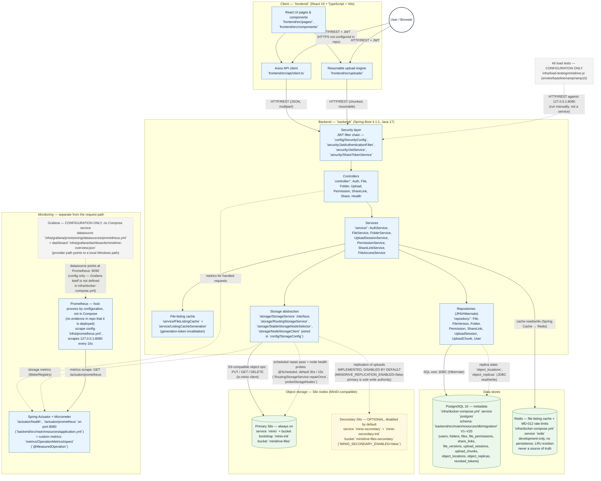
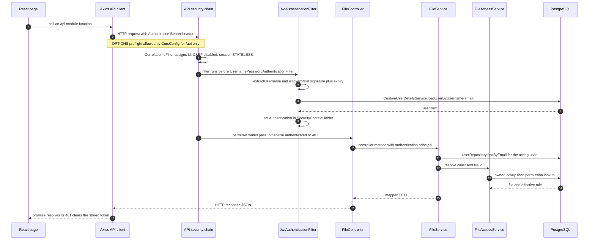
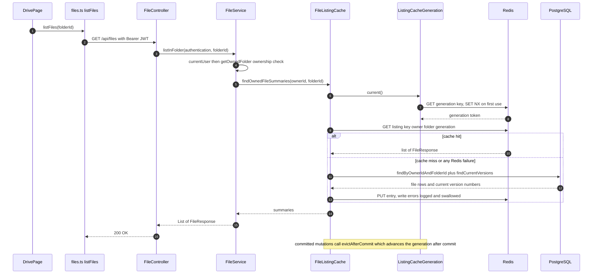
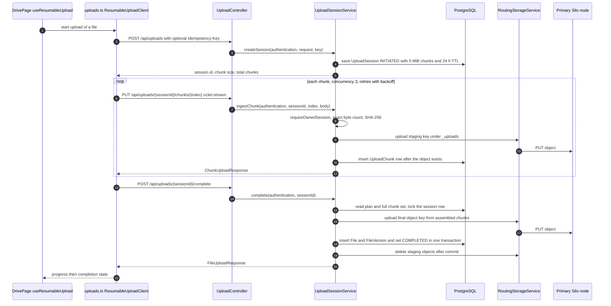
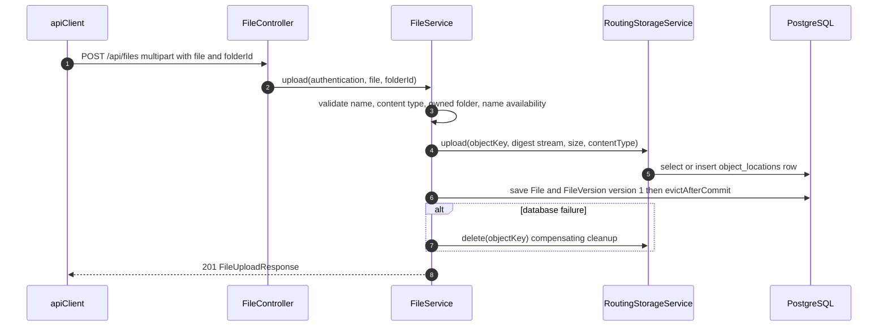
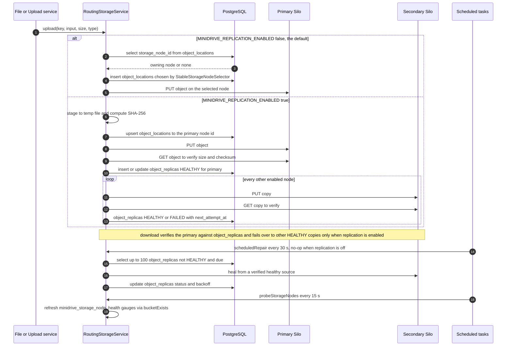

# MiniDrive — High-Level Design

## Architecture Diagram

> Component status is based on repository inspection of source and configuration files
> (see paths in each box). Nothing in this diagram has been runtime-verified as part of
> producing it; services, health checks and endpoints are described as *implemented in
> code / defined in configuration*, not as *observed running*.
>
> - **Solid borders** — implemented components (code exists and is wired).
> - **Dashed borders** — implemented capability that is **disabled or optional by default**.
> - **Dotted borders** — configuration-only artifacts (no service runs them from Compose).
> - Stubbed features (trash, refresh-token rotation, user-profile management beyond `/me`)
>   are **not** depicted, because their classes and migrations are empty placeholder files.

> Deployment boundary: `infra/docker-compose.yml` is local development
> infrastructure only. It does not run the backend, frontend, HTTPS ingress,
> or monitoring. Production uses the `prod` Spring profile and an externally
> operated TLS termination boundary; see the README deployment section. No
> production proxy, certificate manager, or secret manager is implemented here.

### Flow summary

1. **User request path (solid):** browser → React frontend (`frontend/src/`) → HTTP/REST with JWT → Spring Security filter chain → controllers → services. Services read/write metadata and revoked-token state through JPA repositories to **PostgreSQL**, consult the **Redis**-backed file-listing cache (falls through to the database on miss; cache failures never fail the request), enforce MD-012 login, registration, and public-share limits in **Redis** (unavailable Redis rejects those protected requests), and store object bytes through the **storage abstraction** (`StorageService` / `RoutingStorageService`) to the **primary Silo** node.
2. **Replication & repair (dashed):** upload routing records object locations and replica expectations (`object_locations`, `object_replicas` migrations V15/V16) and can copy objects to the **secondary Silo**, with a scheduled repair pass and node health probes. This code is **implemented but disabled by default** (`MINIDRIVE_REPLICATION_ENABLED=false`, `MINIO_SECONDARY_ENABLED=false` in `.env.example`).
3. **Monitoring (dotted):** Actuator exposes only `health` and `prometheus` on the main port; Prometheus (a host process by configuration — the repo contains only its scrape config, `infra/prometheus.yml`, and no Compose service) is configured to scrape it every 15 seconds. Grafana assets exist **as configuration files only** — no Grafana service is defined in `infra/docker-compose.yml`. The k6 suite in `infra/load-testing/` is likewise a manually run configuration artifact, not a deployed component.

### Explicitly not shown (stubbed / not implemented)

These exist in the repository only as empty placeholder files or default-off configuration, and are therefore excluded from the architecture: trash endpoints (`controller/TrashController.java`, `service/TrashService.java` — empty), user-profile endpoints (`controller/UserController.java`, `service/UserService.java` — empty), refresh-token rotation (`entity/RefreshToken.java`, `repository/RefreshTokenRepository.java`, `V5__create_refresh_tokens.sql` — empty; `AuthService` implements only register/login), and direct-share entity flow (`entity/Share.java`, `service/ShareService.java` — empty; public share **links** via `ShareLinkService` are implemented).

## Component Responsibilities

> As with the diagram, everything below is derived from reading source and configuration files. Nothing has been runtime-verified as part of this documentation; components are described as implemented in code, not as observed running.

### 1. React frontend (`frontend/`)

**Responsibility.** The browser SPA provides authentication screens, a file browser, and resumable uploads. Routing is defined in `frontend/src/routes/index.tsx` with React Router 7: `/login` and `/register` sit behind `PublicRoute` (redirecting signed-in users), `/drive` and `/drive/folders/:folderId` behind `ProtectedRoute`, and `/share/:token` is deliberately public so link recipients need no account. The five rendered pages are `frontend/src/pages/{HomePage,LoginPage,RegisterPage,DrivePage,SharedFilePage}.tsx`.

**In/out and peers.** All backend communication goes through the shared Axios instance in `frontend/src/api/client.ts` (base URL from `VITE_API_BASE_URL`), with per-domain modules for files, folders, permissions, share links, versions and upload sessions (`frontend/src/api/*.ts`) and a normalized error wrapper in `frontend/src/api/errors.ts`. Auth state lives in `frontend/src/services/authStore.ts` (register/login/logout backed by `/api/auth/*`). Uploads are implemented client-side as a chunked, resumable state machine in `frontend/src/uploads/resumableUpload.ts` with persistent resume metadata in `frontend/src/uploads/resumeStore.ts`, driven from the UI via `frontend/src/hooks/useResumableUpload.ts`. Peers: the Spring Boot API only.

### 2. Spring Boot API (`backend/src/main/java/com/minidrive/`)

**Responsibility.** A single Spring Boot 4.1.1 (Java 17) application exposing the REST API under `/api/*`. Stateless JWT authentication is enforced by `config/SecurityConfig.java` (separate filter chains for actuator and for the API) together with `security/JwtAuthenticationFilter.java` and `security/JwtService.java` (token generate/extract/validate); public share-link access is authorized by token via `security/ShareTokenService.java`. Controllers in `controller/` (Auth, File, Folder, Upload, Permission, ShareLink, Share, Health) translate HTTP requests into service calls; `controller/HealthController.java` serves a simple `/api/health` payload.

**In/out and peers.** Controllers delegate to the business layer in `service/` — `AuthService` (register/login only), `FileService`, `FolderService`, `UploadSessionService` (resumable session/chunk lifecycle), `PermissionService`, `ShareLinkService`, and `FileAccessService` (authorized download resolution). Services persist through Spring Data JPA repositories in `repository/` (8 non-empty interfaces backed by the entities in `entity/`), consult the Redis listing cache, and store object bytes through the storage abstraction. Peers: React frontend (HTTP/REST + JWT), PostgreSQL, Redis, Silo storage nodes, and the Prometheus scraper.

### 3. PostgreSQL (`infra/docker-compose.yml` service `postgres`; schema in `backend/src/main/resources/db/migration/`)

**Responsibility.** PostgreSQL 16 is the single source of truth for all metadata; JPA runs with `ddl-auto: none`, so the schema is owned entirely by Flyway migrations V1–V16. Tables cover users (`V1__create_users.sql`), folders (`V6`), files (`V7`), file permissions (`V9`), share links (`V10`), file versions (`V11`), resumable upload sessions and their staged chunks (`V12`, with completion columns added in `V13` and concurrency/idempotency/checksum columns in `V14`).

**In/out and peers.** It also holds storage-plumbing metadata: `object_locations` (`V15__create_object_locations.sql`) records which node holds each object key, and `object_replicas` (`V16__create_object_replicas.sql`) tracks per-copy status, size, SHA-256 checksum, retry counters and next-attempt times for the replication/repair subsystem. Peers: the backend only — via Hibernate/JPA for domain data and via `JdbcTemplate` SQL inside `RoutingStorageService` for the two storage tables. (Migrations V2–V5 are placeholders that create nothing: V3, V4 and V5 are empty files and V2 contains only a comment.)

### 4. Redis (`infra/docker-compose.yml` service `redis`)

**Responsibility.** Redis serves exactly one purpose: caching file listings. It is configured as cache-only by design — the Compose service runs with persistence disabled and `allkeys-lru` eviction, and `application.yml` documents that the backend starts without a running Redis and only fails over to direct database reads when a cache operation is attempted.

**In/out and peers.** `service/FileListingCache.java` reads/writes folder listings under a key prefix and a short default TTL of 60 seconds (`config/CacheConfig.java`), with a fail-open policy: cache errors degrade to database reads, never to request failures. Invalidation is generation-based rather than key-based: `service/ListingCacheGeneration.java` stores one shared generation token in Redis (via `StringRedisTemplate`), and `FileListingCache.evictAfterCommit()` advances the generation in a `TransactionSynchronization.afterCommit` callback so concurrent readers see a consistent cut. Peers: the backend's cache layer only — Redis is never a source of truth.

### 5. Object storage — Silo nodes (`infra/docker-compose.yml` services `minio`, `minio-secondary`)

**Responsibility.** Durable file bytes live in MinIO-compatible "Silo" nodes accessed through the `io.minio` client. The **primary node** (`minio`, bucket `minidrive-files`, loopback ports 9000/9001) is always on and bootstrapped by the one-shot `minio-init` job. The **secondary node** (`minio-secondary`, ports 9100/9101, bucket `minidrive-files-secondary`) is **optional and disabled by default** (`MINIO_SECONDARY_ENABLED=false` in `.env.example`).

**In/out and peers.** `storage/SiloStorageService.java` implements the storage contract against a single `MinioClient` and bucket (put/get/delete of one object key); `storage/NodeStorageClient.java` wraps one node's client with id, health flag and per-operation calls. Node endpoints, credentials, buckets and enabled flags are bound from `application.yml`'s `minidrive.storage.nodes` list into `NodeStorageClient` beans by `config/StorageConfig.java`. Peers: the storage abstraction layer of the backend only — no application component talks to Silo directly.

### 6. Storage routing and replication (`storage/RoutingStorageService.java`, `storage/StableStorageNodeSelector.java`)

**Responsibility.** `RoutingStorageService` implements `storage/StorageService.java` and is the single gateway to all Silo nodes. For every object key it consults `object_locations` in PostgreSQL to find the owning node, creating a mapping on first upload via `StableStorageNodeSelector`, which deterministically picks a node by SHA-256-hashing the key over the sorted node id list (stable placement independent of node discovery order).

**In/out, fallback, repair — disabled by default.** With replication off (the default: `MINIDRIVE_REPLICATION_ENABLED=false`), uploads go straight to the recorded node. With replication enabled, uploads are staged to a temp file, checksummed with SHA-256, written to the primary, tracked in `object_replicas`, and copied to the other enabled nodes; downloads verify the primary copy against the expected size/checksum and fall back to other **healthy** replicas on failure (failing over only to copies that pass verification). A scheduled repair pass (`repairOnce`, default every 30 s via `minidrive.storage.replication.repair-delay-ms`) retries failed/pending copies with backoff tracked in `object_replicas`, and `probeStorageNodes` (default 15 s) refreshes per-node health flags. Peers: PostgreSQL (JDBC reads/writes of `object_locations`/`object_replicas`), Silo nodes, and the Micrometer `MeterRegistry` (per-node byte counters, timing and fallback counters).

### 7. Observability (`logging/CorrelationIdFilter.java`, `metrics/OperationMetricsAspect.java`)

**Responsibility.** Every request is assigned (or accepts a validated inbound) correlation id, stored in the SLF4J MDC under `correlation_id`, echoed in the response header, and cleared after the dispatch; the filter also emits the per-request structured access log. Console logging is configured in ECS structured format (`logging.structured.format.console: ecs` in `backend/src/main/resources/application.yml`), so logs are machine-parseable JSON lines.

**In/out and peers.** Spring Actuator exposes only `health` (with `database` and `cache` groups) and `prometheus` on the application's main port 8080. Micrometer's Prometheus registry backs framework metrics, custom storage metrics are recorded directly in `RoutingStorageService`, and `metrics/OperationMetricsAspect.java` provides annotation-driven timing (`@MeasuredOperation` → timer with success/failure outcome), currently applied in `FileService`, `ShareLinkService` and `UploadSessionService`. Prometheus is expected to run as a **host process** (it is not a Compose service) and, per the scrape config `infra/prometheus.yml`, to hit `http://127.0.0.1:8080/actuator/prometheus` every 15 s; the repository holds only that configuration, so the scraper's actual deployment is not evidenced here. Peers: the backend (provides metrics/logs) and the host Prometheus process (consumes them).

### 8. Grafana configuration and k6 (`infra/grafana/`, `infra/load-testing/`)

**Responsibility.** The Grafana assets are **configuration files only — Grafana itself is not defined in `infra/docker-compose.yml` and is not a running service of this project.** `infra/grafana/provisioning/datasources/prometheus.yml` would define a Prometheus datasource pointing at `127.0.0.1:9090`, and `infra/grafana/provisioning/dashboards/minidrive.yml` plus `infra/grafana/dashboards/minidrive-overview.json` would auto-load one overview dashboard from a hard-coded local Windows path (`C:/MiniDrive/infra/grafana/dashboards`). Anyone using them must run their own Grafana instance with that provisioning layout.

**In/out and peers.** The k6 suite is likewise a manually executed script, not a deployed component: `infra/load-testing/minidrive.js` runs smoke/baseline/ramp/ramp10 profiles strictly against `http://127.0.0.1:8080`, driving the real HTTP/REST API (register/login, file/folder operations, chunked uploads) with its own metrics and failure-rate thresholds. `infra/load-testing/provision-k6-account.ps1` provisions a dedicated `k6-test@localhost.test` account through the normal registration endpoint, storing credentials in the local-only `infra/load-testing/k6-credentials.local` file. Peers: Grafana (if run) → Prometheus; k6 → backend API.

## Communication Flows and Trust Boundaries

> **Scope and method.** This section covers only two things: how components exchange data, and where the trust boundaries sit. It was produced by reading the source and configuration files cited in each item. No service was started, no request was replayed and no test was run while writing it, so nothing below is an observation of a running system.
>
> **Labels used below.**
>
> - **Implemented** — the behavior exists in a cited repository file.
> - **Disabled by default** — the code path exists but a repository default turns it off (`backend/src/main/resources/application.yml`, `.env.example`).
> - **Not runtime-verified** — no claim here has been observed against a live deployment. Test files that appear to cover a flow are named for reference only; naming a test is not a claim that it passed.
> - *(Interpretation)* — a reading that follows from the code but is not asserted by it.

### 1. Main communication flows

#### 1.1 User request — frontend → API client → security → controller → service → repository or storage → response

**Steps.**

1. A page calls a per-domain module (`frontend/src/api/files.ts`, `folders.ts`, `share.ts`, `versions.ts`, `permissions.ts`, `uploads.ts`, `frontend/src/services/authService.ts`) rather than Axios directly.
2. The shared instance in `frontend/src/api/client.ts` attaches `Authorization: Bearer <jwt>` from `getToken()` (`frontend/src/utils/tokenStorage.ts`, which reads `localStorage`) when a token exists; login, register and health calls send no header.
3. `config/CorsConfig.java` supplies the single CORS policy used by Spring Security for `/api/**`. Exact origins come from `MINIDRIVE_CORS_ALLOWED_ORIGINS` (comma-separated); the default is `http://localhost:5173,http://127.0.0.1:5173`. Methods are `GET POST PUT PATCH DELETE OPTIONS`, request headers are `Authorization` and `Content-Type`, credentials are disabled, and preflight is cached for 1800 seconds. Valid preflight is processed by Spring Security before authentication; see `docs/MD-013-cors.md` for deployment setup.
4. `logging/CorrelationIdFilter.java` (registration order `HIGHEST_PRECEDENCE + 20`) accepts an inbound `X-Correlation-ID` only if it matches `[A-Za-z0-9][A-Za-z0-9._-]{0,63}`, otherwise generates a UUID, echoes it, and puts it in the SLF4J MDC.
5. `config/SecurityConfig.java` `securityFilterChain` matches `/api/**`, disables CSRF, uses `SessionCreationPolicy.STATELESS` and sets `HttpStatusEntryPoint(UNAUTHORIZED)` for unauthenticated requests.
6. `security/JwtAuthenticationFilter.doFilterInternal` reads the bearer token, calls `JwtService.extractUsername` and `JwtService.isTokenValid` (HMAC verification via `parseSignedClaims`, subject present, expiry in the future), then loads the user again through `security/CustomUserDetailsService.loadUserByUsername`. Any exception is swallowed, leaving the request anonymous. `shouldNotFilterAsyncDispatch()` returns `false`, so MVC async dispatch (streaming downloads) rebuilds the authentication from the original header.
7. The authorization rules then decide: `/api/health`, `/api/auth/register`, `/api/auth/login` and `GET /api/share/**` are `permitAll`; everything else under `/api/**` requires authentication.
8. The controller method (for example `FileController.get`, `list`, `download`) receives the `Authentication` and delegates; controllers hold no authorization logic.
9. The service resolves identity again (`FileService.currentUser` → `UserRepository.findByEmail`) and authorizes through `service/FileAccessService.resolve`, which returns `OWNER` from `FileRepository.findByIdAndOwnerId`, otherwise the `Permission` row from `PermissionRepository.findByFileIdAndUserId`, otherwise a `null` role.
10. The service then touches either repositories (JPA/Hibernate → PostgreSQL) or the storage abstraction (`storage/StorageService` → `RoutingStorageService`), maps the result through `mapper/*`, and `exception/GlobalExceptionHandler.java` converts thrown exceptions into the HTTP error contract.
11. The response returns through the same chain; the API chain sets `HeaderWriterFilter.setShouldWriteHeadersEagerly(true)` so security headers are committed before an async `StreamingResponseBody` writes its body.

**Classes and files.** `frontend/src/api/client.ts`; `backend/src/main/java/com/minidrive/config/{SecurityConfig,CorsConfig}.java`; `backend/src/main/java/com/minidrive/security/{JwtAuthenticationFilter,JwtService,CustomUserDetailsService}.java`; `backend/src/main/java/com/minidrive/logging/CorrelationIdFilter.java`; `backend/src/main/java/com/minidrive/controller/FileController.java`; `backend/src/main/java/com/minidrive/service/{FileService,FileAccessService}.java`; `backend/src/main/java/com/minidrive/repository/{UserRepository,FileRepository,PermissionRepository}.java`; `backend/src/main/java/com/minidrive/exception/GlobalExceptionHandler.java`.

**Status.** **Implemented.** **Not runtime-verified** as part of this documentation. Backend tests that appear to exercise it exist at `backend/src/test/java/com/minidrive/controller/AuthControllerTest.java` and `backend/src/test/java/com/minidrive/controller/FileControllerTest.java`; frontend unit tests exist under `frontend/src/uploads/` and `frontend/src/api/uploads.test.ts`. Two observations follow from the code rather than being asserted by it *(interpretation)*: the user is loaded from the database twice per authenticated request (once in the JWT filter, once in the service), and there is no refresh-token or logout revocation path — `entity/RefreshToken.java` and `V5__create_refresh_tokens.sql` are empty, so an issued JWT stays valid until its 24 h expiry (`jwt.expiration: 86400000`).

#### 1.2 File listing with caching — frontend → API → listing service and cache → Redis or PostgreSQL → response

**Steps.**

1. `DrivePage` calls `listFiles` (`frontend/src/api/files.ts`) → `GET /api/files?folderId=…` (or no parameter for the root listing). The identical path serves `GET /api/folders/{folderId}/files` through `FileService.listInOwnedFolder`.
2. The request passes flow 1.1's authentication and lands in `FileService.listInFolder` or `listInOwnedFolder` (`@Transactional(readOnly = true)`).
3. Authorization runs **before** the cache: the acting user comes from the principal and a folder is checked with `getOwnedFolder` (non-owner → `403`), so a cache hit cannot skip an ownership check.
4. `FileListingCache.findOwnedFileSummaries` resolves the generation first (`ListingCacheGeneration.current`, `GET` then `SET NX` on `minidrive:cache:file-listings:generation` via `StringRedisTemplate`). If the generation cannot be read, no key can be formed and the request is served straight from PostgreSQL.
5. On a key of the form `<ownerId>:<folderId|root>:<generation>` the cache reads through Spring Cache (`CacheConfig`, key prefix `minidrive:cache:`, 60 s TTL, JSON serializer with a type allowlist).
6. On a miss (or any Redis exception — reads, writes and generation operations are all fail-open) `FileListingCache.load` runs `FileRepository.findByOwnerIdAndFolderId` / `findByOwnerIdAndFolderIdIsNull` plus one batched `FileVersionRepository.findCurrentVersions` query, copies the result into an `ArrayList`, and writes it back; the database answer is always what is returned.
7. Mutations call `FileListingCache.evictAfterCommit()`: `FileService.upload`, `createMetadata`, `update`, `replaceContent`, the version-restore path and `delete`, plus `FolderService.delete`. It registers a `TransactionSynchronization.afterCommit` callback that advances the generation; entries written under the old token become unreachable and expire on TTL instead of being deleted.

**Classes and files.** `frontend/src/pages/DrivePage.tsx`; `frontend/src/api/files.ts`; `backend/src/main/java/com/minidrive/controller/{FileController,FolderController}.java`; `backend/src/main/java/com/minidrive/service/{FileService,FileListingCache,ListingCacheGeneration}.java`; `backend/src/main/java/com/minidrive/config/CacheConfig.java`; `backend/src/main/java/com/minidrive/repository/{FileRepository,FileVersionRepository}.java`; `backend/src/main/resources/application.yml` (`spring.cache.type: redis`, `spring.data.redis.*`); `infra/docker-compose.yml` service `redis`.

**Status.** **Implemented** and exercised by the UI on every drive view. **Not runtime-verified** here; tests exist at `backend/src/test/java/com/minidrive/cache/` (`FileListingCacheTest`, `FileListingCacheRedisIntegrationTest`, `FileListingCacheSerializationTest`, `ListingCacheGenerationTest`, `RedisConnectivityIntegrationTest`) and `config/CacheConfigurationTest.java`, but they were not run for this documentation. Only owner-scoped listings are cached; there is no shared-with-me or permission-joined listing to cache, so permission and share-link changes deliberately do not evict anything.

#### 1.3 File upload — frontend → upload API → backend service → object storage and PostgreSQL metadata

The repository contains two upload paths. The **resumable session path is the one the UI drives** (`DrivePage` → `useResumableUpload` → `frontend/src/api/uploads.ts`); the single-shot multipart endpoint is implemented but has no caller in `frontend/src`.

**Single-shot multipart alternative (implemented, not called by the UI):**

**Steps (resumable path).**

1. `frontend/src/hooks/useResumableUpload.ts` drives `ResumableUploadClient` in `frontend/src/uploads/resumableUpload.ts`; resume metadata for an interrupted attempt is persisted by `frontend/src/uploads/resumeStore.ts` and re-validated with `validateResumeAssociation` before continuing.
2. `createUploadSession` (`frontend/src/api/uploads.ts`) → `POST /api/uploads` with an optional `Idempotency-Key` header → `UploadController.create` → `UploadSessionService.createSession`, which validates the declared size (max `MAX_FILE_SIZE_BYTES` 5 GiB), computes the split server-side (`CHUNK_SIZE_BYTES` 5 MiB, `MAX_CHUNKS` 10 000), resolves the owned folder and optional replacement target, and returns the existing session when the same idempotency key and request hash are replayed.
3. Each chunk is `PUT /api/uploads/{sessionId}/chunks/{index}` with `Content-Type: application/octet-stream`. `UploadSessionService.ingestChunk` re-resolves the owner (`requireOwnedSession`, so another user's session is `404`), checks status `INITIATED` and expiry, enforces the exact expected byte count via `readExactly`, hashes it, writes the staging object first (`_uploads/<ownerId>/<sessionId>/<index>`), then persists the `UploadChunk` row; a failed row insert deletes the just-written object. The method is deliberately not transactional.
4. `POST /api/uploads/{sessionId}/complete` → `UploadSessionService.complete`: a read-only `TransactionTemplate` block builds a `CompletionPlan` (status, expiry, complete chunk set, final key from `util/StorageKeys`), the staged chunks are assembled in index order through a `DigestInputStream`, the final object is written to storage **before** any metadata, then `persistCompletion` runs in a row-locked transaction that inserts `File` + `FileVersion` and marks the session `COMPLETED`. On database failure the orphaned object is removed; on success the staging objects are removed afterwards. A repeat completion returns the recorded result instead of creating a second file.
5. Both paths reach PostgreSQL only through repositories (`FileRepository`, `FileVersionRepository`, `UploadSessionRepository`, `UploadChunkRepository`) and reach object storage only through `storage/StorageService` (here `RoutingStorageService` → `NodeStorageClient` → `io.minio`).

**Classes and files.** `frontend/src/pages/DrivePage.tsx`; `frontend/src/hooks/useResumableUpload.ts`; `frontend/src/uploads/{resumableUpload,resumeStore,uploadStatus}.ts`; `frontend/src/api/uploads.ts`; `frontend/src/api/files.ts`; `backend/src/main/java/com/minidrive/controller/{UploadController,FileController}.java`; `backend/src/main/java/com/minidrive/service/{UploadSessionService,FileService}.java`; `backend/src/main/java/com/minidrive/storage/{RoutingStorageService,NodeStorageClient,StorageService}.java`; `backend/src/main/java/com/minidrive/repository/{UploadSessionRepository,UploadChunkRepository,FileRepository,FileVersionRepository}.java`; `backend/src/main/java/com/minidrive/util/StorageKeys.java`.

**Status.** **Implemented** for both paths and covered by `backend/src/test/java/com/minidrive/controller/UploadControllerTest.java`, `UploadCompletionControllerTest.java` and `FileControllerTest.java`. **Not runtime-verified** here. Notes: the single-shot `uploadFile` function in `frontend/src/api/files.ts` has no caller in the UI, while `replaceFileContent` (`POST /api/files/{id}/content`) is used by `DrivePage` for content replacement; no `spring.servlet.multipart` size limit is configured in `application.yml`, so the effective single-shot multipart ceiling is a framework default that has not been verified *(interpretation)*.

#### 1.4 Replication and repair — storage routing service → primary and optional secondary Silo nodes → replica metadata → fallback or scheduled repair

**Steps.**

1. Placement: `RoutingStorageService.existing` reads `object_locations`; on first upload `StableStorageNodeSelector.select` picks a node by SHA-256-hashing the object key over the sorted node id list, and `uploadLegacy` inserts the row with `on conflict do nothing`. Node clients come from `config/StorageConfig.storageNodeClients`, which validates node ids (`[A-Za-z0-9_-]{1,64}`), rejects duplicates and refuses blank credentials or an empty enabled set.
2. Default write path (`replicationEnabled == false`): `uploadLegacy` streams to that one node inside a `measure(...)` timer and increments `minidrive_storage_node_bytes_total`. No `object_replicas` row is written, no verification read happens.
3. Replication write path (`MINIDRIVE_REPLICATION_ENABLED=true`): the object is staged to a temp file and checksummed, the location is upserted to `minidrive.storage.replication.primary-node-id` (default `primary`), the primary copy is written and then re-read through `validatedDownload` (size + SHA-256 must match) before `object_replicas` is marked `HEALTHY`; every other enabled node gets `replicate(...)`, and a failure is recorded through `markFailure` (`FAILED`, `attempt_count`, `last_error`, `next_attempt_at` +30 s) instead of failing the upload.
4. Read path: with replication off, `download` looks up the single location and streams it (`timedDownload`). With replication on, `expectation(key)` reads the `HEALTHY` `object_replicas` row, the primary is verified, and on failure the loop tries other nodes that `isHealthy(key, node)` reports as `HEALTHY`, counting attempts in `minidrive_storage_read_fallback_total`; exhausting them raises `StorageException`.
5. Scheduled repair: `@Scheduled repairOnce` (`minidrive.storage.replication.repair-delay-ms`, default 30 000) selects at most 100 due non-`HEALTHY` rows, de-duplicates in-flight keys with a `ConcurrentHashMap` set, and `heal`s each by streaming a verified healthy source to the target. It returns `0` immediately when replication is disabled.
6. Health probes: `@Scheduled probeStorageNodes` (default 15 000 ms) calls `NodeStorageClient.isHealthy()` (`bucketExists`) and stores 0/1 in the `minidrive_storage_node_health` gauge. This runs regardless of the replication flag but is only useful when replication is on, since reads with replication off ignore health.
7. Deletion: `delete` removes the object from the recorded node first, then the `object_locations` row; with replication on it also deletes from the other nodes and records per-replica failures before propagating a primary failure.

**Classes and files.** `backend/src/main/java/com/minidrive/storage/{RoutingStorageService,StableStorageNodeSelector,StorageNodeSelector,NodeStorageClient,StorageNodeProperties,StorageService}.java`; `backend/src/main/java/com/minidrive/config/StorageConfig.java`; `backend/src/main/resources/application.yml` (`minidrive.storage.*`); `backend/src/main/resources/db/migration/V15__create_object_locations.sql`, `V16__create_object_replicas.sql`; `.env.example`; `infra/docker-compose.yml` services `minio`, `minio-secondary`, `minio-init`, `minio-secondary-init`.

**Status.** **Implemented but disabled by default:** `MINIDRIVE_REPLICATION_ENABLED=false` and `MINIO_SECONDARY_ENABLED=false` in `.env.example`, mirrored by `minidrive.storage.replication.enabled: ${...:false}` and the `secondary` node entry in `application.yml`. The `minio-secondary` and `minio-secondary-init` services are defined unconditionally in `infra/docker-compose.yml` (no Compose profile gates them), but with `MINIO_SECONDARY_ENABLED=false` the backend never builds a client for that node, which is why the existing architecture diagram marks it optional and disabled by default. **Not runtime-verified** here; unit tests exist at `backend/src/test/java/com/minidrive/storage/{RoutingStorageServiceTest,RoutingStorageReplicationTest}.java` and a live MinIO test at `backend/src/test/java/com/minidrive/integration/SiloStorageServiceRealMinioLiveTest.java`, none of which were run for this documentation. *(Interpretation)* the two-store write (Silo object, then PostgreSQL row, in separate transactions) is compensated by explicit deletes on failure, but the compensation itself is only as reliable as the follow-up call.

### 2. Trust boundaries

#### 2.1 Browser → backend API

- **What crosses.** REST/JSON requests and `multipart/form-data` or `application/octet-stream` bodies to port 8080 (`server.port: 8080`), carrying `Authorization: Bearer <JWT>` for protected routes, plus an optional `X-Correlation-ID` and `Idempotency-Key` header. Responses carry JSON, file bytes, `X-Correlation-ID`, and the security headers the API chain writes eagerly (`config/SecurityConfig.java`).
- **Protection that exists.** Stateless JWT authentication for everything except the permitAll list (`config/SecurityConfig.java`); request validation with `jakarta.validation` `@Valid` on DTOs; `exception/GlobalExceptionHandler.java` for error translation; CORS restricted to the exact configured origins on `/api/**` with `allowCredentials(false)` and fixed methods/headers (`config/CorsConfig.java`); inbound correlation ids validated against a strict pattern (`logging/CorrelationIdFilter.java`).
- **Unverified / absent.** No TLS anywhere in the repository: `application.yml` has no `server.ssl` block, `infra/prometheus.yml` uses `scheme: http`, and all Compose port mappings are plain HTTP. No reverse proxy or explicit content-security-policy configuration. Deployment CORS values and browser behavior against an actual deployed frontend have not been verified. *(Interpretation)* with `allowCredentials(false)` and header-based auth there are no session cookies to forge, so CSRF is a limited surface — but the JWT is stored in `localStorage` (`frontend/src/utils/tokenStorage.ts`), which any injected script can read.

#### 2.2 JWT authentication and protected API endpoints

- **What crosses.** A signed bearer token minted by `AuthService.register` / `login` through `JwtService.generateToken` (subject = email, `jwt.expiration: 86400000`, secret from `JWT_SECRET`), sent on every request and re-validated on every request by `JwtAuthenticationFilter`.
- **Protection that exists.** HMAC signature verification plus expiry and subject checks in `JwtService.isTokenValid`; a fresh database load of the user per request (`CustomUserDetailsService`), so a deleted or renamed account stops resolving even though the signature still verifies; `SessionCreationPolicy.STATELESS`; 401 entry point; per-route `permitAll` rather than a blanket filter bypass; authorization enforced in the service layer (`FileAccessService`, `PermissionService`, owner-scoped repository queries) so hidden UI controls are not the control; passwords hashed with `BCryptPasswordEncoder` (`security/PasswordConfig.java`).
- **Unverified / absent.** No refresh-token rotation or server-side logout: `entity/RefreshToken.java`, `repository/RefreshTokenRepository.java` and `V5__create_refresh_tokens.sql` are empty, so a token cannot be revoked before its 24 h expiry; there is no denylist, no `nbf`/issuer/audience claim, and no key rotation mechanism (a single symmetric `jwt.secret`). Token strength in a real deployment, clock-skew behavior, and brute-force resistance of the login endpoint are **not runtime-verified** and not evidenced by the repository. Whether the secret supplied in production is ≥ the 32 characters `.env.example` asks for cannot be checked from the repository.

#### 2.3 Public share-link access vs authenticated file access

- **What crosses.** Two anonymous endpoints, `GET /api/share/{token}` and `GET /api/share/{token}/download`, authorized solely by a bearer token in the URL path; they return minimal metadata (`SharedFileResponse`) and file bytes. Everything under `/api/files/**` stays authenticated, and share-link *management* (`POST /api/files/{fileId}/share-link`, `GET /api/files/{fileId}/share-links`, `DELETE .../share-links/{shareId}`) is authenticated and owner-only in `ShareLinkService`.
- **Protection that exists.** `SecurityConfig` permits **only `HttpMethod.GET` on `/api/share/**`**, so no write method under that prefix can be reached anonymously (the `ShareController` itself declares only the two `GET`s); `ShareTokenService` generates 256 bits from `SecureRandom` and stores only the SHA-256 hex hash — the raw token is returned once at creation and never logged (`ShareLinkService` logs no token, and the access log records the matched route pattern rather than the raw URI); `resolveActiveLink` treats unknown, revoked and expired tokens identically with one message and checks `ShareLinkMapper.isExpired` on every request; revoking deletes the row so the token stops resolving immediately; downloads stream through the same `StorageService` and filename-safety code as authenticated downloads.
- **Unverified / absent.** A share token is a pure capability: whoever holds it can read the file until it expires or is revoked, with no per-view limit, password, recipient binding, audit trail or rate limiting. The token travels in the URL path, so it can end up in proxy, browser-history and referer logs of any fronting infrastructure (none is defined in the repository). Revocation and expiry were **not runtime-verified**; correctness rests on the repository lookup that the tests at `backend/src/test/java/com/minidrive/controller/ShareLinkControllerTest.java` appear to cover but that was not run here.

#### 2.4 Backend → PostgreSQL

- **What crosses.** JDBC traffic (`DB_URL`, `DB_USERNAME`, `DB_PASSWORD` — required, no defaults in `application.yml`) carrying all domain rows: users, folders, files, permissions, share links, file versions, upload sessions/chunks, plus `object_locations` and `object_replicas` written by `RoutingStorageService` through `JdbcTemplate`.
- **Protection that exists.** The Compose service publishes only `127.0.0.1:55432:5432`; schema is owned by Flyway (`spring.jpa.hibernate.ddl-auto: none`), so application code cannot reshape it implicitly; writes are parameterized (`JdbcTemplate` placeholders and Spring Data repositories); services scope every query by owner or by resolved permission.
- **Unverified / absent.** The JDBC URL in `.env.example` (`jdbc:postgresql://127.0.0.1:55432/minidrive`) has no TLS/`sslmode`, so the backend↔database leg is plaintext; no least-privilege role is defined (one application account owns every table); `infra/docker-compose.yml` falls back to `POSTGRES_PASSWORD:-minidrive` when the variable is unset; all Compose services share the default Compose network, so containers can reach each other's internal ports even though published ports are loopback-bound. None of this was runtime-verified.

#### 2.5 Backend → Redis

- **What crosses.** Cache reads/writes of already-authorized `List<FileResponse>` JSON under `minidrive:cache:file-listings::<owner>:<folder|root>:<generation>`, plus the single generation marker key written through `StringRedisTemplate` (`ListingCacheGeneration`). No credentials, no file bytes and no tokens are stored in Redis by any code in the repository.
- **Protection that exists.** Loopback-only host binding (`127.0.0.1:56379:6379`); `spring.data.redis.*` from env with no auth configured; key prefix and 60 s TTL (`config/CacheConfig.java`); JSON deserialization constrained by a polymorphic-type allowlist limited to `com.minidrive.`, `java.util.`, `java.time.` and `java.lang.`; Java native serialization deliberately disabled; every Redis interaction is fail-open, so an unavailable or erroring Redis degrades to PostgreSQL reads instead of failing or silently substituting an in-process cache.
- **Unverified / absent.** Redis runs with **no `--requirepass`/ACL** and no TLS in `infra/docker-compose.yml` or `application.yml`, so any process that can reach 127.0.0.1:56379 can read or rewrite cache entries and the generation marker; the LRU policy can evict both entries and the marker (handled by design — a fresh random token, a cold cache); persistence is off (`--save `, `--appendonly no`). Cache poisoning would be constrained to listing summaries and is defeated on the next generation advance or TTL, but that reasoning is *(interpretation)*, and no Redis behavior was runtime-verified here.

#### 2.6 Backend → object-storage nodes

- **What crosses.** S3-compatible `PUT`/`GET`/`DELETE` (io.minio) from `NodeStorageClient` to `MINIO_ENDPOINT` (`http://localhost:9000`) and `MINIO_SECONDARY_ENDPOINT` (`http://localhost:9100`), authenticated with per-node access/secret keys, operating on buckets `minidrive-files` and `minidrive-files-secondary`. Contents include final objects, version objects and `_uploads/` staging objects — all in the same bucket namespace.
- **Protection that exists.** Host ports are loopback-bound in `infra/docker-compose.yml`; `minio-init` / `minio-secondary-init` create the buckets and set `mc anonymous set private`; `config/StorageConfig` refuses blank credentials, invalid or duplicate node ids and an empty enabled set; the browser never receives a storage URL or credential — all object bytes are proxied by the backend (`frontend/src/api/files.ts` documents this). Bucket reachability is probed by `NodeStorageClient.isHealthy()`.
- **Unverified / absent.** The client endpoint scheme is `http` in every configured path (no TLS to Silo); `application.yml` defaults `minio.access-key/secret-key` to `minioadmin`/`minioadmin` and `.env.example` uses `minioadmin` for both nodes; there is no per-user or per-request storage credential, no server-side encryption configuration, and no object-level access control in Silo — the backend holds full bucket authority. `FileUploadResponse` and `FileMetadataResponse` do expose the internal `objectKey` to authenticated callers (`dto/file/FileUploadResponse.java`, `FileMetadataResponse.java`), which is metadata exposure only, not access. No storage behavior was runtime-verified here.

#### 2.7 Application metrics → Prometheus

- **What crosses.** `GET /actuator/prometheus` and `GET /actuator/health` responses (Micrometer JVM, HTTP, custom `@MeasuredOperation` timers and `RoutingStorageService` storage metrics) from port 8080 toward the scrape target defined in `infra/prometheus.yml` (scrape every 15 s, target `127.0.0.1:8080`, `scheme: http`); the repository defines the scrape configuration, not the scraper service itself.
- **Protection that exists.** A dedicated `@Order(1)` chain matches `/actuator/**` in `config/SecurityConfig.java`: `health`, `health/**` and `prometheus` are permitted **only** when the caller is `127.0.0.1` (`IpAddressMatcher`), and `anyRequest().denyAll()` covers everything else — so `/actuator/env`, `/actuator/configprops`, etc. are unreachable even with a valid JWT, and the actuator chain does not install the JWT filter at all. `application.yml` exposes only `health` and `prometheus`, sets `management.endpoint.health.show-details: never`, and gives `prometheus` read-only access. `backend/src/test/java/com/minidrive/ManagementEndpointIntegrationTest.java` asserts this shape (not run for this documentation).
- **Unverified / absent.** Metrics carry no authentication or TLS of their own — protection is purely the loopback IP match, which means (a) any local process can read them, and (b) *(interpretation)* a Prometheus running outside the backend's network namespace (for example in a container) would **not** match `127.0.0.1` and could not scrape, so the documented `infra/prometheus.yml` layout assumes the backend runs on the host. Metric label content (route patterns, node ids, outcomes) and the actual scrape were **not runtime-verified**; Grafana remains configuration-only per the existing section.

### 3. Important design observations

- **Authoritative metadata: PostgreSQL.** Every authorization, listing, share, permission and location decision is answered from a database row — `files`, `file_versions`, `permissions`, `share_links`, `upload_sessions`/`upload_chunks`, and the two storage tables `object_locations` (`V15__create_object_locations.sql`) and `object_replicas` (`V16__create_object_replicas.sql`). `RoutingStorageService` asks `object_locations` which node owns a key; nothing consults Redis to decide what a user may see or do. *(Interpretation: this is the single source of truth by construction — `ddl-auto: none` plus Flyway means the schema and its rows are the only durable record.)*
- **Actual file contents: the Silo nodes.** Bytes live only in MinIO-compatible buckets (`minidrive-files`, and `minidrive-files-secondary` when enabled), reachable exclusively through `StorageService`/`RoutingStorageService` → `NodeStorageClient`. PostgreSQL stores keys, sizes, checksums and version history; the frontend never talks to Silo directly.
- **Redis must never be treated as the source of truth.** The repository is explicit and consistent about this: the Compose service runs with persistence disabled and `allkeys-lru` eviction, entries expire after 60 s, the generation marker itself can be evicted (which is handled by using a random UUID token so eviction yields a cold cache rather than a stale one), and every cache read, write and generation operation fails open to PostgreSQL. `CacheConfig` documents that a cache miss must always be recoverable and that no in-memory substitute may silently take Redis's place. Losing Redis costs throughput, never data.
- **Optional replication reshapes two of the flows above.** With replication off (the default) flows 1.3 and 1.4 are single-copy: `object_locations` is written, one node stores the object, downloads are unverified streams, `repairOnce` returns immediately, and the secondary node is never contacted. Turning `MINIDRIVE_REPLICATION_ENABLED=true` makes the write path stage-and-verify, forces placement onto `primary-node-id`, writes `object_replicas` expectations, adds verified read fallback across `HEALTHY` copies, and gives the 30 s repair pass real work; the secondary node additionally requires `MINIO_SECONDARY_ENABLED=true` before `StorageConfig` builds a client for it. The metadata side of a write is unaffected either way, so cross-store consistency continues to rely on compensating deletes rather than a distributed transaction.
- **Questions requiring additional investigation.** (1) **Transport security:** no TLS is configured for browser↔API, backend↔PostgreSQL, backend↔Redis or backend↔Silo; determine whether a fronting layer exists outside the repository. (2) **Credential hygiene:** default/minioadmin-style credentials appear in `application.yml` defaults, `infra/docker-compose.yml` fallbacks and `.env.example`; Redis has no AUTH at all. (3) **Token lifecycle:** no revocation, logout or refresh rotation, and JWTs sit in `localStorage`. (4) **Abuse controls:** no rate limiting on login, registration or share-link endpoints. (5) **Resource limits:** no `spring.servlet.multipart` sizing, no request-size or upload-rate limits beyond the session-level 5 GiB / 10 000-chunk caps. (6) **Durability of deletions:** `FileService.delete` intentionally leaves historical version objects in Silo pending a future retention phase, so object-store and metadata lifetimes diverge. (7) **Operational verification:** the metrics scrape path (loopback-only allowlist vs. where Prometheus actually runs), the share-token expiry/revocation behavior, cache fail-open behavior with Redis down, and the replication fallback/repair counters have not been exercised here.

**Distinguishing the three kinds of statement in this section.** *Verified implementation* means the claim was read directly in a cited file (route rules, filters, method names, configuration keys, defaults). *(Interpretation)* marks conclusions drawn from those facts rather than stated by them (for example the double user lookup, the CSRF reasoning, cache-poisoning containment, and the containerized-Scrape implication of the loopback allowlist). *Unverified runtime behavior* covers everything about a running system — endpoint responses, TLS at the network layer, actual scrape success, real Redis/PostgreSQL/Silo availability, and whether the named tests pass — none of which was observed while writing this section.

## Key Architectural Decisions

> **How to read this section.** Each decision states the problem, the design as implemented, one reasonable alternative, the trade-offs, the evidence, and a status. The repository rarely records *why* a choice was made — `docs/ARCHITECTURE.md` and `docs/LLD.md` are both empty files — so where a Javadoc comment, migration header or configuration comment states the reasoning, this section cites it as documented; every **Problem**, **Alternative** and **Trade-offs** field not so attributed is an **engineering interpretation of the implementation, not the author's documented intention**. Status labels mean the same as in the previous section (**implemented**, **partially implemented**, **disabled by default**, **not runtime-verified**): nothing here was run, measured or load-tested while writing it, and no consistency, durability or performance guarantee is claimed.

### 1. Metadata versus file content

- **Problem:** *(Interpretation)* Listings and authorization query metadata constantly while bytes are read rarely and in bulk; combining them couples row reads to large binary I/O and ties retention policies together.
- **Current design:** PostgreSQL owns `files`, `file_versions` and `object_locations` rows (name, size, checksum, `object_key`); bytes exist only in Silo buckets behind `StorageService` → `RoutingStorageService` → `NodeStorageClient`. The stores commit separately, with compensating `storageService.delete(objectKey)` when metadata persistence fails (`FileService.upload`, `UploadSessionService.complete`).
- **Alternative:** Keep blobs in PostgreSQL as `bytea`, gaining one transaction at the cost of row bloat and awkward streaming.
- **Trade-offs:** Listings stay cheap SQL reads and storage scales independently. Cost: no atomic cross-store write — rollback depends on best-effort cleanup the code logs when it fails, so orphaned objects or metadata without bytes remain possible.
- **Evidence:** `backend/src/main/java/com/minidrive/entity/{File,FileVersion}.java`, `service/{FileService,UploadSessionService}.java`, `storage/{StorageService,RoutingStorageService,NodeStorageClient}.java`, `backend/src/main/resources/db/migration/{V7__create_files_metadata.sql,V11__create_file_versions.sql,V15__create_object_locations.sql}`; tests `backend/src/test/java/com/minidrive/repository/FileRepositoryTest.java` and `backend/src/test/java/com/minidrive/integration/SiloStorageServiceRealMinioLiveTest.java`.
- **Status:** Implemented; compensation paths **not runtime-verified** here.

### 2. Redis file-listing cache

- **Problem:** *(Interpretation)* Repeated owner-scoped listings hit PostgreSQL on every drive view; caching must not skip authorization, must not serve pre-mutation results, and must not become a second source of truth.
- **Current design:** `FileListingCache` stores already-authorized `List<FileResponse>` values keyed by owner, folder and a generation token from `ListingCacheGeneration`, advanced in an `afterCommit` callback by `evictAfterCommit`. Every cache and generation failure falls open to PostgreSQL; `CacheConfig` sets a 60 s TTL, the `minidrive:cache:` prefix and an allowlisted JSON serializer.
- **Alternative:** Annotate services with `@Cacheable`/`@CacheEvict` per key, or use an in-process Caffeine cache.
- **Trade-offs:** Fail-open keeps availability and generation rotation invalidates across instances without enumerating keys. Cost: one extra Redis round trip per listing, coarse global invalidation, and up to 60 s staleness when an advance fails; only owner-scoped listings are cached.
- **Evidence:** `backend/src/main/java/com/minidrive/service/{FileListingCache,ListingCacheGeneration}.java`, `config/CacheConfig.java`, `backend/src/main/resources/application.yml`, `infra/docker-compose.yml` service `redis`; tests `backend/src/test/java/com/minidrive/cache/{FileListingCacheTest,FileListingCacheRedisIntegrationTest,ListingCacheGenerationTest}.java` and `config/CacheConfigurationTest.java`.
- **Status:** Implemented and exercised by the UI; fail-open semantics **not runtime-verified** here.

### 3. Resumable chunked uploads

- **Problem:** *(Interpretation)* A single-shot upload ties success to one long-lived request: a dropped connection loses all progress and the server absorbs a whole file in one exchange.
- **Current design:** `UploadController`/`UploadSessionService` implement a session protocol: `POST /api/uploads` creates an `UploadSession` with server-chosen 5 MiB chunks, a 5 GiB cap and 24 h expiry (optional `Idempotency-Key`); `PUT .../chunks/{index}` stages each chunk under `_uploads/<owner>/<session>/<index>` and only then records the `UploadChunk` row; `complete` writes the final object first, then records `File`/`FileVersion` and `COMPLETED` in one row-locked transaction. `DrivePage` drives it via `useResumableUpload` and `resumeStore`; multipart `uploadFile` has no UI caller.
- **Alternative:** Direct browser-to-object-storage uploads with presigned URLs, removing the backend from the byte path.
- **Trade-offs:** Interruptible, retryable, bounded-memory transfers with per-chunk idempotency. Cost: ~three requests per chunk plus assembly, staging objects sharing the production bucket until completion or abort, and unmeasured throughput.
- **Evidence:** `backend/src/main/java/com/minidrive/service/UploadSessionService.java`, `controller/UploadController.java`, `db/migration/{V12__create_upload_sessions.sql,V13__add_upload_session_completion.sql,V14__phase9_concurrency_idempotency_checksums.sql}`; `frontend/src/uploads/{resumableUpload,resumeStore}.ts`, `frontend/src/api/uploads.ts`, `frontend/src/hooks/useResumableUpload.ts`; tests `controller/{UploadControllerTest,UploadCompletionControllerTest}.java` and `frontend/src/uploads/resumableUpload.test.ts`.
- **Status:** Implemented and UI-driven; **not runtime-verified** here.

### 4. File versioning and restore

- **Problem:** *(Interpretation)* Replacing content destroys previous bytes, so rollback requires choosing whether history is rewound or appended, and who may read old revisions.
- **Current design:** The `files` row is the mutable current pointer; `file_versions` is append-only with unique `(file_id, version_number)` and `object_key`, each snapshot owning a new immutable key. Replacement writes a new key (`FileService.persistStoredReplacement`); `restoreVersion` copies historical bytes into another new key and appends a version instead of rewinding; `listVersions`/`downloadVersion` use the normal read rules. Documented in `V11__create_file_versions.sql`'s header.
- **Alternative:** Content-addressed keys shared across versions, or in-place overwrite plus a single backup.
- **Trade-offs:** History never overwrites bytes, restores are non-destructive, and unique indexes constrain retried writes. Cost: storage grows on every replacement and restore; there is no deduplication or garbage collection, and `FileService.delete` leaves cascaded version objects behind.
- **Evidence:** `backend/src/main/java/com/minidrive/entity/FileVersion.java`, `repository/FileVersionRepository.java`, `service/FileService.java` (`listVersions`, `downloadVersion`, `restoreVersion`, `persistStoredReplacement`), `db/migration/V11__create_file_versions.sql`; tests `controller/{FileVersionControllerTest,FileVersionHistoryControllerTest}.java` and `repository/FileVersionRepositoryTest.java`.
- **Status:** Implemented; historical-object retention/cleanup is **explicitly deferred** in code comments; not runtime-verified here.

### 5. Distributed storage routing, replication and repair

- **Problem:** *(Interpretation)* One object node is a single point of failure, while naive placement reshuffles keys on restart or membership change; recovery needs to know where copies should live.
- **Current design:** `object_locations` maps each key to a node chosen once by `StableStorageNodeSelector` (SHA-256 over the sorted node id list). Opt-in replication stages, checksums, treats `primary-node-id` as write authority, verifies each copy and records it in `object_replicas`; `download` verifies the primary and fails over only to `HEALTHY` copies; `repairOnce` (30 s) re-copies due failures and `probeStorageNodes` (15 s) refreshes node health.
- **Alternative:** Infrastructure-level duplication — object-store erasure coding or an external mirror job — with placement outside the application.
- **Trade-offs:** Deterministic placement, with copies verified before they are trusted. Cost: replicated writes are re-read for verification and repair logic lives in application code. Limitation: under defaults there is one copy, no verification and no fallback, so availability matches a single node.
- **Evidence:** `backend/src/main/java/com/minidrive/storage/{RoutingStorageService,StableStorageNodeSelector,StorageNodeSelector}.java`, `config/StorageConfig.java`, `db/migration/{V15__create_object_locations.sql,V16__create_object_replicas.sql}`, `application.yml` `minidrive.storage.*`, `.env.example`; tests `storage/{RoutingStorageServiceTest,RoutingStorageReplicationTest}.java`.
- **Status:** Routing and placement **implemented**; replication, fallback and repair **disabled by default** (`MINIDRIVE_REPLICATION_ENABLED=false`, `MINIO_SECONDARY_ENABLED=false`) and **not runtime-verified** here.

### 6. Security and observability posture

- **Problem:** *(Interpretation)* A stateless API needs authentication without server sessions, must serve some content to users with no account, and must be diagnosable without exposing management endpoints.
- **Current design:** HMAC JWTs (24 h, `JwtService`) validated per request by `JwtAuthenticationFilter`, with authorization in the service layer; public reads only via `GET /api/share/**`, authorized by a 256-bit `SecureRandom` token whose SHA-256 hash alone is stored (`ShareTokenService`) — narrowing anonymous access to GET is documented in `SecurityConfig`'s comment. `CorrelationIdFilter` assigns or validates `X-Correlation-ID` and emits the structured access log; `OperationMetricsAspect` (`@MeasuredOperation`) plus storage timers feed `/actuator/prometheus`, reachable only from `127.0.0.1`.
- **Alternative:** Server-side sessions in cookies with revocable server state, and authenticated metrics scraping.
- **Trade-offs:** Horizontal scalability without session affinity, anonymous sharing without accounts, correlation across async dispatch. Cost: no token revocation before expiry (refresh-token files are empty), share tokens are bearer capabilities in URLs, and metrics rely on an IP allowlist rather than credentials.
- **Evidence:** `backend/src/main/java/com/minidrive/config/{SecurityConfig,CorsConfig}.java`, `security/{JwtAuthenticationFilter,JwtService,ShareTokenService}.java`, `logging/CorrelationIdFilter.java`, `metrics/{OperationMetricsAspect,MeasuredOperation}.java`, `backend/src/main/resources/application.yml`, `infra/prometheus.yml`; tests `ManagementEndpointIntegrationTest.java`, `controller/ShareLinkControllerTest.java`, `logging/CorrelationIdFilterTest.java`.
- **Status:** Implemented; Grafana dashboard remains **configuration only**, and security behavior is **not runtime-verified** here.

## Known Limitations and Open Questions

> **Method.** Everything below derives from reading the repository — source, configuration, migrations and scripts — in the same way as the sections above. No service was started, no test was executed and no endpoint was exercised while compiling it. Each item separates a **confirmed limitation** (a fact directly evidenced by a cited repository file) from an **open question** (behavior that cannot be settled by reading the repository and needs investigation or runtime testing).

### 1. Runtime verification

- **Evidence.** The repository contains substantial test code — `backend/src/test/java/com/minidrive/` (controller, cache, config, storage, repository, logging and integration suites, including `integration/SiloStorageServiceRealMinioLiveTest.java`), frontend unit tests (`frontend/src/uploads/*.test.ts`, `frontend/src/api/uploads.test.ts`) and the k6 suite `infra/load-testing/minidrive.js` — plus historical run artifacts under `artifacts/`. None of these were executed as part of this documentation effort, and the artifacts were not reproduced or validated against the current code.
- **Impact.** Every claim in this document is a code-level claim. Build status, test results, endpoint behavior, cache fail-open behavior under a real Redis outage, upload throughput and metrics-scrape success are all unknown from this repository alone.
- **Confirmed.** No runtime evidence is cited anywhere in this document; test presence is not test passage.
- **Open.** Whether the backend and frontend test suites pass in a clean checkout, what the k6 profiles measure on real hardware, and whether the `artifacts/` bundles correspond to the current code.

### 2. Storage consistency — database metadata vs object storage

- **Evidence.** Writes cross two stores without a shared transaction: `service/FileService.upload` and `service/UploadSessionService.complete` write the Silo object first and then persist metadata, deleting the just-written object when persistence fails; `FileService.delete` deletes the object first and logs an error when the subsequent metadata delete fails; `storage/RoutingStorageService.java` upserts `object_locations`/`object_replicas` around separate object-store calls.
- **Impact.** A crash or store failure between the two writes leaves either an orphaned object (bytes with no metadata) or a metadata row without bytes. Compensation is a best-effort follow-up call, and the code itself logs when it fails.
- **Confirmed.** There is no distributed transaction and no background reconciliation or orphan-sweeping job in the repository; two-store write correctness depends on compensating deletes that can themselves fail.
- **Open.** How often the failure window is hit in practice, and what a reconciliation design (for example a periodic sweep comparing `object_locations` with bucket inventories) should look like — this belongs in the Low-Level Design.

### 3. Version retention and garbage collection

- **Evidence.** `FileService.delete` carries a "Phase 7.1 retention decision" comment: only the current version's object is removed; the `file_versions` rows cascade away but "their historical storage objects are deliberately left in place … retention/cleanup is deferred to a later phase". The header of `V11__create_file_versions.sql` confirms every version owns an immutable object key, and replacement and restore always write new keys. No cleanup, lifecycle or garbage-collection code for these objects exists anywhere in the repository.
- **Impact.** Storage usage grows without bound: deleting a file, or replacing/restoring its content, strands every historical object in the bucket indefinitely. Because the database no longer references the stranded keys after a file delete, capacity cannot be planned from metadata alone.
- **Confirmed.** Historical objects survive deletion of their file; nothing in the repository reclaims them.
- **Open.** The retention policy itself — grace periods, whether restore windows justify retention, how to enumerate and safely delete unreferenced keys, and whether deletion should become asynchronous.

### 4. Replication, fallback and repair

- **Evidence.** The subsystem is implemented (`storage/RoutingStorageService.java`, `V15__create_object_locations.sql`, `V16__create_object_replicas.sql`) but defaults off: `MINIDRIVE_REPLICATION_ENABLED=false` in `.env.example`, mirrored by `minidrive.storage.replication.enabled: ${...:false}` in `application.yml`; the secondary node is likewise off (`MINIO_SECONDARY_ENABLED=false`). The `minio-secondary` and `minio-secondary-init` Compose services are defined unconditionally, so they start even though the backend builds no client for that node under the default flags.
- **Impact.** Under repository defaults there is exactly one copy of every object, no verification read, no read fallback and no repair work; availability equals that of a single node. The secondary Compose services run without participating in the system.
- **Confirmed.** The disabled-by-default status is explicit in configuration; unit and MinIO-backed tests exist but were not run for this documentation.
- **Open.** Live two-node behavior: correct failover to a verified replica, repair throughput and backoff under sustained node loss, and the operational procedure for enabling replication on a pre-existing dataset (whether single-copy objects are backfilled into `object_replicas`).

### 5. Observability

- **Evidence.** Grafana exists only as provisioning files (`infra/grafana/provisioning/datasources/prometheus.yml`, `infra/grafana/provisioning/dashboards/minidrive.yml`, `infra/grafana/dashboards/minidrive-overview.json`) with a hard-coded Windows provider path (`C:/MiniDrive/infra/grafana/dashboards`); no Grafana or Prometheus service is defined in `infra/docker-compose.yml`. The only scraper configuration is `infra/prometheus.yml` targeting `127.0.0.1:8080`, and `config/SecurityConfig.java` permits `/actuator/health*` and `/actuator/prometheus` only from `127.0.0.1`.
- **Impact.** The monitoring stack cannot be brought up from this repository alone, and the loopback-only allowlist rejects a scraper in any other network namespace (for example a container): the documented layout only works with a host-run backend and a host-run Prometheus on the same loopback interface.
- **Confirmed.** Grafana and Prometheus are configuration artifacts, not deployable services of this project; metric label content, scrape success and dashboard rendering were not observed.
- **Open.** Where Prometheus and Grafana are actually expected to run, whether the Windows dashboard path is still correct for the operator's machine, and which alerts or panels the team intends to rely on.

### 6. Security

Recorded only where the source code and configuration provide direct evidence:

- **No transport security anywhere.** No `server.ssl` block in `application.yml`, `scheme: http` in `infra/prometheus.yml`, plain-HTTP Compose port mappings, and a JDBC URL without TLS in `.env.example`. *(Confirmed by configuration.)* Whether a TLS-terminating layer exists outside the repository is an **open question**.
- **Redis has no authentication.** `infra/docker-compose.yml` starts Redis without `--requirepass` or ACLs, so any local process reaching `127.0.0.1:56379` can read or rewrite cache entries and the listing-generation marker. The cache holds only derived listing summaries, but the absence of AUTH is a confirmed configuration fact.
- **No token revocation.** `entity/RefreshToken.java`, `repository/RefreshTokenRepository.java` and `V5__create_refresh_tokens.sql` are empty, so an issued JWT (24 h per `jwt.expiration: 86400000`) cannot be revoked before expiry; there is no denylist, and logout clears local state only (`frontend/src/services/authStore.ts` — the API has no logout endpoint). *(Confirmed.)* The practical blast radius of a stolen token is an **open question** for the deployment.
- **No rate limiting or lockout.** No rate-limit dependency exists in `backend/pom.xml` and no endpoint implements throttling; `/api/auth/login`, `/api/auth/register` and the anonymous `GET /api/share/**` endpoints are unlimited at the application layer. Brute-force resistance is an **open question** for any fronting infrastructure.
- **Default and shared credentials.** `application.yml` defaults the MinIO access/secret keys to `minioadmin`/`minioadmin`, and `infra/docker-compose.yml` falls back to `POSTGRES_PASSWORD:-minidrive` and `minioadmin` root credentials; `.env.example` still ships `minioadmin` access keys for both nodes. *(Confirmed defaults.)* What production secrets look like cannot be checked from the repository.
- **Bearer artifacts in convenient places.** JWTs live in `localStorage` (`frontend/src/utils/tokenStorage.ts`), and share tokens travel in URL paths (`GET /api/share/{token}`) — readable respectively by injected script and by any URL logging of fronting infrastructure. *(Confirmed by code.)* Exploitability depends on the deployment.

### 7. Deployment assumptions

- **Evidence.** `infra/docker-compose.yml` defines only infrastructure (PostgreSQL, two Silo nodes, their init jobs, Redis): the backend and frontend are not Compose services and are expected to run on the host (`.env.example`: "Host-run backend defaults to the Compose-published loopback port"). All published ports bind to `127.0.0.1`, and all containers share the default Compose network. `infra/prometheus.yml` assumes the backend is reachable at host loopback `127.0.0.1:8080`, and the Grafana dashboard provider path is hard-coded to `C:/MiniDrive/...`.
- **Impact.** The repository does not describe a self-contained deployment: host-run processes, host-loopback metrics scraping and a machine-specific dashboard path are all assumed. Nothing here defines multi-host topology, secret injection, or what happens when backend and infrastructure do not share a network namespace.
- **Confirmed.** The topology facts above are direct readings of the Compose and configuration files.
- **Open.** Production network topology (including whether any reverse proxy will terminate TLS), metrics reachability once services are containerized or split across hosts, and how the Grafana provisioning path is adapted off the original Windows machine.
