# MiniDrive — Low-Level Design

> **Scope and method.** This document is derived from reading the backend source in
> `backend/src/main/java/com/minidrive/` and the backend resources. Every class cited below was
> checked for content: 0-byte files are named explicitly as placeholders and are excluded from all
> relationships described here. Nothing was runtime-verified; components are described as *wired in
> code*, not as *observed running*.
>
> **Path convention.** Paths are repository-relative. In prose they are written relative to the
> backend source root `backend/src/main/java/com/minidrive/` (e.g. `config/SecurityConfig.java`);
> resource and migration paths are written in full.

## 1. Backend Layer Map

The backend is one Spring Boot application, `backend/src/main/java/com/minidrive/MiniDriveApplication.java`
(enables `@EnableScheduling` and `@EnableAspectJAutoProxy`), with packages that map to the eight
layers below. Dominant dependency direction (A → B means A calls B):

```
security ─→ repositories, entities
controllers ─→ services   (exception: AuthController → UserRepository, util/)
services ─→ repositories, entities, DTOs, mappers, storage (interface only),
             security token services, caching, metrics, util/
repositories ─→ entities            (leaf for JPA)
entities / DTOs / mappers ─→ nothing in this codebase (leaf)
storage routing ─→ JdbcTemplate tables, MinIO clients, metrics  (bypasses repositories)
caching ─→ repositories, mapper, Redis
logging / metrics / exception handling ─→ wrap all of the above
```

### 1.1 Security and authentication

- **Responsibility.** Stateless request authentication (JWT) and route-level authorization rules;
  no business logic. Also provides the `AuthenticationManager` and `PasswordEncoder` beans other
  layers use.
- **Important classes.** `config/SecurityConfig.java` — two `SecurityFilterChain` beans: an
  `@Order(1)` actuator chain allowing only loopback `/actuator/health` and `/actuator/prometheus`
  (everything else denied), and the API chain for `/api/**` (CORS, CSRF disabled, `STATELESS`, 401
  entry point, `permitAll` for `/api/health`, `/api/auth/register`, `/api/auth/login`, and
  `GET /api/share/**`; JWT filter registered before `UsernamePasswordAuthenticationFilter`;
  eager security-header writes for streaming responses). `config/CorsConfig.java` — the
  `CorsConfigurationSource` injected by `SecurityConfig`. `security/JwtAuthenticationFilter.java`,
  `security/JwtService.java` (token generate/extract/validate), `security/CustomUserDetailsService.java`,
  `security/PasswordConfig.java` (BCrypt encoder), `security/ShareTokenService.java`
  (256-bit `SecureRandom` share tokens + SHA-256 hashing).
- **Depends on.** Repositories (`UserRepository` via `CustomUserDetailsService`), `entity/User`.
- **Interaction.** Runs as servlet filters ahead of every controller; the filter resolves the user
  from the database per request and places the principal in the `SecurityContextHolder`, which
  controllers receive as the `Authentication` argument. Two service-layer classes call back into
  this layer: `AuthService` uses `JwtService` to mint login tokens, `ShareLinkService` uses
  `ShareTokenService` to generate/hash share tokens. Login failures surface as
  `BadCredentialsException` handled by the exception layer.

### 1.2 REST controllers

- **Responsibility.** Translate HTTP (paths, params, `@Valid` bodies, `Authentication` principal)
  into service calls and DTO responses; no authorization decisions of their own.
- **Important classes.** `controller/AuthController.java` (register/login/`me`),
  `controller/FileController.java` (metadata, multipart upload, listing, streaming download,
  content replace, versions), `controller/FolderController.java`,
  `controller/PermissionController.java`, `controller/ShareLinkController.java` (owner-managed link
  CRUD), `controller/ShareController.java` (the two anonymous `GET /api/share/{token}` routes),
  `controller/UploadController.java` (resumable session/chunk lifecycle),
  `controller/HealthController.java` (no dependencies).
- **Depends on.** Business services; `util/DownloadResponses.java` (attachment download response
  helper, used by `FileController` and `ShareController`). **Exception:** `AuthController` injects
  `UserRepository` directly to answer `/api/auth/me`.
- **Interaction.** Entry point of the request path after the security filter chain. Controllers
  generally delegate to services and return DTOs (or `StreamingResponseBody` for downloads);
  `AuthController.me` also reads `UserRepository` directly. MVC-handled exceptions propagate to
  `exception/GlobalExceptionHandler.java`. Empty placeholders:
  `controller/TrashController.java`, `controller/UserController.java` (0 bytes — no routes).

### 1.3 Business services

- **Responsibility.** Authorization (ownership/permission checks), business rules, transactions, and
  orchestration of persistence, object storage and caching. This is where cross-layer policy lives.
- **Important classes.** `service/AuthService.java` (register/login only),
  `service/FileService.java` (largest service: CRUD, upload/replace/download, versions),
  `service/FolderService.java`, `service/UploadSessionService.java` (resumable sessions, chunk
  ingest, completion; injects `TransactionTemplate` and `MeterRegistry`),
  `service/PermissionService.java`, `service/ShareLinkService.java`,
  `service/FileAccessService.java` (shared owner/permission resolution used by File, Permission and
  ShareLink services), `service/FileListingCache.java` and `service/ListingCacheGeneration.java`
  (cache layer, see §1.7).
- **Depends on.** Repositories (§1.4), entities and mappers/DTOs (§1.5), `storage/StorageService`
  (§1.6), `security/JwtService` and `security/ShareTokenService` (§1.1), caching (§1.7),
  `metrics/MeasuredOperation` (§1.8), `exception/*`, `util/StorageKeys.java`.
- **Interaction.** Called only by controllers (plus one internal call: `UploadSessionService` →
  `FileService` on completion). Business-domain metadata writes use repositories inside `@Transactional`
  methods; storage-routing metadata is recorded through `JdbcTemplate` by `RoutingStorageService`.
  Object bytes go through the `StorageService` interface; committed mutations call
  `FileListingCache.evictAfterCommit()`. Failures are signalled by throwing
  `ForbiddenException` / `ResourceNotFoundException` / `StorageException` / `IllegalArgumentException`,
  which the exception layer converts to HTTP statuses. Empty placeholders:
  `service/ShareService.java`, `service/TrashService.java`, `service/UserService.java` (0 bytes).

### 1.4 Repositories and persistence

- **Responsibility.** Spring Data JPA persistence of all metadata against PostgreSQL; schema is
  owned by Flyway, not by Hibernate (`ddl-auto: none`).
- **Important classes.** Eight non-empty `JpaRepository` interfaces:
  `repository/FileRepository.java`, `repository/FileVersionRepository.java`,
  `repository/FolderRepository.java`, `repository/PermissionRepository.java`,
  `repository/ShareLinkRepository.java`, `repository/UploadChunkRepository.java`,
  `repository/UploadSessionRepository.java`, `repository/UserRepository.java` — derived query
  methods plus a few explicit JPQL queries with pessimistic locks (`FileRepository`,
  `UploadSessionRepository`) and an aggregate projection (`FileVersionRepository`).
  Schema/config: `config/FlywayConfig.java` and
  `backend/src/main/resources/db/migration/` (V1–V16; V3, V4, V5 are 0-byte files and V2 is
  comment-only, so tables come from V1, V6–V16).
- **Depends on.** Entities only (§1.5); no repository calls any other layer.
- **Interaction.** Injected into every business service, `FileListingCache`,
  `security/CustomUserDetailsService`, and (directly) `AuthController`; Hibernate issues the SQL.
  Persistence is also reached *outside* this package: `storage/RoutingStorageService.java` reads and
  writes `object_locations` / `object_replicas` with `JdbcTemplate`. Empty placeholders:
  `repository/RefreshTokenRepository.java`, `repository/ShareRepository.java` (0 bytes).

### 1.5 Entities, DTOs, and mapping

- **Responsibility.** The JPA domain model, the API payload contracts (with `jakarta.validation`),
  and hand-written entity → DTO conversion. No mapping framework (no MapStruct in `backend/pom.xml`).
- **Important classes.** Entities: `entity/File.java`, `entity/FileVersion.java`,
  `entity/Folder.java`, `entity/Permission.java`, `entity/ShareLink.java`,
  `entity/UploadSession.java`, `entity/UploadChunk.java`, `entity/User.java`, plus enums
  `entity/FileRole.java` and `entity/UploadSessionStatus.java`. DTOs: `dto/auth/`, `dto/file/`,
  `dto/folder/`, `dto/permission/`, `dto/sharelink/`, `dto/upload/` (request/response records and
  classes such as `dto/file/FileResponse.java`, `dto/upload/UploadSessionResponse.java`). Mappers:
  `mapper/FileMapper.java`, `mapper/FileVersionMapper.java`, `mapper/FolderMapper.java`,
  `mapper/PermissionMapper.java`, `mapper/ShareLinkMapper.java` (also exposes `isExpired`,
  used by `ShareLinkService`), `mapper/UploadSessionMapper.java` — all `final` classes of static
  methods.
- **Depends on.** Nothing else in the codebase (leaf); entities carry JPA annotations, DTOs carry
  validation annotations, and permission DTOs reuse the `FileRole` enum.
- **Interaction.** Entities flow between repositories and services; services call mappers to build
  DTO responses (`FileListingCache` also uses `FileMapper` to build cached values); DTOs cross the
  controller boundary and are validated there via `@Valid`. Empty placeholders:
  `entity/RefreshToken.java`, `entity/Share.java`, `dto/auth/RefreshTokenRequest.java`,
  `dto/share/ShareRequest.java`, `dto/share/ShareResponse.java`, `dto/user/UpdateUserRequest.java`,
  `dto/user/UserResponse.java`, `mapper/ShareMapper.java`, `mapper/UserMapper.java`,
  `config/JacksonConfig.java` (all 0 bytes).

### 1.6 Object storage and storage routing

- **Responsibility.** The single gateway for object bytes: a small storage contract plus a routing
  implementation that places objects on nodes, optionally replicates them (disabled by default),
  repairs copies and probes node health.
- **Important classes.** `storage/StorageService.java` — the 3-method interface
  (`upload` / `download` / `delete`). `storage/RoutingStorageService.java` — the `@Service`
  implementation and only node-aware gateway; injects `JdbcTemplate`, the node-client map,
  `StorageNodeSelector`, `MeterRegistry`, and the replication flags; hosts the `@Scheduled` repair
  (default 30 s) and health-probe (default 15 s) tasks. `storage/StorageNodeSelector.java` +
  `storage/StableStorageNodeSelector.java` — deterministic SHA-256 placement.
  `storage/NodeStorageClient.java` — one MinIO node (client, id, bucket, health).
  `storage/StorageNodeProperties.java` (`@ConfigurationProperties("minidrive.storage")`) and
  `config/StorageConfig.java` — validates node config and builds the
  `Map<String, NodeStorageClient>` bean. `storage/SiloStorageService.java` — a complete
  single-node implementation that is **not a Spring bean in main code**: no main-source file
  references it; its only reference is the test
  `backend/src/test/java/com/minidrive/integration/SiloStorageServiceRealMinioLiveTest.java`.
- **Depends on.** Persistence via `JdbcTemplate` (tables `object_locations`, `object_replicas` —
  deliberately not via repositories), `exception/StorageException.java`, Micrometer `MeterRegistry`,
  the `io.minio` client.
- **Interaction.** Services depend on the `StorageService` **interface only** — no main-source
  class outside `storage/` names `RoutingStorageService` (dependency inversion through
  constructor injection of the interface). The scheduled tasks only run because
  `MiniDriveApplication` is annotated `@EnableScheduling`. Storage metrics are recorded directly
  into the shared `MeterRegistry`. Empty placeholders: `storage/StorageException.java`
  (0 bytes — note the live exception class is `exception/StorageException.java`, a name collision
  across packages) and `storage/StoragePathResolver.java`.

### 1.7 Caching

- **Responsibility.** Cache file listings in Redis with a fail-open policy (cache problems degrade
  to database reads, never to request failures) and generation-token invalidation. Redis is
  cache-only, never a source of truth.
- **Important classes.** `config/CacheConfig.java` — `RedisCacheManager` with JSON values
  (Jackson type allowlist), key prefix `minidrive:cache:`, 60 s default TTL.
  `service/FileListingCache.java` — programmatic read-through cache (`CacheManager`, cache name
  `file-listings`) plus `evictAfterCommit()`. `service/ListingCacheGeneration.java` — the single
  shared generation token held in Redis via `StringRedisTemplate`.
- **Depends on.** `FileRepository` and `FileVersionRepository` (database fallback load),
  `mapper/FileMapper.java`, `config/CacheConfig` constants, Spring Data Redis.
- **Interaction.** Invoked only from the service layer: `FileService` reads listings and calls
  `evictAfterCommit()` after mutations; `FolderService` calls it on folder delete. There are **no**
  `@Cacheable` / `@CacheEvict` annotations anywhere in the codebase — all cache access is
  programmatic through `CacheManager`. Eviction is deferred to a `TransactionSynchronization`
  `afterCommit` callback so concurrent readers see a consistent cut.

### 1.8 Logging, metrics, and exception handling

- **Responsibility.** Cross-cutting observability and selected HTTP error mappings.
- **Important classes.** `logging/CorrelationIdFilter.java` — assigns/validates `X-Correlation-ID`,
  stores it in the SLF4J MDC, echoes the header and writes the structured completion log; registered
  by the nested `Registration` `@Bean` (`FilterRegistrationBean`, order
  `HIGHEST_PRECEDENCE + 20`, REQUEST/ASYNC/ERROR dispatchers). `metrics/MeasuredOperation.java`
  (annotation) and `metrics/OperationMetricsAspect.java` (`@Aspect`, `@Component`,
  `@Order(HIGHEST_PRECEDENCE)`) — timer per annotated operation with success/failure outcome;
  applied in `FileService`, `ShareLinkService`, `UploadSessionService`.
  `exception/GlobalExceptionHandler.java` (`@RestControllerAdvice`) plus the exception types it and
  the services throw: `exception/ResourceNotFoundException.java` (404),
  `exception/ForbiddenException.java` (403), `exception/StorageException.java` (502),
  and framework types (`IllegalArgumentException` → 400, `BadCredentialsException` → 401,
  `MethodArgumentNotValidException` → 400, optimistic/pessimistic locking failures → 409).
- **Depends on.** Micrometer `MeterRegistry` (backed by Spring Actuator/Micrometer in
  `backend/src/main/resources/application.yml`); the annotated service methods as pointcuts.
- **Interaction.** The filter wraps every request ahead of the security chains; the aspect wraps
  service methods at call time; the advice converts service-thrown exceptions into HTTP responses
  after controllers rethrow them. Metrics also enter through other paths: `RoutingStorageService`
  and `UploadSessionService` record into the `MeterRegistry` directly.

### Layer → important classes

| # | Layer | Important classes (relative to `backend/src/main/java/com/minidrive/`) |
|---|-------|--------------------------------------------------------------------------|
| 1 | Security and authentication | `config/SecurityConfig.java`, `config/CorsConfig.java`, `security/JwtAuthenticationFilter.java`, `security/JwtService.java`, `security/CustomUserDetailsService.java`, `security/PasswordConfig.java`, `security/ShareTokenService.java` |
| 2 | REST controllers | `controller/AuthController.java`, `controller/FileController.java`, `controller/FolderController.java`, `controller/PermissionController.java`, `controller/ShareLinkController.java`, `controller/ShareController.java`, `controller/UploadController.java`, `controller/HealthController.java` |
| 3 | Business services | `service/AuthService.java`, `service/FileService.java`, `service/FolderService.java`, `service/UploadSessionService.java`, `service/PermissionService.java`, `service/ShareLinkService.java`, `service/FileAccessService.java` |
| 4 | Repositories and persistence | `repository/FileRepository.java`, `repository/FileVersionRepository.java`, `repository/FolderRepository.java`, `repository/PermissionRepository.java`, `repository/ShareLinkRepository.java`, `repository/UploadChunkRepository.java`, `repository/UploadSessionRepository.java`, `repository/UserRepository.java`, `config/FlywayConfig.java`, `backend/src/main/resources/db/migration/` |
| 5 | Entities, DTOs, and mapping | `entity/{File,FileVersion,Folder,Permission,ShareLink,UploadSession,UploadChunk,User,FileRole,UploadSessionStatus}.java`, `dto/{auth,file,folder,permission,sharelink,upload}/`, `mapper/{FileMapper,FileVersionMapper,FolderMapper,PermissionMapper,ShareLinkMapper,UploadSessionMapper}.java` |
| 6 | Object storage and storage routing | `storage/StorageService.java`, `storage/RoutingStorageService.java`, `storage/StorageNodeSelector.java`, `storage/StableStorageNodeSelector.java`, `storage/NodeStorageClient.java`, `storage/StorageNodeProperties.java`, `storage/SiloStorageService.java` (unwired in main code), `config/StorageConfig.java` |
| 7 | Caching | `config/CacheConfig.java`, `service/FileListingCache.java`, `service/ListingCacheGeneration.java` |
| 8 | Logging, metrics, and exception handling | `logging/CorrelationIdFilter.java`, `metrics/MeasuredOperation.java`, `metrics/OperationMetricsAspect.java`, `exception/GlobalExceptionHandler.java`, `exception/{ResourceNotFoundException,ForbiddenException,StorageException}.java` |

## 2. Authentication and JWT Request Flow

> **Scope.** Source-inspected only; nothing in this section was executed or runtime-verified.
> Tests are named as existing artifacts, never as passing ones. Paths follow the §1 convention
> (relative to `backend/src/main/java/com/minidrive/` unless written in full). Note: `PasswordConfig`
> lives at `security/PasswordConfig.java` — there is no `config/PasswordConfig.java`.
> File permissions and sharing authorization are deliberately out of scope here (later sections).

### 2.1 Registration and login

Endpoints in `controller/AuthController.java` (class-level `@RequestMapping("/api/auth")`):
`POST /api/auth/register` → `register`, `POST /api/auth/login` → `login`. Both take `@Valid`
request bodies and delegate to `service/AuthService.java`.

- **Request validation.** `dto/auth/RegisterRequest.java`: `name` `@NotBlank` + `@Size(2..100)`,
  `email` `@NotBlank` + `@Email`, `password` `@NotBlank` + `@Size(8..100)`;
  `dto/auth/LoginRequest.java`: `email` `@NotBlank` + `@Email`, `password` `@NotBlank`.
  Violations raise `MethodArgumentNotValidException`, which
  `exception/GlobalExceptionHandler.java` `handleValidation` maps to **400** with an
  `{"errors": {field: message}}` body; nothing is persisted.
- **Registration — `AuthService.register` (`@Transactional`).** Normalizes the email
  (`trim().toLowerCase()` through `normalizeEmail`), rejects duplicates via
  `UserRepository.existsByEmail` by throwing `IllegalArgumentException("Email is already registered")`
  → handler → **400**. Constructs `entity/User.java` as `new User(name.trim(), email,
  passwordEncoder.encode(password))` — hashing with the only `PasswordEncoder` bean,
  `BCryptPasswordEncoder`, declared by `security/PasswordConfig.passwordEncoder()`. BCrypt strength
  is the library default; no strength or re-hash policy is configured anywhere in the repository.
  `UserRepository.save` writes `users.password_hash` (`entity/User.java` `@Column(name =
  "password_hash")`, with `@PrePersist` filling `created_at`/`updated_at`). The token comes from
  `jwtService.generateToken(email)` and is wrapped in `dto/auth/AuthResponse.java`;
  `AuthController.register` answers **201 Created**.
- **Login — `AuthService.login`.** Normalizes the email, then delegates credential verification to
  `authenticationManager.authenticate(new UsernamePasswordAuthenticationToken(email, password))`.
  The `AuthenticationManager` bean is declared in `config/SecurityConfig.authenticationManager`
  (`AuthenticationConfiguration`); under Spring Security's default configuration it authenticates
  against the application's single `UserDetailsService` — `security/CustomUserDetailsService.
  loadUserByUsername` → `UserRepository.findByEmail` → Spring `UserDetails` carrying the stored
  hash and authority `USER` — using the same `PasswordEncoder` bean. A bad password or unknown
  email surfaces as `BadCredentialsException`, which `GlobalExceptionHandler.handleBadCredentials`
  maps to **401** `{"error": "Invalid email or password"}`. On success `login` re-reads the user
  (`findByEmail(...).orElseThrow(() -> new IllegalArgumentException("User not found"))`), mints the
  token, and `AuthController.login` answers **200 OK**. *(Interpretation)* that re-read and its
  `orElseThrow` are effectively dead after a successful `authenticate`; if ever reached they would
  map to **400**, not 401.
- **JWT generation — `security/JwtService.java`.** `generateToken(email)` builds
  `Jwts.builder().subject(email).issuedAt(now).expiration(now + expirationMs).signWith(secretKey)
  .compact()`, HMAC-signed with `Keys.hmacShaKeyFor(${jwt.secret}.getBytes(UTF_8))`. Configuration:
  `backend/src/main/resources/application.yml` → `jwt.secret: ${JWT_SECRET}` (no default value in
  the file; `.env.example` supplies the variable) and `jwt.expiration: 86400000` (24 h). The token
  contains **only** `sub`, `iat`, `exp` — no `jti`, issuer, audience or roles, which is why there is
  no server-side revocation key (§2.5).
- **Response construction — `dto/auth/AuthResponse.java`.** Fields `token`, `tokenType`
  (hard-coded `"Bearer"`), `userId`, `name`, `email`. The password and hash never enter the
  response.

### 2.2 Authenticated request

Filter order as found in the code (not observed at runtime):

- `logging/CorrelationIdFilter.java` is registered by its nested `Registration` class bean
  (`correlationIdFilterRegistration`) as a `FilterRegistrationBean` at
  `Ordered.HIGHEST_PRECEDENCE + 20` for REQUEST/ASYNC/ERROR dispatchers — it runs before Spring
  Security's own filter chain, which Spring Boot registers at its default, much later order and
  which this repository does not override (no `spring.security.filter.order` in `application.yml`).
- The API chain is selected by `config/SecurityConfig.securityFilterChain` because its
  `securityMatcher` is `/api/**`. Inside that chain,
  `.addFilterBefore(jwtAuthenticationFilter, UsernamePasswordAuthenticationFilter.class)` places
  `JwtAuthenticationFilter` at the username/password filter's position: after context, CORS and
  header plumbing, and before the `authorizeHttpRequests` rules that close the chain.
- `JwtAuthenticationFilter.shouldNotFilterAsyncDispatch()` returns `false`, so the filter runs again
  on MVC async dispatch and rebuilds authentication from the original header (streaming downloads
  stay protected through completion).
- No other authentication mechanism exists: no form login, basic auth or OAuth2 is configured, and
  only this filter ever calls `SecurityContextHolder...setAuthentication` in the request path.

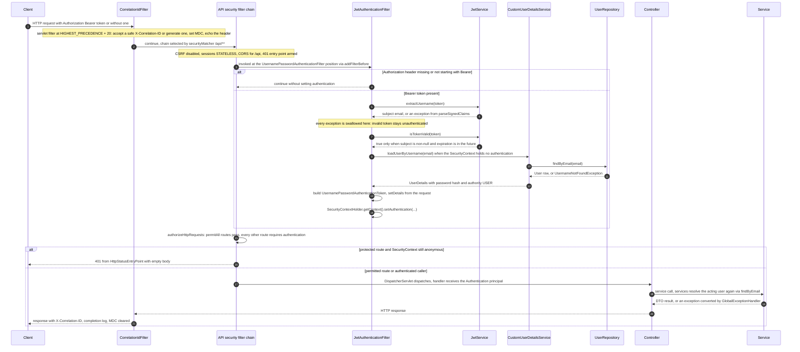

Notes on the diagram, tied to code:

1. `JwtAuthenticationFilter.doFilterInternal` reads `Authorization`; a header that is `null` or does
   not start with the literal `Bearer ` short-circuits before any JWT work.
2. `jwtService.extractUsername(token)` → `extractAllClaims` → `Jwts.parser().verifyWith(secretKey)
   .parseSignedClaims(token)`; a malformed token, bad signature or expired token throws, and the
   filter's `catch (Exception ignored)` (comment: "Invalid token -> remain unauthenticated") ends
   the attempt.
3. The guard `email != null && SecurityContextHolder...getAuthentication() == null &&
   jwtService.isTokenValid(token)` means authentication is only built when the context is empty.
4. `CustomUserDetailsService.loadUserByUsername` performs the database read
   (`UserRepository.findByEmail`, `UsernameNotFoundException` if absent) and builds `UserDetails`
   with username = email, password = stored hash, authority `"USER"`.
5. The `UsernamePasswordAuthenticationToken` is created unauthenticated-with-authorities, gets
   `WebAuthenticationDetailsSource.buildDetails(request)`, and is stored in the
   `SecurityContextHolder` — this is the `Authentication` later received by controller methods.
6. Authorization (permitAll vs authenticated) is enforced after this filter, by the API chain's
   `authorizeHttpRequests` block in `SecurityConfig`; unauthenticated rejections come from
   `HttpStatusEntryPoint(HttpStatus.UNAUTHORIZED)`.
7. Services do not trust the principal's existence alone: they re-resolve the row (e.g.
   `FileService.currentUser` → `UserRepository.findByEmail`), so the user is loaded at least twice
   per authenticated request *(interpretation, follows from the call sites)*.

### 2.3 Security configuration

Both filter chains live in `config/SecurityConfig.java`:

- **`actuatorSecurityFilterChain` — `@Order(1)`, matcher `/actuator/**`.** Permits
  `/actuator/health`, `/actuator/health/**` and `/actuator/prometheus` only when the caller address
  is `127.0.0.1` (`IpAddressMatcher`); everything else under `/actuator/**` is `denyAll()`.
  CSRF disabled, sessions `STATELESS`. `JwtAuthenticationFilter` is **not** part of this chain —
  actuator endpoints are never bearer-authenticated.
- **`securityFilterChain` — matcher `/api/**`.** Declared without an explicit `@Order`, so it is
  evaluated after the ordered actuator chain; only one chain matches any request. It enables CORS
  from `config/CorsConfig.java` (bean `corsConfigurationSource`, registered for `/api/**` only:
  origin patterns `http://localhost:[*]` and `http://127.0.0.1:[*]`, methods
  `GET POST PUT PATCH DELETE OPTIONS`, headers `Authorization` + `Content-Type`,
  `allowCredentials(false)`, `maxAge(1800)`), disables CSRF, forces `SessionCreationPolicy.STATELESS`,
  installs `HttpStatusEntryPoint(UNAUTHORIZED)` for unauthenticated requests, writes security
  headers eagerly (`HeaderWriterFilter.setShouldWriteHeadersEagerly(true)`, so async streaming
  responses still get them), and adds `jwtAuthenticationFilter` before
  `UsernamePasswordAuthenticationFilter`.
- **Public routes (no JWT needed):** `/api/health`, `/api/auth/register`, `/api/auth/login`, and
  `GET /api/share/**` — the share rule is narrowed to `HttpMethod.GET`, so no write method under
  `/api/share` is ever public. **Every other route under `/api/**` requires authentication.**
- **JWT requirement.** Enforcement is deny-by-default at the end of the API chain: no valid bearer
  token (or no token) on a non-permitAll route → **401 with an empty body**. The token is only read
  when the `Authorization` header starts with the exact prefix `Bearer ` (`doFilterInternal`).
- **Route coverage.** Every controller mapping in the codebase sits under `/api/**` — class-level
  `@RequestMapping` on `AuthController` (`/api/auth`), `FolderController` (`/api/folders`),
  `PermissionController` (`/api/files/{fileId}/permissions`), `ShareController` (`/api/share`),
  and full `/api/...` paths in `FileController`, `UploadController`, `ShareLinkController`,
  `HealthController`. A request outside `/api/**` and `/actuator/**` matches no chain, reaches no
  controller and 404s — there is no unsecured application surface there.
- **Password encoding.** `security/PasswordConfig.passwordEncoder()` returns
  `new BCryptPasswordEncoder()` as the sole `PasswordEncoder` bean; registration hashing and the
  default `AuthenticationManager`'s verification both use it. There is no password-change,
  re-hash-on-login or strength-configuration logic in the code.

### 2.4 Current-user endpoint

`GET /api/auth/me` — `AuthController.me(Authentication authentication)`:

1. **Identification.** The identity is taken directly from the security context:
   `authentication.getName()` returns the `UserDetails` username that
   `CustomUserDetailsService.loadUserByUsername` set to `user.getEmail()` — i.e. the JWT `sub`.
   No token parsing happens in the controller.
2. **Direct repository access (service-layer bypass).** The controller performs
   `userRepository.findByEmail(authentication.getName()).orElseThrow()` itself.
   `AuthController` injects `UserRepository` through its constructor — this is the **only
   controller → repository dependency in the codebase**; no service is involved, and there is no
   `UserService` behind the endpoint because `service/UserService.java` and
   `controller/UserController.java` are 0-byte placeholders.
3. **Response shape.** An ad-hoc `Map.of("id", "name", "email")` serialized as a JSON object —
   not a DTO, because `dto/user/UserResponse.java` is an empty placeholder. The password hash is
   never included.
4. **Unhandled edge.** The no-argument `orElseThrow()` throws `NoSuchElementException`, which
   `GlobalExceptionHandler` does not map, so it would fall through to the container's default error
   handling (**500**). *(Interpretation)* it looks unreachable in practice — the JWT filter loaded
   the same row moments earlier for the same subject — with a deletion between the two lookups the
   only trigger.

### 2.5 Limitations

**Implemented behavior:**

- **Token expiry.** Enforced twice: the `exp` claim written by `JwtService.generateToken`
  (`jwt.expiration: 86400000` = 24 h in `application.yml`) and `JwtService.isTokenValid`, which
  returns `false` when `claims.getExpiration()` is not after the current time or when parsing
  throws (jjwt rejects expired tokens during `parseSignedClaims`). No clock-skew allowance is
  configured (`JwtService` never sets one), so validity ends exactly at `exp`. There is no renewal:
  an expired token behaves like an invalid one.
- **Invalid tokens.** `JwtAuthenticationFilter.doFilterInternal` wraps header extraction,
  `extractUsername`, `isTokenValid` and `loadUserByUsername` in `catch (Exception ignored)`
  (source comment: "Invalid token -> remain unauthenticated"). Signature failures, malformed JWTs
  and tokens for deleted users therefore all downgrade silently to anonymous; protected routes
  then get **401 with an empty body** from `HttpStatusEntryPoint`, while permitAll routes proceed
  normally. `JwtService.isTokenValid` independently swallows every exception and returns `false`.
- **Missing credentials.** No `Authorization` header, or one not starting with `Bearer ` (including
  `"Bearer"`, `"Bearer "`, and non-bearer schemes) → the filter continues without setting
  authentication → the same **401** on protected routes; `/api/health`, register, login and
  `GET /api/share/**` are unaffected.

**Not implemented — empty scaffolding (0-byte files):**

- **Refresh tokens.** `entity/RefreshToken.java`, `repository/RefreshTokenRepository.java`,
  `dto/auth/RefreshTokenRequest.java` and
  `backend/src/main/resources/db/migration/V5__create_refresh_tokens.sql` are all empty, and a grep
  for `refresh` over `backend/src/main/java` returns nothing. There is no refresh endpoint: a
  session cannot be extended before the 24 h expiry — only a fresh login.
- **Logout / revocation.** No logout endpoint exists (no `logout` reference anywhere in
  `backend/src/main/java`; Spring Security's default logout processing is unreachable too, since
  the API chain only matches `/api/**` and no controller maps `/logout`). Because `generateToken`
  writes no `jti` and the application keeps no denylist, an issued JWT stays valid for its full 24 h
  regardless of any future logout mechanism; the only effective invalidation today is deleting the
  user row, because the filter reloads the subject on every request.
- **User profile management.** `service/UserService.java`, `controller/UserController.java`,
  `dto/user/UpdateUserRequest.java`, `dto/user/UserResponse.java` are 0-byte placeholders;
  `/api/auth/me` (§2.4) is the only current-user read.
- **Credential-stuffing defenses.** No rate limiting, lockout or login throttling exists in the
  code, and `backend/pom.xml` contains no rate-limiting dependency.

In one line: **implemented** = register, login, `/api/auth/me`, bearer filter, BCrypt, deny-by-default
chains, 401 entry point; **empty scaffolding** = refresh-token entity/repository/DTO/migration and
user-profile service/controller/DTOs.

**Tests that appear to cover this flow** — named as repository artifacts only; **they were not run
for this document, and nothing here claims they pass:**

- `backend/src/test/java/com/minidrive/controller/AuthControllerTest.java` (`@SpringBootTest` +
  `MockMvc`) contains cases for: registration persisting a BCrypt hash and returning a JWT with no
  password fields; case-normalized duplicate email → 400; login success; wrong password and unknown
  email → identical 401 responses without a token; `/api/auth/me` requiring a token and returning
  only the authenticated user; malformed, random and invalid-signature tokens → 401; malformed
  `Authorization` headers → 401 (no 500); expired JWT → 401; field-validation failures → 400 with
  an `errors` map; `/api/health` public.
- Related to the first hop of §2.2:
  `backend/src/test/java/com/minidrive/logging/CorrelationIdFilterTest.java` and
  `backend/src/test/java/com/minidrive/logging/StructuredRequestLoggingTest.java`.
- Gaps: there is no unit test for `JwtService` or `AuthService` —
  `backend/src/test/java/com/minidrive/service/` contains only a `.gitkeep`, and there is no
  `security/` test package.

## 3. File Lifecycle: Upload, Download, and Deletion

This section follows the implemented file-content paths only. The frontend's new-file UI uses the
resumable path; the multipart endpoint remains an independently exposed backend implementation.
The descriptions below are derived from source and tests, not from a runtime observation.

### 3.1 File upload

#### Resumable upload used by the frontend

`DrivePage.handleFileSelected` passes the browser `File` to
`useResumableUpload`/`ResumableUploadClient.start`. The client does not load the whole file into
memory. It performs the following sequence through `api/uploads.ts` and the shared Axios
`apiClient`:

1. `createUploadSession` sends `POST /api/uploads` with the filename, normalized content type,
   total byte count, and optional `folderId` (or `targetFileId` for a replacement). The
   `UploadController.create` method validates the request and calls
   `UploadSessionService.createSession`. The service resolves the authenticated user through
   `UserRepository`, validates name, content type, size, folder ownership and replacement
   target, chooses a 5 MiB chunk size, derives the chunk count, and saves an `UploadSession`
   through `UploadSessionRepository` in a short transaction. An optional idempotency key is
   owner-scoped and request-hash checked.
2. The client reads the session status with `GET /api/uploads/{sessionId}` before uploading.
   `UploadSessionService.getStatus` reads the owner-scoped session and
   `UploadChunkRepository.findBySessionIdOrderByChunkIndexAsc`, so a resumed run skips indexes
   already persisted. `Blob.slice()` creates each missing chunk. At most the configured client
   concurrency (default three) is in flight.
3. Each chunk is sent as raw `application/octet-stream` to
   `PUT /api/uploads/{sessionId}/chunks/{index}`. `UploadController.putChunk` delegates to
   `UploadSessionService.ingestChunk`, which rechecks ownership, status, expiry, index range and
   exact expected byte count, hashes the bytes, then calls `StorageService.upload` first with a
   server-generated `_uploads/{owner}/{session}/{index}` staging key. Only after the object write
   succeeds does `persistChunk` insert the `UploadChunk` row through PostgreSQL. A duplicate
   index is reconciled as an idempotent response; a database failure after the object write
   attempts to delete that staging key.
4. When all indexes are confirmed, `ResumableUploadClient.runCompletion` calls
   `POST /api/uploads/{sessionId}/complete`. `UploadSessionService.complete` first builds a
   complete, owner-scoped plan. It opens staging streams in ascending chunk order, wraps the
   concatenation in a digest stream, and uploads the assembled bytes to a fresh final content
   key through `StorageService`. The implementation bounds assembly memory by opening one chunk
   stream at a time; it does not buffer the entire logical file.
5. Only after the final object write succeeds does `persistCompletion` acquire the session row
   lock (`UploadSessionRepository.findByIdAndOwnerIdForUpdate`). For a new file it calls
   `FileService.persistStoredNewFile`, which saves `File` through `FileRepository`, saves
   `FileVersion` version 1 through `FileVersionRepository`, and marks the session
   `COMPLETED` with the resulting file id/version in the same database transaction. For a
   replacement, completion rechecks `FileAccessService` edit access and calls
   `FileService.persistStoredReplacement`; the file pointer advances and a new immutable
   version is recorded.
6. After the metadata transaction commits, `removeStaging` deletes each staging object and then
   removes the `UploadChunk` rows. These are best-effort post-success cleanup operations. A
   repeated completion returns the recorded response without touching storage. The frontend
   clears its `ResumeStore` record only after receiving the successful final response; a
   completion failure keeps the session resumable and can be retried without re-uploading
   chunks.

The storage abstraction is `StorageService`. In the configured implementation,
`RoutingStorageService` records the object location in PostgreSQL's `object_locations` table
through `JdbcTemplate`, then delegates bytes to the selected `NodeStorageClient`, which calls
MinIO. Replication-specific routing is intentionally not expanded here.

#### Single-shot multipart upload

`FileController.upload` exposes `POST /api/files` with a `file` multipart part and optional
`folderId`; it calls `FileService.upload`. This path validates the authenticated owner, non-empty
content, size, filename, content type, folder ownership and name uniqueness. It streams the
multipart input through a SHA-256 `DigestInputStream` to `StorageService.upload`, then saves the
`File` and its version-1 `FileVersion` with `FileRepository` and `FileVersionRepository` in the
transaction. If metadata persistence fails, it attempts to delete the newly written object and
rethrows the database failure.

`frontend/src/api/files.ts` contains `uploadFile`, which builds the corresponding `FormData`
request, but a repository-wide caller search found no frontend call site. The active
`DrivePage` new-file handler uses `ResumableUploadClient`; therefore the multipart flow is
available to callers but is not the UI-driven upload path currently wired in the frontend.
`POST /api/files` with JSON is a different metadata-only operation (`createMetadata`) and stores
no bytes.

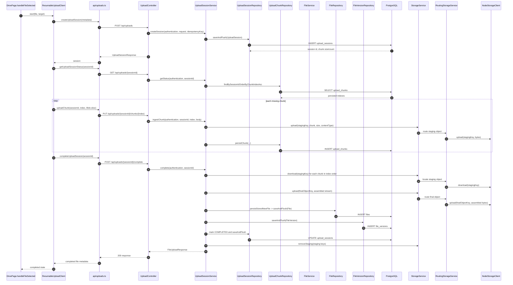

### 3.2 File download

The real UI path is `DrivePage.handleDownload` → `downloadFile` in
`frontend/src/api/files.ts` → `GET /api/files/{id}/download` through `apiClient`. The Axios
client attaches the stored authentication token and requests `responseType: 'blob'`; the browser
does not receive a storage URL. `FileController.download` passes the UUID and `Authentication`
to `FileService.download`.

`FileService.download` re-resolves the caller with `UserRepository`, then calls
`FileAccessService.resolve`. That service first checks `FileRepository.findByIdAndOwnerId`, then
loads the file and checks `PermissionRepository.findByFileIdAndUserId`; owners, editors and
viewers have read access. An inaccessible existing file is returned as a not-found response by
this operation, and a missing file is also not found. Once authorized, the service uses the
stored `File.objectKey` and calls `StorageService.download`.

`RoutingStorageService.download` finds the object's node in `object_locations` through
`JdbcTemplate` and returns the `InputStream` from `NodeStorageClient.download`, which wraps
MinIO `getObject`. `FileService` returns the stream, name, content type and recorded size to
`DownloadResponses.attachment`. That helper creates a `StreamingResponseBody`; its callback
copies the input stream to the HTTP output with `InputStream.transferTo` and closes the input.
The response is therefore streamed, not buffered into a byte array, and includes content type,
content length and a sanitized `Content-Disposition: attachment` filename.

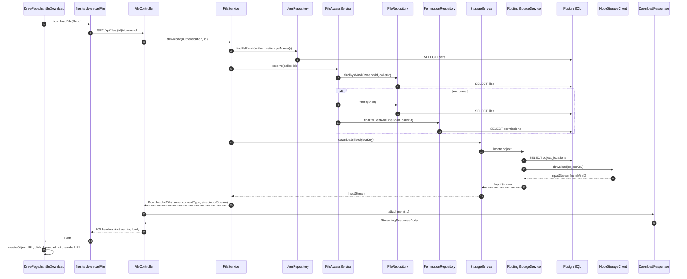

### 3.3 File deletion

`FileController.delete` exposes `DELETE /api/files/{id}` and delegates directly to
`FileService.delete`; there is no file-delete caller in the current frontend source (the
`DrivePage` comment explicitly places delete in a later phase). The API still enforces the
operation independently of UI controls.

The service resolves the caller and file through `FileAccessService`. A missing or inaccessible
file produces not found; an existing file for a non-owner produces forbidden. Only after the
owner check does it call `StorageService.delete(file.getObjectKey())`. In the non-replicated
`RoutingStorageService` path, the storage node object is deleted first and then its
`object_locations` row is removed. Only if that completes does `FileService` call
`FileRepository.delete(file)` and `flush`; the foreign-key cascade removes `file_versions` rows.
The service intentionally deletes only the current file object's key. Historical version rows and
their object keys are retained, so deletion is not historical-object garbage collection.

This ordering is a deliberate compensation boundary: storage failure leaves the metadata row
and is retryable. It is not fully atomic with PostgreSQL. If object deletion succeeds but the
metadata delete/flush fails, the transaction rolls back metadata while the object is already
gone; the service logs that condition and rethrows the database failure. No object recreation
or automatic repair is implemented in this method.

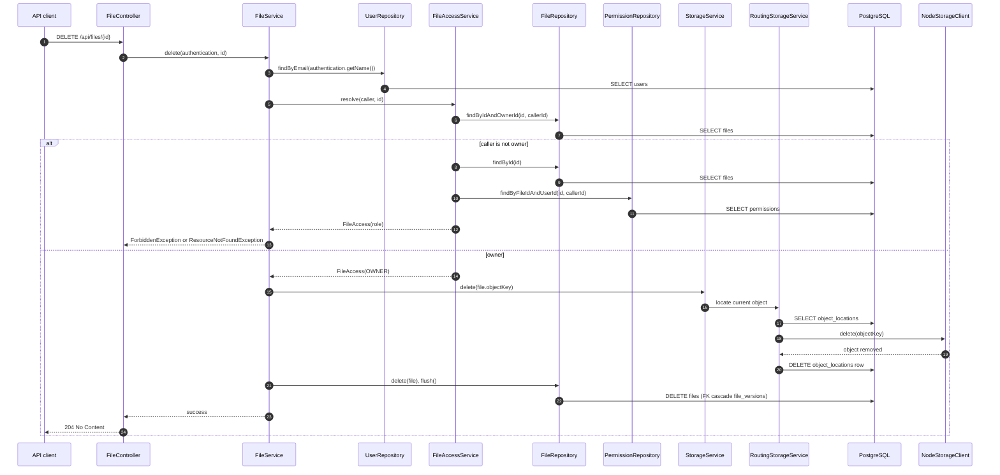

### 3.4 Failure behavior

The following distinguishes behavior present in the implementation from risks that follow from
the ordering but are not claimed as runtime observations:

| Operation | Input, authentication, and authorization failures | Storage or database failure | Partial-success behavior |
|---|---|---|---|
| Resumable upload | Bean/request validation and service checks return 400. Missing authentication is rejected by the security chain with 401. A foreign session is owner-scoped and resolves to 404; replacement edit access is rechecked at completion and can return 403. | A chunk storage failure prevents its chunk row from being persisted. A chunk-row failure attempts staging cleanup. Final-object assembly/storage failure leaves the session initiated and attempts to remove the final object. Metadata failure rolls back the completion transaction and attempts final-object cleanup. | After a successful metadata commit, staging cleanup and chunk-row deletion are best effort; cleanup failure is logged and the completed file remains valid. Concurrent completion is reconciled by the session lock and recorded response. These are implemented paths covered by tests, not runtime verification here. |
| Single-shot multipart upload | Empty input, invalid name/type/size, folder access or duplicate name returns 400; unauthenticated access is 401. The service uses the authenticated owner. | Storage failure occurs before metadata persistence, so no file metadata is created. A metadata/version failure after storage attempts to delete the newly uploaded object. | If that compensating delete also fails, the database exception is rethrown with the cleanup failure suppressed; the source does not claim atomic storage/database rollback. |
| Download | Missing/invalid UUID or missing file returns 404; unauthenticated access is 401. An existing file without a read role is treated as not found by `FileService.download`. | A storage lookup failure raised before the response is constructed becomes `StorageException`, mapped to 502; no response body is constructed from a missing stream. Database lookup failures propagate through the global exception layer. | The stream is obtained before the response is built and is copied asynchronously by `StreamingResponseBody`. A failure while the stream is being copied is an HTTP streaming failure; no application-level retry or resume behavior is implemented in this path. |
| File deletion | Missing/invalid UUID or inaccessible file returns 404; a non-owner receives 403; unauthenticated access is 401. | Storage failure happens before `FileRepository.delete`, leaving metadata intact. A database delete/flush failure after object deletion is logged and rethrown; the transaction rolls back metadata but cannot restore the object. | The latter ordering is an inferred orphaned-metadata risk from the code and is directly exercised as a failure shape by the existing controller test, but no runtime production verification was performed. Historical objects are intentionally not deleted. |

`GlobalExceptionHandler` maps validation/`IllegalArgumentException` to 400, not-found to 404,
forbidden to 403, storage failures to 502, and bad login credentials to 401. The security filter
chain separately rejects unauthenticated protected requests with 401. The advice does not
provide a general database-exception response; database failures therefore retain the repository's
normal Spring error handling unless a more specific exception handler applies.

### 3.5 Code and test mapping

The table names existing tests without implying that they were run for this documentation change.
The “unverified” column records the boundary of each test rather than a claim about production
behavior.

| Workflow step | Important source files and methods | Relevant existing tests | Coverage and remaining unverified behavior |
|---|---|---|---|
| UI starts/resumes resumable upload | `frontend/src/pages/DrivePage.tsx` — `handleFileSelected`, resume handlers; `frontend/src/hooks/useResumableUpload.ts`; `frontend/src/uploads/resumableUpload.ts` — `start`, `resume`, `uploadMissing`, `runCompletion` | `frontend/src/uploads/resumableUpload.test.ts`, `frontend/src/uploads/resumeStore.test.ts` | Covers chunk math, resume state, retry classification, finalization state and stored records. Browser/XHR behavior and a live backend are unverified. |
| Session creation/status and chunk ingest | `frontend/src/api/uploads.ts`; `backend/src/main/java/com/minidrive/controller/UploadController.java`; `backend/src/main/java/com/minidrive/service/UploadSessionService.java` — `createSession`, `getStatus`, `ingestChunk`; `UploadSessionRepository`, `UploadChunkRepository` | `frontend/src/api/uploads.test.ts`; `backend/src/test/java/com/minidrive/controller/UploadControllerTest.java` | Covers request shapes, validation, ownership, idempotency, chunk sizing, concurrency, storage failure and row-persistence cleanup with mocked storage. Real PostgreSQL/object storage integration is unverified. |
| Completion and final metadata | `UploadSessionService.complete`, `buildCompletionPlan`, `persistCompletion`, `removeStaging`; `FileService.persistStoredNewFile`, `persistStoredReplacement`; `FileRepository`, `FileVersionRepository` | `backend/src/test/java/com/minidrive/controller/UploadCompletionControllerTest.java` | Covers ordered assembly, checksums, replacement/new-file persistence, idempotent/concurrent completion, compensation and staging cleanup. Production storage and database coordination are unverified. |
| Multipart upload alternative | `backend/src/main/java/com/minidrive/controller/FileController.java` — `upload`; `backend/src/main/java/com/minidrive/service/FileService.java` — `upload`; `frontend/src/api/files.ts` — `uploadFile` (no caller found) | `backend/src/test/java/com/minidrive/controller/FileControllerTest.java` | Covers multipart success, storage failure and metadata cleanup behavior. No frontend integration caller and no live multipart object-store run were found. |
| Authenticated download | `frontend/src/pages/DrivePage.tsx` — `handleDownload`; `frontend/src/api/files.ts` — `downloadFile`; `FileController.download`; `FileService.download`; `FileAccessService.resolve`; `DownloadResponses.attachment`; `RoutingStorageService.download` | `backend/src/test/java/com/minidrive/controller/FileControllerTest.java`; `backend/src/test/java/com/minidrive/StreamingDownloadHeaderConcurrencyIntegrationTest.java` | Covers access isolation, headers, filename encoding, storage failure and repeated HTTP streaming with mocked storage. The latter integration test is not a real MinIO verification. |
| Owner deletion | `FileController.delete`; `FileService.delete`; `FileAccessService.resolve`; `RoutingStorageService.delete`; `FileRepository.delete/flush` | `backend/src/test/java/com/minidrive/controller/FileControllerTest.java` | Covers owner success, unauthorized/forbidden/missing identifiers, storage failure, database failure after object deletion, and storage-call ordering assertions. No production reconciliation or historical-object cleanup job is verified here. |

No runtime verification is claimed in this section. Unresolved questions are operational rather
than inferred code facts: whether the unused multipart frontend helper will be wired in a later
phase, and when retained historical objects will receive a separately designed cleanup policy.

## 4. Folder Operations

This section documents the folder endpoints and callers present in the repository. It does not
cover file permissions or public sharing. The behavior described as implemented is based on source
inspection and the cited tests; no runtime verification is claimed.

### 4.1 Endpoints and purposes

`backend/src/main/java/com/minidrive/controller/FolderController.java` is rooted at
`/api/folders` and delegates each route to `FolderService`:

| HTTP endpoint | Controller method | Purpose |
|---|---|---|
| `POST /api/folders` | `FolderController.create` | Create a root folder or a child of an owned parent. Returns `201 Created` and `FolderResponse`. |
| `GET /api/folders` | `FolderController.list` | List direct root folders when `parentFolderId` is omitted, or direct children of the supplied parent. |
| `GET /api/folders/{id}` | `FolderController.get` | Return one owned folder, including its parent id and owner id. |
| `GET /api/folders/{id}/children` | `FolderController.children` | List direct children of one owned folder. |
| `PATCH /api/folders/{id}` | `FolderController.rename` | Rename one owned folder while retaining its parent. Returns `200 OK`. |
| `DELETE /api/folders/{id}` | `FolderController.delete` | Delete one owned folder. Returns `204 No Content`; database cascades determine dependent-row deletion. |

All routes accept the `Authentication` supplied by Spring Security. The API security chain
requires authentication for these non-public `/api/**` routes; the controller itself does not
perform authorization. `FolderController` uses `@Valid` for `FolderRequest` on create and rename.

### 4.2 Frontend invocation

The frontend API boundary is
`frontend/src/api/folders.ts`. It uses the shared `apiClient`, so the request interceptor in
`frontend/src/api/client.ts` supplies the bearer token and the response interceptor maps 401
responses into the existing client authentication handling. Each API function converts failures
with `toApiError`:

- `listFolders(parentFolderId?)` calls `GET /api/folders`, omitting the query parameter at the
  drive root and sending `parentFolderId` inside a folder.
- `createFolder(name, parentFolderId?)` calls `POST /api/folders` with `name` and an optional
  `parentFolderId`.
- `renameFolder(id, name)` calls `PATCH /api/folders/{id}` with only `name`.
- `getFolder(id)` calls `GET /api/folders/{id}`.

`frontend/src/pages/DrivePage.tsx` calls `listFolders` alongside `listFiles` whenever the current
folder changes, calls `createFolder` from `handleCreateFolder`, and calls `renameFolder` from
`handleRenameFolder`. The create handler prevents duplicate submissions while one request is
active, refreshes the current listing after success, and closes the dialog. The rename handler
refreshes the listing and patches the visible breadcrumb with `updateCrumbName`.

`frontend/src/hooks/useDriveLocation.ts` calls `getFolder` repeatedly to walk parent links from
the route folder toward the root. It performs one request per parent link, limits the walk to 32
levels, and converts request failures to a displayed error. There is no
`deleteFolder` function in `frontend/src/api/folders.ts` and no folder-delete caller in the
frontend source found during inspection; deletion is therefore a backend endpoint without a
current frontend control.

### 4.3 Backend layer and database relationships

`FolderService` is the business layer between the controller and persistence:
`backend/src/main/java/com/minidrive/service/FolderService.java`. Every operation first resolves
the authenticated email through `UserRepository.findByEmail`. The service then uses
`FolderRepository` and `FolderMapper`:

- `create` trims the supplied name, resolves an optional owned parent, checks name uniqueness in
  that owner/parent scope, constructs `new Folder(owner, parent, name)`, and saves it.
- `listChildren` returns either
  `FolderRepository.findByOwnerIdAndParentFolderIdIsNull(ownerId)` for root folders or
  `findByOwnerIdAndParentFolderId(ownerId, parentId)` for direct children. It maps rows with
  `FolderMapper.toResponse`.
- `get` uses `getOwnedFolder`, then maps the entity.
- `rename` uses `getOwnedFolder`, trims the new name, checks uniqueness only when the name changes,
  and mutates the managed entity's name. The surrounding transaction persists the update.
- `delete` uses `getOwnedFolder`, calls `FolderRepository.delete(folder)`, and evicts the file
  listing cache after commit through `FileListingCache`.

`backend/src/main/java/com/minidrive/repository/FolderRepository.java` is a
`JpaRepository<Folder, UUID>`. Its derived queries cover root listing, direct-child listing,
ownership existence, and duplicate-name checks. The service's `getOwnedFolder` uses
`findById`, then compares `folder.getOwner().getId()` with the authenticated user's id; the
repository does not itself expose an owner-scoped `findById` method.

`backend/src/main/java/com/minidrive/entity/Folder.java` maps the `folders` table. Each folder has
one required `User owner`, an optional lazy `parentFolder`, a non-null name, and created/updated
timestamps maintained by `@PrePersist` and `@PreUpdate`. `FolderResponse` and
`FolderMapper` expose the folder id, name, parent id, owner id, and timestamps, not the entity
relationships themselves.

The database relationships are defined in
`backend/src/main/resources/db/migration/V6__create_folders.sql` and
`V7__create_files_metadata.sql`:

- `folders.owner_id` references `users(id) ON DELETE CASCADE`.
- `folders.parent_folder_id` self-references `folders(id) ON DELETE CASCADE`, so deleting a
  parent cascades to its descendant folder rows.
- `files.folder_id` references `folders(id) ON DELETE CASCADE`, so files directly in a deleted
  folder are deleted by the database.
- A folder name is unique per owner within the same parent scope. The migration folds a null
  parent to a fixed UUID in `uq_folders_owner_parent_name`, which makes duplicate root names
  rejectable as well.

The `Folder` entity's `@OnDelete(action = OnDeleteAction.CASCADE)` annotation is on the parent
association and is consistent with the migration's self-referencing cascade. The migration also
confirms the file-row cascade. Therefore, the implementation does not reject deletion of a
non-empty folder; it relies on database cascades to remove descendant folders and files. The
repository test cited below confirms child-folder deletion through the endpoint. Broader effects
such as all storage-object cleanup associated with cascaded file rows are not established by the
folder service test and are not inferred here as a completed cleanup workflow.

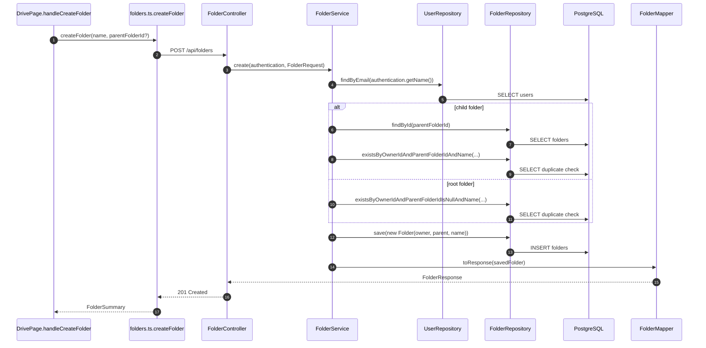

### 4.4 Authentication, ownership, validation, and errors

Authentication is enforced before controller dispatch by the API security configuration in
`backend/src/main/java/com/minidrive/config/SecurityConfig.java`. An unauthenticated request to
these folder routes is rejected with 401. Once authenticated, `FolderService.currentUser`
re-reads the user by `authentication.getName()` and returns a not-found error if the user row is
missing.

Ownership is checked consistently for parents and target folders:
`resolveOwnedParent` delegates to `getOwnedFolder`, and `get`, `rename`, `delete`, and nested
listing also use `getOwnedFolder`. A missing folder produces `ResourceNotFoundException`
(`404` through `GlobalExceptionHandler`); a folder belonging to another user produces
`ForbiddenException` (`403`). This prevents using another user's folder as a parent and prevents
cross-owner lookup, rename, listing, or deletion.

`FolderRequest` in
`backend/src/main/java/com/minidrive/dto/folder/FolderRequest.java` requires a non-blank name
and limits it to 255 characters. `FolderService.normalizeName` trims the value before duplicate
checking and persistence. Validation failures raised by `@Valid` are converted by
`GlobalExceptionHandler` into `400` with an `errors` object. A duplicate name in the same
owner/parent scope raises `IllegalArgumentException`, also mapped to `400`. Names that are equal
after trimming do not cause a rename write; names in different parent scopes are allowed.

Malformed UUID path/query values are handled by Spring MVC before the service is reached. The
repository does not define a custom handler for those conversion failures, so this section does
not assert a more specific response shape beyond the framework/error configuration actually
present. Database constraint failures caused by races or other persistence errors likewise have
no folder-specific recovery path in `FolderService`; the source does not establish a custom
folder error response for those cases.

### 4.5 Tests and evidence boundaries

`backend/src/test/java/com/minidrive/controller/FolderControllerTest.java` is the primary folder
workflow test. It establishes, through `MockMvc` and repository assertions, that:

- root and nested folders are created with owner and parent metadata;
- root listing returns only the authenticated user's root folders;
- `/children` returns only direct children;
- an owned folder can be retrieved and renamed;
- deleting a parent removes it and its child folder through the configured database cascade;
- duplicate names are rejected within one parent scope while the same name in different parents is
  allowed;
- another user cannot use a folder as a parent or read, rename, or delete it;
- unauthenticated list/create/delete requests are rejected; and
- blank names are rejected with validation errors.

The test uses the Spring application context and `MockMvc`, but this documentation does not claim
that it was executed for this change. It does not by itself establish browser behavior, live
PostgreSQL behavior outside the test configuration, object-storage cleanup for files deleted by a
folder cascade, malformed-UUID response formatting, or recovery from a database failure during
folder deletion. Those remain unverified here.

## 5. File Permissions and Authorization

This section covers direct, file-scoped permissions for registered users. Public share links are
implemented separately and are not described here beyond their owner-only management check.

### 5.1 Data model

`entity/Permission.java` is the JPA entity for one collaborator's direct access to one file. It
contains:

- a generated UUID `id`;
- required lazy `ManyToOne` relationships to `File file` and `User user`;
- an enum-string `role` column; and
- `createdAt` and `updatedAt` timestamps populated by `@PrePersist` and `@PreUpdate`.

The entity-level unique constraint `uq_file_permissions_file_user` and migration
`backend/src/main/resources/db/migration/V9__create_file_permissions.sql` enforce one row per
`(file_id, user_id)`. The migration also adds foreign keys to `files` and `users`, both with
`ON DELETE CASCADE`, indexes on both foreign-key columns, and a check constraint limiting stored
roles to `EDITOR` and `VIEWER`.

`entity/FileRole.java` defines `OWNER`, `EDITOR`, and `VIEWER`. `OWNER` is an effective role only:
it is derived from `files.owner_id` and is never stored in `file_permissions`. `EDITOR` and
`VIEWER` are the only grantable roles. `entity/File.java` owns the authoritative `User owner`
relationship, while `Permission` supplies the separate user/file/role relationship for
collaborators. `entity/User.java` supplies the registered identity and unique email used for
email-based grants. Deleting a file or user cascades permission rows at the database relationship
level.

`repository/PermissionRepository.java` is a `JpaRepository<Permission, UUID>` with the relevant
queries `findByFileIdAndUserId`, `findByFileIdOrderByCreatedAtAsc`, and
`existsByFileIdAndUserId`. `mapper/PermissionMapper.java` converts a row to
`dto.permission.PermissionResponse`, exposing `userId`, `email`, `role`, and `createdAt`, but not
the permission ID or internal relationships.

### 5.2 Permission-management API

The controller is `controller/PermissionController.java`, rooted at
`/api/files/{fileId}/permissions`. It accepts the authenticated Spring Security
`Authentication` and delegates all policy decisions to `service/PermissionService.java`.

| Operation | HTTP endpoint | Controller method | Service method | Result |
|---|---|---|---|---|
| Grant or change role | `POST /api/files/{fileId}/permissions` | `grant` | `PermissionService.grant` | `200 OK`, `PermissionResponse` |
| List collaborators | `GET /api/files/{fileId}/permissions` | `list` | `PermissionService.list` | `200 OK`, ordered `PermissionResponse[]` |
| Revoke collaborator | `DELETE /api/files/{fileId}/permissions/{userId}` | `revoke` | `PermissionService.revoke` | `204 No Content` |

The request body is `dto/permission/PermissionRequest`: a nonblank, `@Email`-validated `email`
and nonnull `FileRole role`. `PermissionService.grant` trims and lowercases the email before
calling `UserRepository.findByEmail`. It resolves the caller with `currentUser`, requires the
caller to own the file, rejects roles other than `VIEWER` and `EDITOR`, rejects an unknown
recipient, and rejects attempts to grant the owner's own access. It then looks up the existing
`(file, recipient)` row, creates one when absent, or changes `role` when present, and returns the
mapper response after `saveAndFlush`.

`PermissionService.list` uses the same owner-only file resolution and maps
`findByFileIdOrderByCreatedAtAsc` to responses. `PermissionService.revoke` also requires the
caller to own the file, rejects the owner's user ID, requires an existing collaborator row, and
deletes that row.

The frontend wrapper is `frontend/src/api/permissions.ts`: `listPermissions`, `grantPermission`,
and `revokePermission` call the three endpoints through the shared API client and map failures
through `toApiError`. `frontend/src/components/sharing/ShareDialog.tsx` loads collaborators when
opened, submits email/role grants, uses the same grant call for role changes, confirms revocation,
and refreshes the authoritative list after each mutation. `frontend/src/pages/DrivePage.tsx`
mounts the dialog for the selected file. The UI's email check and owner-oriented controls are
convenience behavior; the backend remains authoritative.

### 5.3 Authorization checks

There are two distinct layers:

1. **Endpoint-level security.** `config/SecurityConfig.java` applies the `/api/**` chain with
   stateless sessions and the JWT filter before `UsernamePasswordAuthenticationFilter`.
   `/api/files/**` and therefore all permission endpoints require an authenticated request;
   unauthenticated requests are rejected with `401 Unauthorized` before the controller is called.
   The permission controller has no method-level `@PreAuthorize` annotations.
2. **Service-level resource authorization.** `service/FileAccessService.resolve` first checks
   `findByIdAndOwnerId`, returning `OWNER` for the owner. Otherwise it loads the file and looks
   up the caller's direct permission row; no row produces a resolved file with a null role.
   Callers then choose whether an inaccessible existing file should be `403` or `404`.

The effective role behavior in `FileAccessService.FileAccess` is:

| Effective role | Read metadata/download/version reads | Modify content or metadata | Manage direct permissions/share links | Delete file |
|---|---:|---:|---:|---:|
| `OWNER` | Yes | Yes | Yes | Yes |
| `EDITOR` | Yes | Yes, subject to operation-specific owner rules | No | No |
| `VIEWER` | Yes | No | No | No |
| no role | No | No | No | No |

`canRead()` is true for any non-null role and is used by file read operations. `canEdit()` is
true only for `OWNER` and `EDITOR`; `FileService.update` additionally makes moving a file
owner-only, so an editor can rename but cannot move it. `FileService.replaceContent` and version
restore require edit access. `FileService.delete` requires `isOwner()`, not merely edit access.
File metadata reads, downloads, version listing, and historical-version downloads accept any
role with access. The permission service and `ShareLinkService` independently require
`isOwner()` for permission/link management; a collaborator cannot delegate their access.

The file service uses different not-found/forbidden choices by operation: for example,
`FileService.get` reports an existing inaccessible file as forbidden, while download and delete
use not-found for an inaccessible file. `PermissionService.requireOwnedFile` and
`ShareLinkService.requireOwnedFile` also return not-found when the caller cannot see the file,
then return forbidden when the caller can see it but is not the owner. These are service-level
resource decisions, not route-level authentication rules.

### 5.4 Grant sequence

The following sequence follows the implemented direct-grant path. The JWT filter authenticates
the request before `PermissionController.grant`; validation is performed by Spring MVC before
the service call, and `saveAndFlush` persists the row before the response is built.

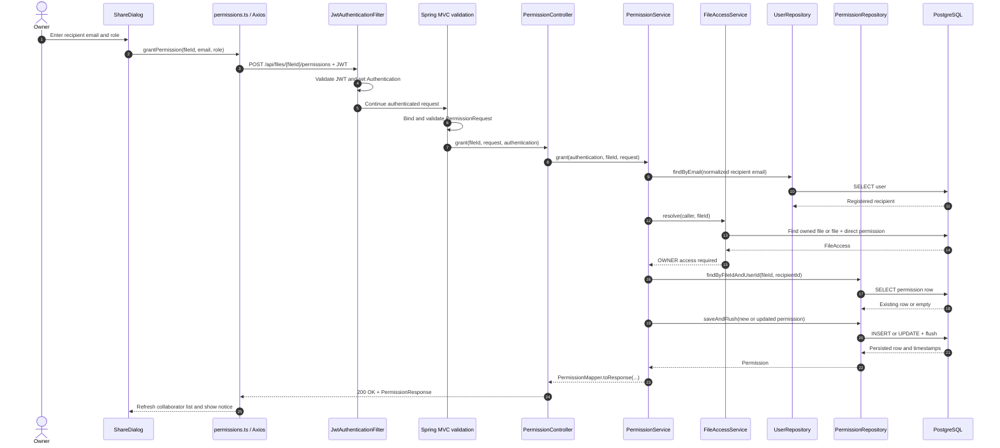

### 5.5 Security and failure cases

- **Unauthenticated requests:** the API security chain requires authentication for the permission
  routes and returns `401`; the controller and service are not reached. This behavior is asserted
  in `PermissionControllerTest.unauthenticatedAccessIsUnauthorized`.
- **Non-owners granting, listing, or revoking:** a collaborator with either `VIEWER` or `EDITOR`
  access resolves to a non-owner role and receives `403 Forbidden`. An unrelated authenticated
  user is resolved with no role and receives `404 File not found` from the owner-only permission
  guard, avoiding disclosure of an inaccessible file. The controller test covers both cases.
- **Insufficient file permissions:** viewers can read metadata and download but cannot edit, delete,
  or manage access. Editors can rename and perform other edit-authorized operations, but cannot
  delete, move the file, or manage access. The role-specific restrictions are asserted by
  `PermissionControllerTest.viewerCanReadAndDownloadButCannotEditDeleteOrShare` and
  `editorCanRenameButCannotDeleteMoveOrManagePermissions`.
- **Invalid users, files, and roles:** unknown recipient emails produce `404 User not found`;
  missing files produce `404 File not found`; blank or malformed email fields and null roles are
  rejected by DTO validation with `400` validation errors. `OWNER` is a valid enum value at
  binding time but is rejected by service policy with `400`; an unknown enum value such as
  `SUPERADMIN` is rejected during request binding with a framework-generated bad request.
  Malformed UUID path values are converted by Spring MVC before the service is reached; the
  repository has no custom handler that establishes a more specific response shape.
- **Revoking or changing permissions:** posting an existing recipient updates its role rather than
  inserting a second row. Revocation deletes the direct row, so access disappears on subsequent
  resolutions. The owner cannot be granted a collaborator row and cannot be revoked because
  ownership is stored on `File`, not in `Permission`.
- **Existing rows, duplicates, and transactions:** `grant` and `revoke` are `@Transactional`;
  `list` is `@Transactional(readOnly = true)`. `saveAndFlush` makes lifecycle timestamps and the
  database unique constraint visible within the grant transaction. There is no explicit
  permission-row lock or retry in this service. Concurrent first grants for the same file/user
  can therefore contend on the database unique constraint; the source does not provide a
  permission-specific conflict recovery path. `PermissionRepositoryTest` separately verifies
  the database rejects a duplicate pair, while the service's existing-row lookup is the normal
  sequential update path.
- **Potential authorization gaps to investigate:** the permission controller relies on service
  checks rather than method-level authorization annotations, so any future alternate caller of
  `PermissionService` must preserve the authenticated-user contract. Also, authorization outcomes
  intentionally differ between file read/update/delete methods (`403` versus `404`) and should
  remain covered when endpoints are added. These are review items from the source structure, not
  proven exploits in the current routed API.

### 5.6 Evidence mapping and verification boundary

| Source or test | Evidence covered |
|---|---|
| `backend/src/main/java/com/minidrive/entity/Permission.java` | Entity fields, relationships, timestamps, and entity uniqueness |
| `backend/src/main/java/com/minidrive/entity/FileRole.java` | Effective roles and non-persisted `OWNER` semantics |
| `backend/src/main/resources/db/migration/V9__create_file_permissions.sql` | Foreign keys, cascades, role check, indexes, and unique pair |
| `backend/src/main/java/com/minidrive/repository/PermissionRepository.java` | File/user lookup, ordered listing, and existence query |
| `backend/src/main/java/com/minidrive/service/FileAccessService.java` | Role resolution, `canRead`, `canEdit`, and owner checks |
| `backend/src/main/java/com/minidrive/service/PermissionService.java` | Grant/update, owner-only list/revoke, validation, and transaction boundaries |
| `backend/src/main/java/com/minidrive/controller/PermissionController.java` | The three REST routes and controller-to-service delegation |
| `backend/src/main/java/com/minidrive/config/SecurityConfig.java` | Authenticated `/api/**` route policy and JWT filter placement |
| `backend/src/test/java/com/minidrive/controller/PermissionControllerTest.java` | End-to-end MockMvc role, owner, failure, scoping, duplicate-update, and unauthenticated cases |
| `backend/src/test/java/com/minidrive/repository/PermissionRepositoryTest.java` | Persistence/timestamps, lookup/listing, duplicate constraint, and file-delete cascade |
| `frontend/src/api/permissions.ts` and `frontend/src/components/sharing/ShareDialog.tsx` | Frontend endpoint wrappers, grant/update/revoke actions, refresh, and error surfacing |

The source and test files above were inspected for this documentation. The tests were not executed
as part of this change, so this section makes no claim that they pass. No runtime verification was
performed. Remaining questions are whether production database error handling should map a
concurrent unique-constraint failure to a stable `409` response, and whether future permission
management entry points should add explicit method-level authorization in addition to the current
service checks.

## 6. Public Share Links and Token-Based Access

This section describes the public bearer-link feature implemented by the share-link classes. It
covers anonymous metadata and download access only; direct file permissions remain documented in
Section 5.

### 6.1 Data model and token generation

`entity/ShareLink.java` represents one public link for one `File`. It contains a generated UUID
`id`, a required lazy `ManyToOne` `file`, the persisted `tokenHash`, `createdAt`, and nullable
`expiresAt`. A null expiry means the link does not expire. The file relationship is authoritative
for the target file; ownership is not duplicated in the share-link row.

`backend/src/main/resources/db/migration/V10__create_share_links.sql` creates `share_links` with
these relationships:

- `file_id` references `files(id)` with `ON DELETE CASCADE`;
- `token_hash` is a required `VARCHAR(64)` with a unique constraint;
- `created_at` is required and `expires_at` is optional; and
- an index supports lookup of links by file.

The database therefore removes links when their file is deleted, and it prevents two rows from
using the same hash. `repository/ShareLinkRepository.java` provides
`findByTokenHash`, `existsByTokenHash`, `findByFileIdOrderByCreatedAtAsc`, and
`findByIdAndFileId`.

`security/ShareTokenService.java` generates 32 random bytes with `SecureRandom`, then encodes
them with unpadded URL-safe Base64. This produces a 256-bit bearer token suitable for a path
segment. Its `hash` method computes SHA-256 over the UTF-8 token and returns lowercase hexadecimal
output. `ShareLinkService.create` generates the raw token, hashes it, constructs `ShareLink`, and
calls `saveAndFlush`. The raw token is placed in `CreatedShareLinkResponse` exactly once; only the
64-character SHA-256 hash is persisted. `ShareLinkResponse`, used by later list calls, contains
link metadata and an `expired` flag but neither the raw token nor its hash. The mapper is
`mapper/ShareLinkMapper.java`.

`ShareLinkService.resolveActiveLink` validates every public request by rejecting null or blank
tokens, hashing the supplied raw token, finding the matching hash, and checking
`ShareLinkMapper.isExpired`. Expiry is true when `expiresAt` is non-null and is not after
`LocalDateTime.now()`, so an expiry at or before the current time is unavailable. Unknown,
revoked, and expired tokens all use the same
`"This share link is invalid, expired, or has been revoked"` not-found message.

### 6.2 Creating and managing links

Owner management is implemented by `controller/ShareLinkController.java` and
`service/ShareLinkService.java`:

| Operation | HTTP endpoint | Controller method | Service method | Result |
|---|---|---|---|---|
| Create | `POST /api/files/{fileId}/share-link` | `create` | `ShareLinkService.create` | `201 Created`, `CreatedShareLinkResponse` |
| List metadata | `GET /api/files/{fileId}/share-links` | `list` | `ShareLinkService.list` | `200 OK`, `ShareLinkResponse[]` |
| Revoke | `DELETE /api/files/{fileId}/share-links/{shareId}` | `revoke` | `ShareLinkService.revoke` | `204 No Content` |

`dto.sharelink.CreateShareLinkRequest` has one optional `LocalDateTime expiresAt`. The controller
allows an absent request body; the service treats absent or null expiry as never-expiring and
rejects a timestamp that is not in the future with `IllegalArgumentException`. The create
response is built by `ShareLinkMapper.toCreatedResponse` and is the only API response that
contains the raw token.

All three management methods resolve the authenticated principal through `UserRepository` and
call `requireOwnedFile`. That helper uses `FileAccessService.resolve`: an inaccessible existing
file is reported as `404 File not found`, while a visible file owned by another authenticated
user produces `403 Forbidden` with `"Only the file owner can manage share links"`. Create and
revoke are `@Transactional`; list is `@Transactional(readOnly = true)`. Revoke uses
`findByIdAndFileId`, so a link ID from a different file cannot be used, then deletes the row.
Because revocation deletes the row, subsequent token resolution fails immediately after the
transaction commits.

The frontend API wrapper is `frontend/src/api/share.ts`: `createShareLink`, `listShareLinks`,
and `revokeShareLink` call these authenticated management endpoints. `frontend/src/components/
sharing/ShareDialog.tsx` creates links with optional expiry presets, refreshes the metadata list,
displays the returned URL only after creation, and supports revocation. The same component also
contains direct-permission controls from Section 5. `frontend/src/pages/DrivePage.tsx` mounts the
dialog. The public route is `share/:token` in `frontend/src/routes/index.tsx`, outside
`ProtectedRoute`; `frontend/src/pages/SharedFilePage.tsx` calls `getPublicShare` and,
after metadata loads, `downloadPublicShare`. Both functions URL-encode the token in
`frontend/src/api/share.ts`.

### 6.3 Public access flow

`controller/ShareController.java` exposes only two public operations:

- `GET /api/share/{token}` calls `ShareLinkService.getSharedFile`, which resolves the active link
  and maps only `name`, `contentType`, and `sizeBytes` to `SharedFileResponse`.
- `GET /api/share/{token}/download` calls `ShareLinkService.download`, which resolves the active
  link, opens the file's object key through `StorageService.download`, and returns an attachment
  using `DownloadResponses.attachment`. The helper streams and closes the input stream and
  sanitizes the filename.

The token alone selects the file. The public controller does not accept a file ID as an
authorization substitute, and `ShareLinkService` does not call `FileAccessService` during public
token resolution; the link row itself is the authorization. The file relationship and database
cascade ensure a deleted file normally removes its link rows. There is no public preview route,
write operation, or public version/permission/share-link-management operation in this controller.

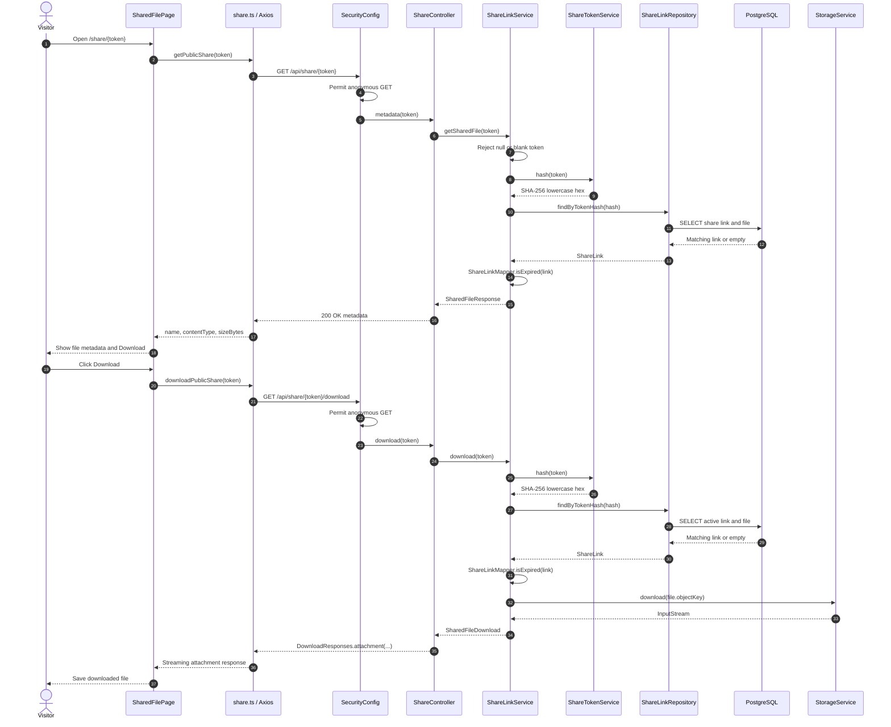

### 6.4 Security boundaries and failure cases

- **Route and method boundary:** `SecurityConfig` permits only `GET /api/share/**` anonymously.
  The `/api/files/**` management routes remain under `.authenticated()`. `ShareController`
  declares only the two GET routes above. Anonymous `POST`, `PATCH`, and `DELETE` requests under
  `/api/share/{token}` are not permitted and are rejected by the security filter with `401`;
  there is no public mutation handler.
- **Invalid or malformed tokens:** the service does not enforce a token-length or Base64 shape
  check; it hashes any nonblank path string and performs a repository lookup. Unknown strings
  therefore produce `404` with the uniform unavailable-link message. A blank or absent token is
  rejected before lookup. Path conversion/encoding is handled by the HTTP framework and frontend
  URL encoding; no additional token parser is implemented.
- **Expired links:** expiry is checked on every metadata and download request, not only by the
  frontend. An expired row produces the same `404` as an unknown or revoked token, and storage
  is not opened.
- **Revoked links:** revocation physically deletes the row. The token then has no matching hash
  and produces the same `404`. File deletion also cascades to its share-link rows in the database,
  so a deleted file's link is unavailable through normal persistence behavior.
- **Missing files:** the link points to a `File` row, and the migration cascades link deletion
  when that row is deleted. The source does not define a separate public missing-file handler or
  an explicit race-recovery path if file deletion occurs concurrently with public resolution.
  Such behavior is therefore unverified beyond the database cascade and normal exception layer.
- **Private endpoints:** a public token is not a JWT and does not authenticate requests to
  `/api/files/{id}`, `/api/files/{id}/download`, versions, permissions, or share-link management.
  Those endpoints remain authenticated. `ShareLinkControllerTest.existingProtectedEndpointsRemainProtected`
  verifies unauthenticated access to representative private routes returns `401`.
- **Scope of public access:** a valid token permits only metadata and downloading the one linked
  file. `SharedFileResponse` intentionally excludes internal IDs, owner, checksum, expiry, and
  object key. The tested implementation ignores a caller-supplied `fileId` query parameter and
  continues to use the token's linked file; no alternate file can be selected through the public
  API.
- **Failure during storage access:** `ShareLinkService.download` catches `StorageException`,
  logs an error without the raw token, and rethrows it; the global exception handler maps storage
  failures to `502`. The source does not claim a successful download when storage fails.

### 6.5 Evidence and limitations

| Source or test | Evidence covered |
|---|---|
| `backend/src/main/java/com/minidrive/entity/ShareLink.java` | Entity fields, file relationship, hash-only storage, expiry, and timestamps |
| `backend/src/main/resources/db/migration/V10__create_share_links.sql` | File foreign key cascade, unique hash, index, and expiry schema |
| `backend/src/main/java/com/minidrive/security/ShareTokenService.java` | Secure random token generation and SHA-256 hashing |
| `backend/src/main/java/com/minidrive/service/ShareLinkService.java` | Owner checks, create/list/revoke, token resolution, expiry, metadata, and storage download |
| `backend/src/main/java/com/minidrive/controller/ShareLinkController.java` | Authenticated management routes |
| `backend/src/main/java/com/minidrive/controller/ShareController.java` | Anonymous metadata/download routes |
| `backend/src/main/java/com/minidrive/repository/ShareLinkRepository.java` | Hash lookup, file-scoped management lookup, and ordered listing |
| `backend/src/main/java/com/minidrive/mapper/ShareLinkMapper.java` | Created, management, and anonymous response shapes plus expiry calculation |
| `backend/src/main/java/com/minidrive/config/SecurityConfig.java` | Anonymous GET-only `/api/share/**` route rule and protected API default |
| `backend/src/test/java/com/minidrive/controller/ShareLinkControllerTest.java` | Token lifecycle, hash-only persistence, anonymous access/download, expiry, revocation, owner checks, read-only routes, file scoping, and protected endpoints |
| `backend/src/test/java/com/minidrive/repository/ShareLinkRepositoryTest.java` | Persistence, hash lookup, uniqueness, file scoping, ordering, and delete cascade |
| `frontend/src/api/share.ts`, `frontend/src/pages/SharedFilePage.tsx`, and `frontend/src/routes/index.tsx` | Management calls, public metadata/download UI, and unauthenticated browser route |
| `backend/src/test/java/com/minidrive/logging/StructuredRequestLoggingTest.java` | Logging filter test shows sensitive bearer/query values are not emitted in its tested scenario |

The source and tests were inspected, but tests were not executed for this documentation change.
The public access flow and database cascade are therefore source-derived, not runtime-verified.
The implementation provides revocation by row deletion and per-request expiry checks. It does not
show a token rotation mechanism, a cleanup job for expired rows, rate limiting, or a dedicated
share-token access audit record. Request logging has a test for excluding sensitive values in a
representative request, but this section does not claim that all production logging paths have
been exhaustively verified. Token enumeration resistance is supported by 256-bit random tokens,
hash lookup, and a uniform unavailable response; no runtime or rate-limit guarantee is claimed.
Unresolved questions are whether expired rows should be physically cleaned up, whether public
share access needs dedicated audit metrics, and how concurrent file/link deletion should be
mapped if it races with a public request.

## 7. File Versioning and Restoration

### 7.1 Data model

`entity/FileVersion.java` is the immutable history row for one stored content snapshot. Its generated UUID `id` identifies the row; the required `file` relationship (`file_id`) associates it with the logical file; `versionNumber` establishes its per-file sequence; and `objectKey` identifies the exact object containing its bytes. The content description is `originalFilename`, `contentType`, `sizeBytes`, optional SHA-256 `checksum`, `createdBy` (the uploader, not necessarily the owner), and `createdAt`. The entity has no update methods; the service appends rows.

`backend/src/main/resources/db/migration/V11__create_file_versions.sql` creates `file_versions` with a primary key, non-null columns for file, positive version number, object key, original filename, content type, size, creator, and timestamp. It enforces unique `(file_id, version_number)` and globally unique `object_key`, checks `version_number >= 1` and `size_bytes >= 0`, and adds indexes on `file_id` and `created_by`. Foreign keys to `files` and `users` both use `ON DELETE CASCADE`. `backend/src/main/resources/db/migration/V14__phase9_concurrency_idempotency_checksums.sql` later adds nullable `checksum VARCHAR(64)`; the checksum is not part of the original V11 schema.

`entity/File.java` is the mutable logical/current record. Its `objectKey`, `contentType`, `sizeBytes`, and `checksum` describe the current bytes; after content upload its object key also matches the latest `FileVersion`. The file keeps its own stable ID, name, folder, owner, and permissions. It has a JPA `rowVersion` optimistic version column, added to the database by V14. `FileVersionRepository` provides ordered history, file-scoped ID lookup, latest-version lookup and a grouped current-version projection. `FileVersionMapper` creates the public `FileVersionResponse`, which includes version identity/number, filename, content type, size, creator fields and creation time, but omits object keys. `FileUploadResponse` and `FileMetadataResponse` expose the latest version number; metadata-only files have version 0 and no history row.

### 7.2 Version creation and transaction boundaries

For multipart initial upload, `FileService.upload` computes SHA-256 while writing a new object through `StorageService`, then persists the `File` and version 1 row in its `@Transactional` method. The file and version-row writes share one PostgreSQL transaction. If the explicit persistence block throws, the service attempts to delete the just-uploaded object and rethrows; an existing version object is not involved. Metadata-only creation does not create a version.

For multipart replacement, `FileController.replaceContent` calls `FileService.replaceContent`. After access/edit checks, the service uploads bytes to a fresh key first. It then locks the file row with `FileRepository.findByIdForUpdate`, derives the next number from history, updates the current file pointer/content metadata, and inserts the corresponding `FileVersion`, using `saveAndFlush` for both rows in the same `@Transactional` method. The new row records the caller as creator and the uploaded checksum. On a runtime exception in this persistence block it attempts to delete only the new object. PostgreSQL and object storage do not participate in one atomic transaction: cleanup is a compensating operation, and a storage cleanup failure is logged and attached as a suppressed exception.

Resumable upload completion follows the same file/version persistence helpers, without documenting the chunk protocol here. `UploadSessionService.complete` assembles and writes the final object before calling `TransactionTemplate.execute`. Inside that transaction `persistCompletion` row-locks the upload session, calls `FileService.persistStoredNewFile` (version 1) or `persistStoredReplacement` (next version, with the file row locked), then marks the session completed. The transaction includes the file/current pointer, version row and session completion. If the transaction execution fails, completion attempts to delete its new final object; a concurrent duplicate completion discards its unused object and returns the recorded result. Staging-object removal follows commit. Thus storage writes precede PostgreSQL persistence; neither flow establishes atomicity across the two systems.

### 7.3 History and historical download

`FileController` exposes authenticated routes:

- `GET /api/files/{fileId}/versions` → `FileService.listVersions` → `FileVersionRepository.findByFileIdOrderByVersionNumberDesc` → `FileVersionMapper.toResponse`.
- `GET /api/files/{fileId}/versions/{versionId}/download` → `FileService.downloadVersion` → file-scoped `requireVersion` lookup → `StorageService.download(version.objectKey)` → `DownloadResponses.attachment`.

The service resolves the caller through `FileAccessService`. Any owner, editor, or viewer can list and download history; a caller with no access receives 403 for listing and 404 for historical download, following the service's concealment behavior. A version ID is looked up with both its ID and the path's file ID, so an ID belonging to another file is reported as `Version not found` (404). The list response is metadata only. Download opens the selected version's own stored object key and returns its saved filename, content type, and size with an input stream; it does not serve the metadata DTO or the current file pointer's bytes.

### 7.4 Restoration

`POST /api/files/{fileId}/versions/{versionId}/restore` calls `FileService.restoreVersion`. It resolves the file, requires edit access (owner or editor), and verifies that the selected version belongs to that file. The service streams the selected object's bytes into a fresh object key generated by `StorageKeys.contentObjectKey`, then locks the current `File` row and derives the next version number. It moves the current object pointer and content type, size, and checksum forward, then saves a new `FileVersion` row with the restored snapshot's original filename/content metadata and the restoring caller as creator. The logical file name, owner, folder, ID, and permissions remain as they were. Restoration therefore appends a new version; it does not rewind or mutate an old row, and the restored-from object remains downloadable.

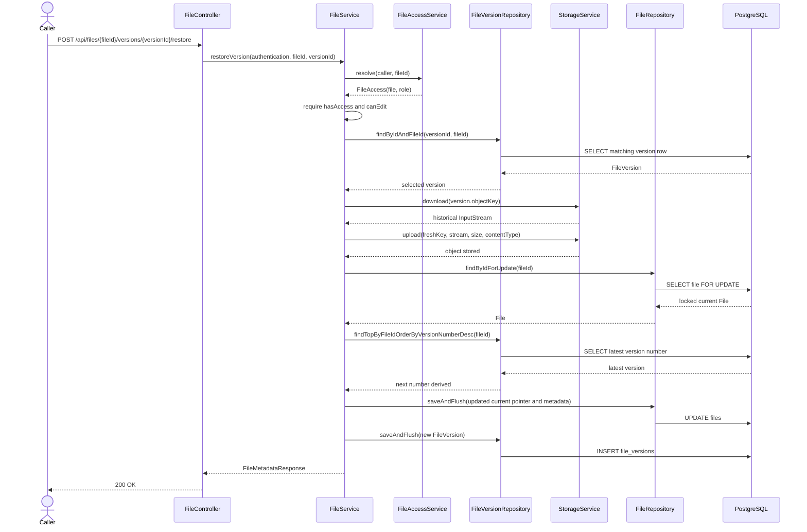

The restore method is `@Transactional` for PostgreSQL work. Historical object read and new object write occur before the file-row lock and outside any storage transaction. If an `IOException` occurs during streaming, it becomes `StorageException`; if the explicit metadata persistence block throws a runtime exception, the service attempts to delete only the just-created restore object. Old objects are not deleted. A transaction commit failure that occurs after the method body returns is outside that inner cleanup catch; source inspection does not prove compensation in that case.

### 7.5 Failure and concurrency

- **Missing version:** the `(versionId, fileId)` repository lookup fails with `ResourceNotFoundException("Version not found")`, mapped by `GlobalExceptionHandler` to 404. A version belonging to another file is indistinguishable from a missing version. A missing file is likewise 404.
- **No access:** the service applies `FileAccessService` checks. History listing returns 403 for a known file with no role; historical download and restore return 404 for no access. Restore also returns 403 for a viewer (read access but no edit role). These are implemented service checks, not controller-only UI restrictions.
- **Object read/write failure:** historical download logs and rethrows `StorageException`; restore wraps stream `IOException` as `StorageException`. The global handler maps `StorageException` to 502. An object failure before metadata writes leaves the database unchanged. A partially completed provider write or cleanup behavior on every adapter-specific failure is not established by source or tests.
- **Database failure after object write:** the multipart replacement/restore code attempts compensating deletion of the new object for runtime failures inside the explicit persistence blocks. Resumable completion catches failures from its `TransactionTemplate.execute` (including transaction completion) and attempts deletion. A failed cleanup can leave an orphan. For multipart transaction-commit failures that occur after the method body returns, the inner catch cannot be assumed to run. None of these flows is atomic across PostgreSQL and object storage.
- **Concurrent update or restore:** replacement and restore serialize the metadata advance by locking the `File` row before reading the latest version number and updating the pointer. `File.rowVersion` is also an optimistic guard for updates that use JPA version checking; lock/optimistic conflicts map to 409. Distinct object keys prevent one attempted update from overwriting another version's object. The final latest version follows the order in which transactions acquire the file lock, not necessarily request start order. The version-focused tests cover ordinary sequential changes, not simultaneous replacement/restore races, so their complete race behavior is unverified. Resumable completion additionally locks its session row, preventing duplicate completion of that same session from recording two versions; that is a separate safeguard from per-file update ordering.

### 7.6 Retention and evidence

Historical version objects are retained on replacement and restoration. File deletion removes the current object's key first, then deletes the file row; PostgreSQL cascades the version rows, but the historical objects are deliberately left in storage. The source explicitly defers historical-object garbage collection/retention policy. This means deleting a file can leave historical objects without version rows; no cleanup job for those objects is present in this flow. The code also assumes each logical version owns its object, and V14 comments defer content-addressed sharing until reference tracking is available.

| Behavior | Source files and methods | Existing tests and evidence |
|---|---|---|
| Version schema and constraints | `backend/src/main/resources/db/migration/V11__create_file_versions.sql`; `backend/src/main/resources/db/migration/V14__phase9_concurrency_idempotency_checksums.sql` | `backend/src/test/java/com/minidrive/repository/FileVersionRepositoryTest.java`: generated ID/timestamp, ordering, duplicate-number rejection, file scoping, aggregate current version. The test schema verifies several persistence rules; the migration itself is the authority for PostgreSQL checks/FKs. |
| Initial upload and replacement | `backend/src/main/java/com/minidrive/service/FileService.java`: `upload`, `replaceContent`, `nextVersionNumber`; `backend/src/main/java/com/minidrive/util/StorageKeys.java` | `backend/src/test/java/com/minidrive/controller/FileVersionControllerTest.java`: first upload is v1, replacements append distinct keys, metadata-only rename creates no version, permissions, storage failure, explicit persistence-failure cleanup. |
| History and download | `backend/src/main/java/com/minidrive/controller/FileController.java`; `backend/src/main/java/com/minidrive/service/FileService.java` (`listVersions`, `downloadVersion`, `requireVersion`); `backend/src/main/java/com/minidrive/mapper/FileVersionMapper.java` (`toResponse`) | `backend/src/test/java/com/minidrive/controller/FileVersionHistoryControllerTest.java`: newest-first metadata without keys, access rules, old-version bytes, cross-file ID rejection, viewer read access. |
| Restore | `backend/src/main/java/com/minidrive/controller/FileController.java` (`restoreVersion`); `backend/src/main/java/com/minidrive/service/FileService.java` (`restoreVersion`); `backend/src/main/java/com/minidrive/repository/FileRepository.java` (`findByIdForUpdate`) | `FileVersionHistoryControllerTest.java`: editor restoration appends a latest row, restored object is distinct, old versions remain downloadable, viewer denied, persistence failure leaves history/pointer intact and attempts cleanup. |
| Upload-completion recording | `backend/src/main/java/com/minidrive/service/UploadSessionService.java`: `complete`, `persistCompletion`; `FileService.persistStoredNewFile`, `persistStoredReplacement` | The version-focused controller tests do not establish concurrent completion or its storage/database failure behavior. Those are implemented in source but remain unverified by the cited version tests. |
| Concurrency and retention | `backend/src/main/java/com/minidrive/repository/FileRepository.java`; `backend/src/main/java/com/minidrive/entity/File.java`; `backend/src/main/java/com/minidrive/service/FileService.java` (`delete`); `backend/src/main/resources/db/migration/V11__create_file_versions.sql` | Repository/controller tests above are sequential. No cited version test demonstrates concurrent updates/restores or orphan-object collection; no historical-object retention/GC job is documented in these paths. |

These statements are source-derived. Existing tests establish the listed controller and repository scenarios when run in their configured test environment; they do not prove PostgreSQL/object-storage atomicity, adapter behavior under partial writes, concurrent update/restore outcomes, transaction-commit compensation for multipart operations, or historical-object garbage collection. Tests were not run for this documentation change, and no runtime behavior is claimed. Unresolved design questions are the retention period and mechanism for deleting historical objects (especially after file deletion), and whether to add reconciliation for objects left behind by partial storage operations or multipart commit failures.

## 8. Resumable Uploads and Session Management

### 8.1 Session and chunk model

`backend/src/main/java/com/minidrive/entity/UploadSession.java` stores one user's declared upload: owner, optional destination `folder`, optional replacement `targetFile`, filename, normalized content type, total size, server-selected chunk size/count, status, creation/update/expiry timestamps, optional create-idempotency key/request hash, and completion result fields. `completedFileId` and `completedVersionNumber` are scalar result references, not a JPA relationship. The final `File` and its `FileVersion` are created only at completion. For a replacement session, `targetFile` identifies the file whose current content will advance; otherwise completion creates a file in the optional folder (or root).

`backend/src/main/java/com/minidrive/entity/UploadChunk.java` stores one accepted chunk's session, zero-based index, byte count, server-computed SHA-256 checksum, private `stagingObjectKey`, and creation time. A row is inserted only after the bytes have been written to object storage. The relationship is `UploadSession` → many `UploadChunk` rows. The final file/version rows are independent metadata created during completion; the completed session records their resulting file ID and version number. After completion, chunk rows are deleted, while the session remains as a completed-result record.

`backend/src/main/java/com/minidrive/entity/UploadSessionStatus.java` declares `INITIATED`, `COMPLETED`, `ABORTED`, and `EXPIRED`. The service's active transitions are `INITIATED → ABORTED` through `UploadSessionService.abort` and `INITIATED → COMPLETED` through `UploadSessionService.persistCompletion`/`UploadSession.markCompleted`. Chunk writes and first-time completion require `INITIATED`. Repeated completion of `COMPLETED` returns the stored result; abort is a no-op for `ABORTED`. `EXPIRED` is an allowed enum/database value but no service transition to it or expiry cleanup job was found. Expiry is currently a timestamp check, not a state transition.

`backend/src/main/resources/db/migration/V12__create_upload_sessions.sql` creates both tables. For sessions it requires owner, filename, content type, nonnegative total size, positive chunk size/count, status, timestamps and expiry; checks status against the four enum strings; cascades owner, folder and target-file deletion; and indexes `owner_id` and `expires_at`. For chunks it requires session, nonnegative index/size, unique staging key and timestamp; cascades session deletion; enforces unique `(session_id, chunk_index)` and unique `staging_object_key`; and indexes `session_id`. `backend/src/main/resources/db/migration/V13__add_upload_session_completion.sql` adds nullable completion fields, a completed-file FK with `ON DELETE SET NULL` (the completed session remains a tombstone if that file is deleted), and a positive-or-null completed version check. `backend/src/main/resources/db/migration/V14__phase9_concurrency_idempotency_checksums.sql` adds `row_version`, optional creation idempotency key/hash, and a partial unique index on `(owner_id, create_idempotency_key)` where the key is non-null. The SQL migrations define runtime PostgreSQL constraints; JPA annotations mirror some uniqueness but do not replace the Flyway schema.

`backend/src/main/java/com/minidrive/repository/UploadSessionRepository.java` supplies owner-scoped lookups, lookup by owner/idempotency key, expiry query, and a `PESSIMISTIC_WRITE` owner-scoped lookup for completion. `UploadChunkRepository.java` finds one index, lists indexes in ascending order, and deletes rows by session. The repository's unique index and the database constraint are the arbiter for concurrent same-index inserts.

### 8.2 API and browser flow

All `/api/uploads` routes in `backend/src/main/java/com/minidrive/controller/UploadController.java` require authentication. `UploadSessionService` resolves the principal to the owner; session reads and mutations use `UploadSessionRepository.findByIdAndOwnerId`, so another user's session is returned as not found. Creation also requires an owned destination folder, or read/edit access to a replacement target; replacement edit access is checked again at completion.

1. **Create.** `POST /api/uploads` calls `UploadController.create` → `UploadSessionService.createSession`. It validates declared metadata, fixes the chunk split server-side, creates an `INITIATED` database row, and returns `UploadSessionResponse` with session ID, chunk split, status, and expiry. The endpoint accepts optional `Idempotency-Key`; the server hashes the normalized request metadata and returns the existing session for the same owner/key/request, rejects key reuse with different metadata, and resolves concurrent key creation through the unique index. The current frontend API's `createUploadSession` does not supply that header.
2. **Read status.** `GET /api/uploads/{sessionId}` calls `getStatus`, which reads sorted chunk indexes from `UploadChunkRepository.findBySessionIdOrderByChunkIndexAsc`. `UploadSessionStatusResponse.uploadedChunks` is the backend's persisted resume map; clients derive missing indexes from it. `getStatus` does not itself reject an expired timestamp or change the state.
3. **Send chunks.** `PUT /api/uploads/{sessionId}/chunks/{index}` accepts raw `application/octet-stream` and calls `ingestChunk`. The service checks owner, `INITIATED` state, expiry and bounds; reads exactly the expected length; computes SHA-256; uploads bytes to `_uploads/{ownerId}/{sessionId}/{index}` through `StorageService`; and then inserts `UploadChunk`. These are staging objects, not final file objects. Distinct indexes can be uploaded in parallel.
4. **Resume and retry.** `frontend/src/hooks/useResumableUpload.ts` exposes `start`, `resume`, `resumeLatest`, `finalize`, `pause`, `cancel`, and stored-session controls around `frontend/src/uploads/resumableUpload.ts`. `frontend/src/api/uploads.ts` maps the controller routes. `frontend/src/uploads/resumeStore.ts` stores only session/file metadata in browser local storage, not bytes or auth tokens. After refresh, the user reselects the file; `ResumableUploadClient.resumeRun` checks file association and local expiry, fetches authoritative server status, then schedules only missing chunks. The client defaults to at most three concurrent chunk requests and five attempts per chunk, with bounded backoff; these are client defaults, not server limits. On ambiguous retryable failures it refreshes server status before resending.
5. **Complete.** `POST /api/uploads/{sessionId}/complete` calls `UploadSessionService.complete`. It plans the operation in a database transaction, streams staged chunks in index order into a fresh final object, then uses a second transaction to persist the file/current pointer, `FileVersion`, and completed session result. It then best-effort deletes staging objects and chunk rows. The final object key follows the normal content-object key helper; staging keys stay under `_uploads/`. A new file gets version 1; a replacement appends the next version.
6. **Delete and expiry.** `DELETE /api/uploads/{sessionId}` calls `abort`: for an `INITIATED` session it deletes known staging objects, deletes chunk rows, and stores status `ABORTED`; repeated abort is a no-op. Expired sessions can still be aborted because the abort rule checks status, not expiry. The service sets `expiresAt` 24 hours after creation and refuses chunk writes/completion after that time, but no scheduler or automatic cleanup uses `findByExpiresAtBefore`. Local `ResumeStore.list` prunes expired browser records only; it does not delete server rows or objects.

`backend/src/main/java/com/minidrive/storage/StorageService.java` is the service-facing object API. `RoutingStorageService` is the wired implementation that maps staging/final keys to storage nodes; upload-session code does not call node clients directly. The storage adapter may maintain its own object-location metadata, separate from the PostgreSQL upload-session/chunk rows described here.

### 8.3 Chunk validation and limits

- `UploadSessionService` caps declared file size at **5 GiB**, fixes chunk size at **5 MiB**, and caps derived chunks at **10,000**. Given the file-size cap, the practical maximum from this split is 1,024 chunks; the explicit 10,000 guard remains in code. A zero-byte upload is represented by one empty chunk.
- Each non-final chunk must be exactly 5 MiB; the final chunk must equal the remaining declared bytes. The service rejects missing, short, and oversized bodies. It buffers no more than the expected chunk size while reading, and checks for overrun before appending more bytes.
- Chunk indexes are zero-based and must satisfy `0 <= index < totalChunks`; PostgreSQL also checks nonnegative indexes. Completion requires exactly `totalChunks` rows in ascending gap-free order, matching expected sizes and total declared size.
- The session's content type is trimmed, any `;` parameters are stripped, and the base value must match the service's `type/subtype` token pattern. Filename is trimmed, required, at most 255 characters, rejects path separators and `.`/`..`. The request DTO also validates nonblank filename/content type and nonnegative required size; the service enforces the upper size bound. Chunk requests use `application/octet-stream` at the controller boundary.
- The server computes SHA-256 for each chunk and verifies the staged bytes against the persisted checksum during assembly. The raw chunk checksum column is nullable in V12, although this implementation writes it. The whole assembled stream is also hashed for the final file/version.
- Optional session-creation idempotency keys are trimmed and must be 1–200 characters. Reuse by the same owner with matching normalized request metadata returns the existing session; reuse with a different request is rejected. The key is optional, and the frontend wrapper does not currently send it.
- Every session lookup is owner-scoped. New-file folder ownership is validated at creation. Replacement requires edit permission at creation and is rechecked at completion to catch revoked access. Session expiration is 24 hours; chunk ingest and first-time completion reject expired sessions. Status lookup and abort do not perform that expiry rejection.

### 8.4 Sequence: create, stage, resume, and complete

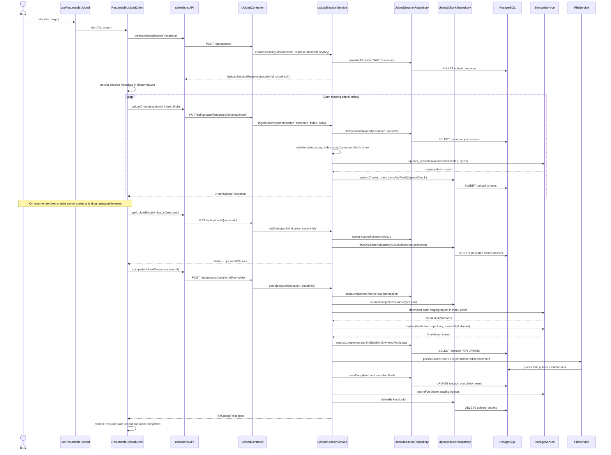

The sequence separates object bytes from PostgreSQL metadata: chunk bytes are staged before each chunk row; final bytes are stored before file/version/session persistence; cleanup follows successful completion. Storage and PostgreSQL do not share a transaction.

### 8.5 Failure handling and concurrency

- **Chunk upload fails or is retried:** body/index/state/expiry checks run before object write. If storage reports failure, no chunk row is inserted. If the explicit chunk-row persistence fails after storage succeeds, `persistChunk` attempts to delete the staging object. For the same index, the key is deterministic and the unique `(session_id, chunk_index)` row makes an ordinary same-payload retry return `duplicate=true`; concurrent insert conflict is reconciled by finding the winning row. However, the service writes to the deterministic key before checking whether that row already exists and does not compare a retry's checksum with the existing row. A same-size retry with different bytes can therefore overwrite staging while leaving the earlier checksum in PostgreSQL; completion's checksum verification then rejects that staged content. This is a source-derived edge case, not a tested retry contract.
- **Interrupted/resumed upload:** the browser record is only a hint; the client re-fetches server status and skips indexes the server reports. If a retryable response is ambiguous, the client refreshes status before re-sending. If a request reached storage but its chunk-row insert did not persist, status omits the chunk and the client may resend it. The session is resumable only until expiry or abort, and only while the server session still exists.
- **Missing/duplicated chunk:** missing indexes make completion fail before writing final file metadata. A duplicate database row for one index is prevented by the unique constraint; same-index retries are represented as one row. Completion checks row count, consecutive indexes, expected per-index byte counts, and total bytes. A chunk checksum mismatch during assembly raises a validation failure and prevents completion.
- **Repeated completion:** after success, the completed session stores file ID and version number; another completion returns that recorded result without creating another file/version. If the returned file was later deleted, V13 leaves a completed tombstone with `completed_file_id = NULL`; a repeat returns not found rather than recreating it.
- **Invalid index or data:** out-of-range indexes, wrong byte counts, and invalid session state/expiry are rejected before staging write. Controller media-type mismatch is rejected at the endpoint boundary. Service argument errors map through the global handler to HTTP 400. Session ownership failures resolve as 404; unauthenticated API requests are rejected by security.
- **Storage succeeds but PostgreSQL persistence fails:** chunk insertion failure triggers best-effort deletion of the staging object; completion transaction failure triggers best-effort deletion of the newly written final object and leaves the session available for retry if PostgreSQL rolled back. Cleanup failures are logged/suppressed, so orphan objects remain possible. A storage adapter that partially writes and then throws before returning can leave an unindexed staging/final object; the source does not establish provider-level rollback. Abort deletes storage first and then changes rows/status in a PostgreSQL transaction; a later database failure can leave rows referring to objects already deleted.
- **Two completion attempts:** the session row lock in `findByIdAndOwnerIdForUpdate` serializes persistence. The winner commits file/version/session together; a later waiter sees `COMPLETED` and returns the recorded result. If both attempts already wrote separate final objects, the losing attempt deletes its unused object. If assembly races with the winner's staging cleanup, the losing attempt tries the completed-result lookup after failure. `UploadCompletionControllerTest` has a simultaneous-completion scenario; this supports that tested path, not a claim of global exactly-once execution across clients, processes, or object storage.
- **Expiry or deletion:** expiry causes chunk ingest and first-time completion to reject with a client error, but status can still return `INITIATED`, and there is no server expiry sweep that marks `EXPIRED` or removes its objects/rows. The owner can explicitly DELETE an initiated session; abort removes known staging objects before deleting chunk rows and setting `ABORTED`. Storage deletion failure aborts the method before metadata changes, leaving the session retryable. Cleanup after storage deletion but before transaction commit is not atomic. No concurrent abort-vs-chunk guarantee is established by the inspected code.

### 8.6 Source and test map

| Behavior | Source files and methods | Existing tests and what they cover |
|---|---|---|
| Session/chunk schema and lookups | `backend/src/main/resources/db/migration/V12__create_upload_sessions.sql`, `backend/src/main/resources/db/migration/V13__add_upload_session_completion.sql`, `backend/src/main/resources/db/migration/V14__phase9_concurrency_idempotency_checksums.sql`; `backend/src/main/java/com/minidrive/entity/UploadSession.java`, `backend/src/main/java/com/minidrive/entity/UploadChunk.java`, `backend/src/main/java/com/minidrive/entity/UploadSessionStatus.java`; `backend/src/main/java/com/minidrive/repository/UploadSessionRepository.java`, `backend/src/main/java/com/minidrive/repository/UploadChunkRepository.java` | `backend/src/test/java/com/minidrive/controller/UploadControllerTest.java`: H2 create-drop persistence scenarios including owner isolation, idempotent creation, unique chunk indexes and ordering. Flyway is disabled in the test profile, so this test does not execute the SQL migrations or establish production PostgreSQL behavior. |
| Create, status, chunk validation/ingest, abort | `backend/src/main/java/com/minidrive/controller/UploadController.java`; `backend/src/main/java/com/minidrive/service/UploadSessionService.java` (`createSession`, `getStatus`, `ingestChunk`, `persistChunk`, `abort`) | `backend/src/test/java/com/minidrive/controller/UploadControllerTest.java`: server split/zero-byte/size limits, metadata validation, owner checks, out-of-order indexes, bounds and size rejection, duplicate and concurrent chunk requests, abort, storage failure, and DB-persistence cleanup. |
| Frontend API, resume, retries, local state | `frontend/src/hooks/useResumableUpload.ts`; `frontend/src/api/uploads.ts`; `frontend/src/uploads/resumableUpload.ts`; `frontend/src/uploads/resumeStore.ts` | `frontend/src/api/uploads.test.ts`: route/body/media type and typed error mapping; `frontend/src/uploads/resumableUpload.test.ts`: skip-stored chunks, retry/reconcile, pause/resume, invalid association/expiry, finalization retries and same-client coalescing; `frontend/src/uploads/resumeStore.test.ts`: local persistence, expiration pruning and absence of token persistence. |
| Completion and consistency | `backend/src/main/java/com/minidrive/service/UploadSessionService.java` (`complete`, `buildCompletionPlan`, `persistCompletion`, `requireCompleteChunkSet`, `assemble`, `removeStaging`); `backend/src/main/java/com/minidrive/service/FileService.java` (`persistStoredNewFile`, `persistStoredReplacement`); `backend/src/main/java/com/minidrive/util/StorageKeys.java` | `backend/src/test/java/com/minidrive/controller/UploadCompletionControllerTest.java`: assembly order/checksum, missing/incorrect chunks, initial/replacement version result, repeated and concurrent completion, final-write/persistence failures, staging cleanup, expiry, abort, owner checks and replacement permission recheck. |
| Storage routing | `backend/src/main/java/com/minidrive/storage/StorageService.java`; `backend/src/main/java/com/minidrive/storage/RoutingStorageService.java` | The upload-session tests use the configured test storage setup; they do not verify partial writes or every real storage-provider failure mode. |

This section is based on source and test inspection. The cited tests describe scenarios and assertions but were not run for this documentation change. The implementation does not demonstrate atomic commits spanning storage and PostgreSQL. Unverified risks include partial provider writes, orphan cleanup after adapter failures, abort racing with an in-flight chunk, expiry cleanup (none is implemented), and correctness of differing-payload same-index retries under concurrency. The client-side local resume record can also become stale; server status remains authoritative. No exact-once guarantee beyond the tested same-session completion behavior is claimed.

## 9. Redis Caching and Invalidation

> **Scope.** This section describes the owner-scoped file listing cache only. Paths are repository-relative. The implementation and cited tests were inspected, not executed as part of this documentation update; this is not runtime verification.

### 9.1 Components and boundaries

- `backend/src/main/java/com/minidrive/service/FileListingCache.java` is the read-through coordinator. It uses Spring's `CacheManager` cache named `file-listings`, obtains a generation from `ListingCacheGeneration`, and falls back to `FileRepository` plus `FileVersionRepository` on a miss or cache failure. `FileMapper.toResponse` builds `dto/file/FileResponse` listing summaries. The value is a mutable `ArrayList<FileResponse>` because that is a supported root shape for the configured serializer.
- `backend/src/main/java/com/minidrive/service/ListingCacheGeneration.java` stores one opaque UUID token in Redis at `minidrive:cache:file-listings:generation`, using `StringRedisTemplate`; it is a marker, not a cached listing. A GET followed by atomic `SET NX` initializes a missing marker. Concurrent initializers adopt the winner's token. `advance()` replaces it with a fresh UUID through one Redis `SET`.
- `backend/src/main/java/com/minidrive/config/CacheConfig.java` provides `RedisCacheManager`, JSON value serialization with a polymorphic-type allowlist, prefix `minidrive:cache:`, a 60-second default entry TTL, and disabled null caching. The generation marker bypasses the JSON cache serializer through `StringRedisTemplate`. `backend/src/main/resources/application.yml` selects Redis and configures its host and port; it has no local-cache fallback. `infra/docker-compose.yml` configures the provided Redis service with a 256 MB maximum and `allkeys-lru` eviction policy.
- `backend/src/main/java/com/minidrive/controller/FileController.java` exposes `GET /api/files?folderId=...` and `GET /api/folders/{folderId}/files`, returning `List<FileResponse>`. Both delegate to `FileService.listInFolder` or `FileService.listInOwnedFolder` in `backend/src/main/java/com/minidrive/service/FileService.java`. Those methods resolve the authenticated user and, for folder listings, verify folder ownership before calling the cache. `FileListingCache` itself does not authorize.
- PostgreSQL remains authoritative: the cache miss queries `FileRepository.findByOwnerIdAndFolderIdIsNull` or `findByOwnerIdAndFolderId`, then gets current versions in one batch through `FileVersionRepository.findCurrentVersions`. Redis contains only the returned DTO summaries. Shared files are not included: the repository query is restricted to the owner, not permissions or share links.

The Redis cache key after Spring's prefixing is `minidrive:cache:file-listings::<owner UUID>:<folder UUID or root>:<generation UUID>`. The generation marker key has one global namespace across owners/folders, so mutation invalidation is deliberately coarse. Older listing entries are not individually deleted; they are unreachable through the current generation and expire by TTL or Redis eviction.

### 9.2 Listing request: authorization, hit, and miss

For either listing endpoint, Spring Security's JWT filter authenticates the request before the controller. The controller passes the resulting `Authentication` to `FileService`. `FileService.currentUser` resolves the principal's user; a folder request also calls `getOwnedFolder` before the cache is invoked. Root listing has no folder check. Therefore the current identity and relevant folder ownership check precede both generation lookup and cache read. A cache hit cannot grant access to a folder whose ownership check now fails.

`FileListingCache.findOwnedFileSummaries(ownerId, folderId)` reads the generation exactly once. If `ListingCacheGeneration.current()` cannot provide a token (for example, Redis throws), the service queries PostgreSQL and skips cache read/write. Otherwise it forms the owner/folder/generation key and attempts a cache read. A hit returns the cached `List<FileResponse>` directly. On miss, an unavailable cache, or a read/deserialize exception, it loads the owner-scoped rows from PostgreSQL, batches version lookup and maps the results, then attempts to store them under the same key. A write failure is logged and the already-loaded database result is still returned.

This is fail-open at the service boundary for `RuntimeException` failures in generation lookup, cache resolution/read/write, and generation advance. It does not switch to an in-process cache. PostgreSQL fallback can itself fail normally; the fail-open policy does not mask database errors. The listing JSON is passed through Spring Data Redis's `GenericJacksonJsonRedisSerializer`; the mutable collection root is intentional, while the DTO contains the file fields used by the response (no storage object key).

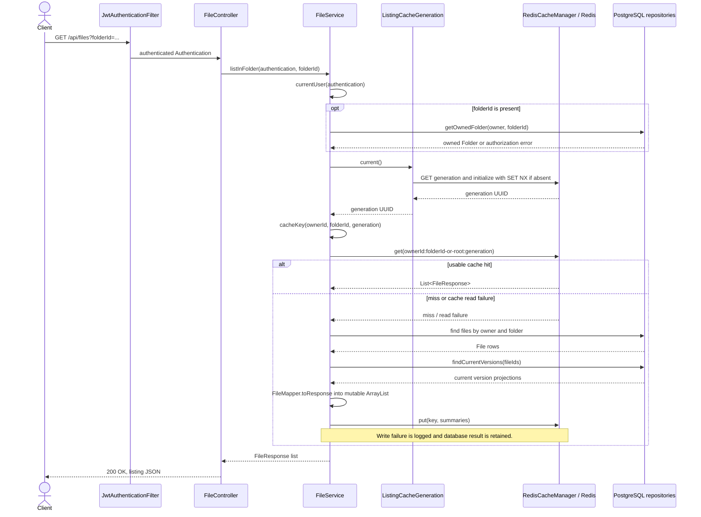

The generation lookup itself can race with an advance after the token has been read. The lookup is intentionally not repeated before writing: the request writes under the token it originally observed. Thus a delayed pre-mutation reader cannot populate the new namespace with its old snapshot. If generation lookup fails entirely, the path avoids Redis for the listing and uses PostgreSQL directly.

### 9.3 Invalidation after mutations

`FileService` calls `FileListingCache.evictAfterCommit()` for file metadata creation and upload, metadata update (including rename/move), content replacement, stored-file persistence used by resumable completion, restore, and deletion. These operations can change a field or membership represented in `FileResponse`. `FolderService.delete` also invalidates because the database cascades deletion to files in the folder tree. Folder creation/rename do not change the file-summary query result. Permission and share-link changes do not affect this owner-only listing and leave this cache alone.

Inside an active transaction, `evictAfterCommit()` registers a Spring `TransactionSynchronization.afterCommit()` callback. It advances the generation only after PostgreSQL commit. A rollback does not run that callback, so the generation stays as it was. Without active transaction synchronization the method advances immediately. This is a post-commit callback in the code, not an outbox, background job, or database transaction hook.

Changing the generation makes all old keys unreachable to later requests. This avoids clearing every entry and prevents a request holding an old generation from writing into the current namespace after it completes. The old keys remain in Redis until their TTL expires or eviction removes them. If generation advance fails after commit, the method logs and suppresses the Redis exception; the old token remains current, so old entries can continue to be served until their 60-second TTL expires, unless Redis evicts them sooner. Therefore post-commit invalidation is attempted but cannot be guaranteed while Redis is unavailable.

The Compose Redis configuration uses `allkeys-lru`, meaning Redis may evict any key, including the generation marker. If `ListingCacheGeneration.current()` finds the marker missing, it creates a fresh random UUID with `SET NX`. Old keys under previous UUIDs then form a cold, unreachable namespace rather than becoming current again; random-token uniqueness makes accidental reuse extraordinarily unlikely, not mathematically impossible. A listing key evicted independently is just a miss. The 60-second TTL bounds the lifetime of listing entries but does not set a TTL on the generation marker. Redis eviction policy, server availability, and successful post-commit token writes are operational dependencies of prompt invalidation.

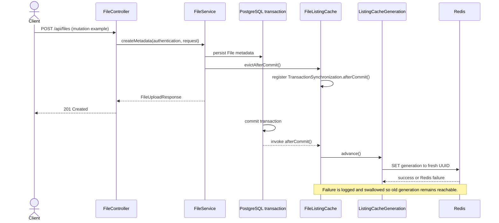

The diagram shows the service's transaction-scoped callback registration and the framework invoking it after commit. The database does not call Redis as part of its commit, and Redis generation change is not atomic with the PostgreSQL commit.

### 9.4 Correctness and failure limits

- **Normal mutation path:** if the database commits and the subsequent Redis generation advance succeeds, later listing requests use the new namespace and reload changed rows. A read already underway may return the snapshot it loaded, but it writes only under its originally-read generation; later requests do not consult that entry.
- **Redis unavailable:** listing generation/read failures fall back to PostgreSQL; write failures do not replace the already computed answer. A committed mutation still succeeds when generation advance fails, but cached entries remain reachable under the old token until TTL expiry or eviction. Fail-open preserves request availability and database authority, not immediate freshness during an outage.
- **Generation marker eviction:** a fresh UUID is initialized atomically; requests after initialization use a cold namespace, so old entries do not revive. If Redis is unavailable at lookup, no cache operation is attempted for that listing. If marker eviction/reinitialization overlaps an operation that already read the old token, that operation may still write to an old key, which remains unreachable while the new marker persists.
- **Concurrent operations:** atomic `SET NX` makes concurrent initializers converge on the winner. `advance()` uses a fresh UUID and one Redis `SET`; concurrent advances leave some fresh generation as current. Readers use one token per call, preventing a stale database result from being written under a separately re-read newer token. This does not make Redis and PostgreSQL atomic, serialize all reads against commits, or guarantee that a request overlapping a commit observes the latest state.
- **Rollback:** because invalidation is registered with `afterCommit`, rollback leaves the current cache namespace intact. A database exception that aborts a transaction before commit does not cause this callback to run. Methods called without active transaction synchronization advance immediately, so that particular call path does not have rollback deferral.
- **Serialization:** cache read exceptions, including Redis/JSON deserialization runtime failures, are treated as misses and use PostgreSQL; cache write/serialization exceptions are logged and the database result is returned. The configured type allowlist limits class reconstruction, and mutable `ArrayList` roots are used to avoid the documented immutable-root round-trip limitation. A malformed value that happens to deserialize as a `List` is cast without validating every element's type; no separate repair/deletion mechanism exists for such content. Persistent Redis/serializer incompatibility can therefore cause repeated database fallback.

Potential Redis outage windows, unusual concurrent timelines, and malformed list contents above are source-derived risks/limits; this document does not claim they were reproduced in a running deployment. The cache tests listed below provide specific behavioral assertions, not proof of all distributed interleavings.

### 9.5 Evidence and existing tests

| Behavior | Source files and important methods | Existing tests and what they establish |
|---|---|---|
| Endpoint ordering and authorization | `backend/src/main/java/com/minidrive/controller/FileController.java` (`list`, `listInFolder`); `backend/src/main/java/com/minidrive/service/FileService.java` (`listInFolder`, `listInOwnedFolder`, `currentUser`, `getOwnedFolder`) | `backend/src/test/java/com/minidrive/cache/FileListingCacheTest.java` (`anotherUsersFolderIsRejectedBeforeTheCacheIsEverConsulted`, `cachedOwnerListingIsNotServedOnceTheFolderIsNoLongerAccessible`): with the test cache doubles, verifies folder authorization is applied before generation/cache interaction and an inaccessible folder does not receive a cached answer. |
| Key dimensions, hit/miss and database summary construction | `backend/src/main/java/com/minidrive/service/FileListingCache.java` (`findOwnedFileSummaries`, `cacheKey`, `load`, `toSummaries`); `backend/src/main/java/com/minidrive/repository/FileRepository.java`; `backend/src/main/java/com/minidrive/repository/FileVersionRepository.java`; `backend/src/main/java/com/minidrive/mapper/FileMapper.java`; `backend/src/main/java/com/minidrive/dto/file/FileResponse.java` | `FileListingCacheTest.java` (`initialRequestPopulatesTheCacheUnderAnOwnerAndFolderKey`, `repeatedRequestIsServedFromCacheWithoutRequeryingTheDatabase`, `differentUsersNeverReceiveEachOthersCachedEntries`, `differentFoldersAndTheRootListingDoNotCollide`): asserts population, reuse without a second file query, and user/folder/root isolation. |
| Mutation invalidation and transaction boundary | `backend/src/main/java/com/minidrive/service/FileListingCache.java` (`evictAfterCommit`, `advanceQuietly`); `backend/src/main/java/com/minidrive/service/FileService.java` (mutation call sites); `backend/src/main/java/com/minidrive/service/FolderService.java` (`delete`) | `FileListingCacheTest.java` (`creatingAFileInvalidatesTheCachedListing`, `renamingAndMovingAFileInvalidatesTheCachedListing`, `replacingContentInvalidatesTheCachedListing`, `deletingAFileInvalidatesTheCachedListing`, `deletingAFolderInvalidatesTheCachedListingOfItsFiles`, `evictionIsDeferredUntilTheTransactionCommitsAndSkippedOnRollback`, `evictionWithoutATransactionAdvancesImmediately`, `delayedReaderUnderAnOldGenerationCannotRepopulateTheCurrentGeneration`): covers tested mutation examples, commit/rollback timing, immediate no-transaction path, and one delayed-reader race. |
| Generation initialization, sharing and eviction | `backend/src/main/java/com/minidrive/service/ListingCacheGeneration.java` (`current`, `advance`) | `backend/src/test/java/com/minidrive/cache/ListingCacheGenerationTest.java` (`currentInitializesAnOpaqueTokenOnceAndReusesIt`, `twoInstancesSharingRedisAgreeOnOneGeneration`, `anAdvanceByOneInstanceIsImmediatelyVisibleToAnother`, `anEvictedMarkerOpensANewNamespaceInsteadOfRecyclingTheOldToken`, `aLosingAtomicInitializationAdoptsTheWinnersToken`): exercises these token semantics with mocked Redis operations. |
| Fail-open behavior | `backend/src/main/java/com/minidrive/service/FileListingCache.java` (`currentGenerationOrNull`, `resolveCache`, `read`, `write`, `advanceQuietly`) | `FileListingCacheTest.java` (`redisOutageFailsOpenAndIsLogged`, `failedMutationLeavesTheCacheUntouched`): asserts the tested simulated Redis failure falls back to a listing result and does not make mutation failure solely due to cache advance. |
| Serializer and actual Redis key/TTL integration | `backend/src/main/java/com/minidrive/config/CacheConfig.java` (`redisJsonSerializer`, `cacheDefaults`, `cacheManager`); `backend/src/main/java/com/minidrive/service/FileListingCache.java` (`write`); `backend/src/main/java/com/minidrive/service/ListingCacheGeneration.java` (`GENERATION_KEY`) | `backend/src/test/java/com/minidrive/config/CacheConfigurationTest.java`: asserts JSON/concrete-type round trips, type allowlist, prefix, 60-second TTL, null policy, and immutable-root limitation. `backend/src/test/java/com/minidrive/cache/FileListingCacheSerializationTest.java`: checks listing DTO fields and mutable-root serialization shape. `backend/src/test/java/com/minidrive/cache/FileListingCacheRedisIntegrationTest.java`: when a Redis server is reachable, checks real Redis JSON, TTL, namespaced keys, hit reuse, and generation change after mutation; its setup explicitly skips if Redis is unreachable. |

Source references above were checked. The test descriptions report their named assertions and do not claim those tests were run or passed here. The Redis integration test's server-dependent behavior is not established unless that test is actually executed against Redis.

## 10. Distributed Storage: Routing, Replication, Fallback, and Healing

> **Scope.** This section follows object storage through the storage interface, routing implementation, PostgreSQL routing metadata, and MinIO clients. It describes code and checked-in tests, not runtime observations.

### 10.1 Storage architecture and wiring

- `backend/src/main/java/com/minidrive/storage/StorageService.java` is the application-facing contract: `upload`, `download`, and `delete`. `FileService`, `UploadSessionService`, and `ShareLinkService` inject this interface instead of a concrete provider.
- `backend/src/main/java/com/minidrive/storage/RoutingStorageService.java` is the production `@Service` implementing that contract. It routes objects, records primary locations through `JdbcTemplate`, optionally writes and validates replicas, performs fallback reads, exposes `repairOnce()`, and hosts scheduled repair and health-probe methods. Its Spring constructor receives the `storageNodeClients` map, `StorageNodeSelector`, `MeterRegistry`, and configuration flags.
- `backend/src/main/java/com/minidrive/storage/StorageNodeSelector.java` is the selector interface; `backend/src/main/java/com/minidrive/storage/StableStorageNodeSelector.java` is its `@Component` implementation. In replication-disabled mode, `select(objectKey, nodeIds)` sorts IDs, hashes the object key with SHA-256, and uses a stable index into that sorted set. Reordering the input collection therefore does not change placement. It is deterministic placement, not health-aware placement or replica selection.
- `backend/src/main/java/com/minidrive/config/StorageConfig.java` enables `StorageNodeProperties` and creates the `storageNodeClients` bean. It builds a `MinioClient` and `NodeStorageClient` for each enabled node, validates IDs and required fields, and rejects an empty enabled-node map. If no nodes are configured, it synthesizes a single enabled `primary` from the `minio.*` defaults.
- `backend/src/main/java/com/minidrive/storage/StorageNodeProperties.java` binds `minidrive.storage.nodes`; each node has `id`, `endpoint`, credentials, bucket, and `enabled`. The node list passed to `RoutingStorageService` contains only enabled nodes.
- `backend/src/main/java/com/minidrive/storage/NodeStorageClient.java` wraps MinIO `putObject`, `getObject`, `removeObject`, and `bucketExists`. Node operations throw `exception/StorageException` on provider exceptions; `isHealthy()` reports whether the configured bucket check succeeds.
- `backend/src/main/java/com/minidrive/storage/SiloStorageService.java` is a separate direct MinIO implementation of `StorageService`. It is not annotated as a Spring bean and has no production main-source references. Its only main-source role is absent; the checked reference is `backend/src/test/java/com/minidrive/integration/SiloStorageServiceRealMinioLiveTest.java`, which constructs it directly for an opt-in live MinIO test. The Spring application wires `RoutingStorageService`, not `SiloStorageService`.
- `backend/src/main/resources/db/migration/V15__create_object_locations.sql` creates `object_locations(object_key, storage_node_id, created_at)` and seeds legacy file-version object keys and resumable staging keys as located on `primary`. `backend/src/main/resources/db/migration/V16__create_object_replicas.sql` creates one `(object_key, storage_node_id)` record per expected copy, with `PENDING`, `HEALTHY`, or `FAILED` status, size, SHA-256 checksum, attempt count, last error, retry time, verification time, and update time. The `(status, next_attempt_at)` index supports repair lookup. These tables are accessed directly with `JdbcTemplate`, not JPA repositories.
- `backend/src/main/java/com/minidrive/exception/StorageException.java` is a runtime exception wrapped around storage errors. `backend/src/main/java/com/minidrive/exception/GlobalExceptionHandler.java` maps it to HTTP 502 with a generic storage error body.

`backend/src/main/resources/application.yml` sets `minidrive.storage.replication.enabled` from `MINIDRIVE_REPLICATION_ENABLED`, default `false`; `primary-node-id` defaults to `primary`; and `repair-delay-ms` defaults to `30000`. It configures `primary` as enabled by default and `secondary` as disabled by default (`MINIO_SECONDARY_ENABLED:false`). Therefore, **replication and the secondary node are disabled by default**. The health-probe delay is read by code from `minidrive.storage.health-check-delay-ms`, default `15000`; no override is present in the inspected `application.yml`. `MiniDriveApplication` enables scheduling, so the annotated methods are scheduled when the application is running.

When replication is disabled, `uploadLegacy` first reuses an existing `object_locations` row or chooses a node with `StableStorageNodeSelector`, inserts the location with `ON CONFLICT DO NOTHING`, re-reads the winning row, then uploads to that node. Concurrent first inserts therefore use the row that won the database uniqueness conflict. There is no storage health filtering in this selection path. When replication is enabled, the selector is not used for placement: `upload` stages the full input in a temporary file, checks its byte count against `size`, calculates SHA-256, sets `object_locations` to the configured primary, writes and verifies the primary copy, then tries each other enabled node.

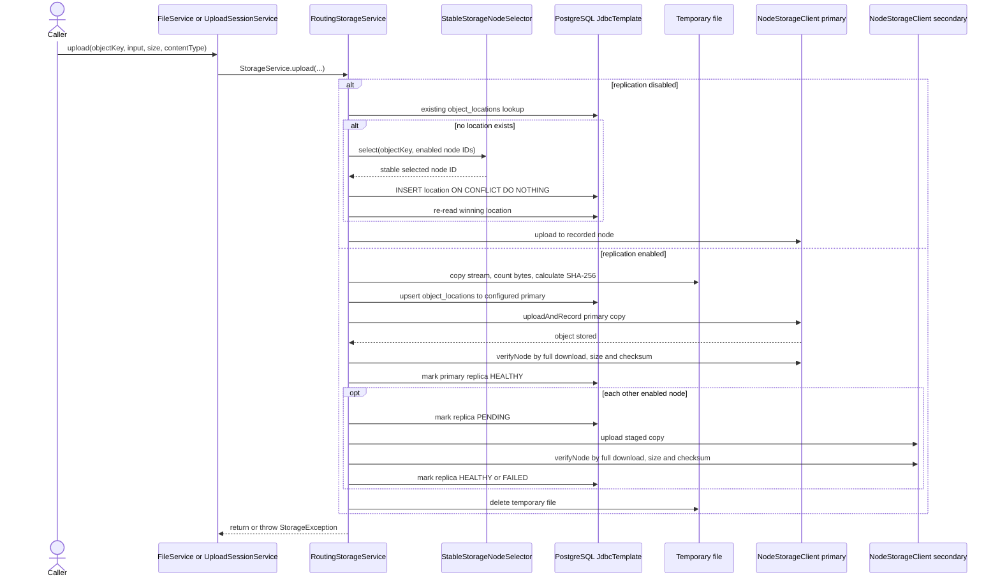

In replication mode, secondary failures are caught by `replicate` and normally recorded as `FAILED`, allowing the primary upload to return successfully with a degraded copy set. A failure while staging, uploading/verifying the primary, or persisting primary replica state escapes the write call. The staging file is deleted in `finally`; no compensating object deletion is performed inside `RoutingStorageService.upload` for a primary object that was written before a later metadata error. Higher-level callers such as `FileService.upload` may attempt cleanup when their later file/version persistence fails, but that is outside the router and is not an atomic transaction with MinIO.

### 10.2 Read routing and fallback

`RoutingStorageService.download(key)` always begins with the `object_locations` row. With replication disabled, it downloads from exactly that node and has no alternate-copy attempt or checksum verification. A missing location throws `StorageException`.

With replication enabled, it first queries `object_replicas` for one `HEALTHY` row to obtain expected size and checksum, then reads the primary ID from `object_locations`. It tries the recorded primary first. `validatedDownload` downloads the whole object to a temporary file, computes byte count and SHA-256, and returns a stream over that local file only after both values match. A mismatch is marked `FAILED`; download or verification failure also causes the primary attempt to fail. The router then checks other configured nodes, excluding the primary, for a `HEALTHY` per-object replica row and tries each eligible copy through the same full verification. `NodeStorageClient.isHealthy()` is not consulted by this per-object fallback eligibility query; the health gauge and replica metadata are separate signals. A successful fallback is counted and returned. If all eligible copies fail, it throws `StorageException("No valid storage copy is available for object ...")`; the global handler maps that exception to 502.

The expected size/checksum is derived from an existing `HEALTHY` replica row, not from `FileVersion`. If there is no such row, `expectation(key)` returns `null`; the replication read path does not synthesize an expectation from file metadata. In particular, V15 seeds locations but V16 does not seed replica checksums for pre-existing objects. Enabling replication for existing data therefore has a source-visible compatibility gap until healthy replica records are created by some other supported path; no bulk bootstrap is implemented in these classes.

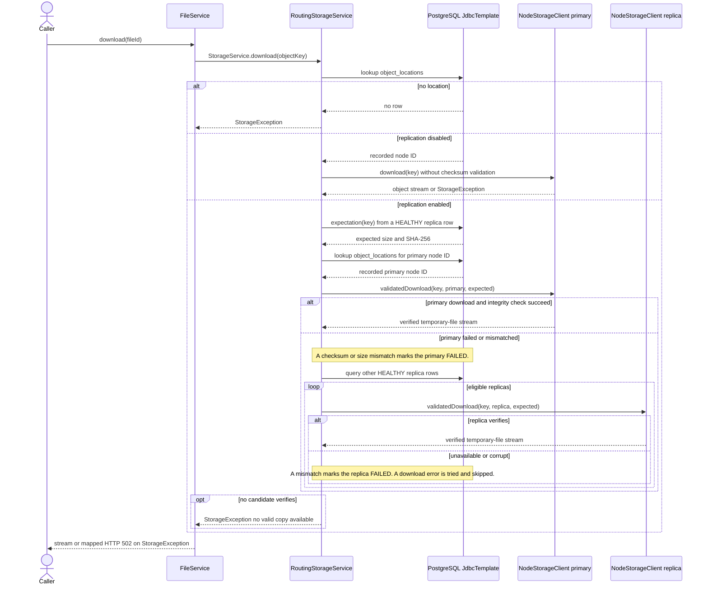

### 10.3 Replication, health probes, and repair

In enabled mode, `uploadAndRecord` writes a copy, downloads it again with `verifyNode`, then calls `mark(..., "HEALTHY", ...)`. `mark` updates the `(object_key, storage_node_id)` row or inserts it if absent, increments `attempt_count`, records errors/retry time for non-healthy states, and records `verified_at` for healthy state. `replicate` first marks a secondary `PENDING`; on failure it calls `markFailure`, which records `FAILED`, the current expected checksum when available, and `next_attempt_at` 30 seconds in the future. The 30-second retry backoff is hard-coded in `mark`, separate from the scheduled scan delay.

`RoutingStorageService.scheduledRepair()` runs `repairOnce()` at `minidrive.storage.replication.repair-delay-ms`, default 30,000 ms. A pass selects at most 100 `object_replicas` rows whose status is not `HEALTHY` and whose retry time is null or due. A process-local concurrent set suppresses duplicate work for the same object/node inside one service instance. `heal` finds another row for the object with status `HEALTHY`, marks the target `PENDING`, downloads and verifies that source, stages the bytes, uploads the target, verifies it, and records it `HEALTHY`; failures are recorded and counted. This scan does not discover a missing replica row and does not require `NodeStorageClient.isHealthy()` before attempting repair. It learns whether a target is usable through the storage operation and subsequent verification.

`probeStorageNodes()` runs every `minidrive.storage.health-check-delay-ms`, default 15,000 ms, and calls each configured node's `isHealthy()` to update a `minidrive_storage_node_health` gauge (`-1` initially, then `1` or `0`). This probe does not update `object_replicas`, block routing, or itself trigger repair. A recovered node's gauge can change to healthy, while a failed per-object row remains eligible for a later scheduled repair after `next_attempt_at`; the repair attempt then tests the node by writing and verifying an object. The scheduler and gauge are enabled in application code, but the repair pass immediately returns zero when the replication flag is false.

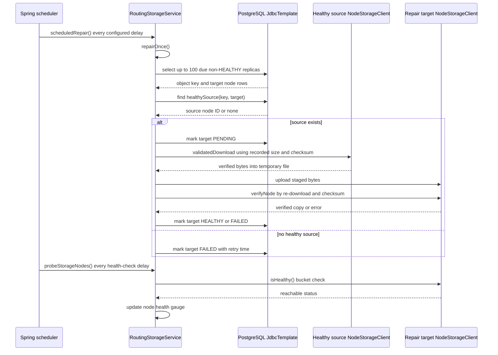

### 10.4 Failure behavior, test evidence, and limits

The table separates code behavior from what the checked-in tests assert. Inferred risks are not represented as reproduced failures.

| Case | Implemented behavior | Existing test evidence | Risk or unverified behavior |
|---|---|---|---|
| Primary node unavailable | In disabled mode, no fallback is attempted; the node operation fails. In enabled mode, the primary failure enters fallback over other configured nodes with per-object `HEALTHY` metadata and verifies candidates before returning them. | `backend/src/test/java/com/minidrive/storage/RoutingStorageServiceTest.java` (`downloadAndDeleteUseRecordedNodeAndDeleteFailureKeepsRegistry`) tests only the recorded-node happy read in disabled mode. `backend/src/test/java/com/minidrive/storage/RoutingStorageReplicationTest.java` (`uploadTracksVerifiedCopiesAndFallbackReadsSecondary`) uses a mocked primary failure and verifies a secondary read. | The no-healthy-replica expectation path and all-node failure path are not covered by these tests. Replication reads require an existing healthy replica record to obtain expected size/checksum. |
| Secondary unavailable | Enabled upload catches ordinary replica upload/verification exceptions, attempts to record `FAILED` with a retry time, and returns after primary success. | `RoutingStorageReplicationTest.failedSecondaryIsPendingAndRepairIsIdempotent` mocks secondary upload failure and inspects the `FAILED` row. | If recording `FAILED` itself fails, the exception can escape `replicate`; cross-system outcomes and metadata outage behavior are not established. |
| Object write succeeds but replica metadata persistence fails | `uploadAndRecord` writes and verifies bytes before recording `HEALTHY`. Metadata exceptions propagate. For a primary, `object_locations` was already upserted; router code does not compensate by deleting the object. | No checked test injects a database failure at the `mark` step after a successful node write. | An object may remain stored with a location and no healthy checksum row; later enabled reads cannot obtain an integrity expectation. Secondary bytes may also remain without healthy metadata. This is a potentially serious consistency gap. |
| Replication interrupted | Input is staged before metadata changes. Primary-stage failures escape; a secondary failure is normally recorded as failed and queued after 30 seconds. `repairOnce` retries due non-healthy rows in bounded batches. | The secondary failure and one repair attempt are covered in `RoutingStorageReplicationTest`. | Process crash timing between remote write and status update is not tested. Missing metadata rows are not found by the repair query, so it is not a general inventory reconciler. |
| Stored object missing or checksum/size mismatch | Replication-enabled reads fully download to a temp file, compare expected size and SHA-256, mark a mismatch `FAILED`, and try other metadata-healthy copies. Legacy reads do not verify checksums. `validatedDownload` cleans its temporary file on failure and returned stream close. | `RoutingStorageReplicationTest.checksumMismatchIsNotAcceptedAsHealthy` asserts a corrupt secondary is not marked healthy. | A missing/corrupt primary with no eligible verified alternative produces a storage failure. More complex interleavings between status updates and reads are not exercised. |
| All eligible copies unavailable | Enabled mode exhausts metadata-healthy candidates, then throws `StorageException` saying no valid copy is available; `GlobalExceptionHandler` maps this to 502. Disabled mode reports the direct location/node failure. | No test explicitly exhausts every enabled candidate and asserts the final 502 mapping. | Exact client behavior for streaming failures after a response begins is not verified here; enabled routing validates the whole object before returning its stream, while legacy mode can fail during stream consumption. |
| Failed node recovers | Health probing updates a gauge only. Due `FAILED` rows are later repaired by `scheduledRepair` if another healthy source exists; success requires target upload and verification. | `RoutingStorageServiceTest.nodeHealthGaugeStartsUnknownAndTracksProbeResults` checks gauge updates with mocked clients. `RoutingStorageReplicationTest.failedSecondaryIsPendingAndRepairIsIdempotent` makes the target usable and calls `repairOnce()`. | No test runs the actual scheduler across an outage/recovery interval. A healthy bucket probe does not prove every object is present. |
| Concurrent operations on one object's replica state | A per-process concurrent set prevents duplicate `heal` work for the same key/node in one `RoutingStorageService`; JDBC `mark` performs update then insert, without an explicit row lock or transaction spanning object I/O. Redis/server state is not shared for this guard. | The repair test checks that a second sequential `repairOnce()` sees no remaining work; no cross-thread or cross-instance same-object repair test was found. | Concurrent app instances may both repair or update a row. Update-then-insert races can collide with the `(object_key, storage_node_id)` primary key; status may be overwritten by concurrent read/repair/write operations. No distributed lock or strong ordering guarantee is implemented. |

Additional source-visible limits: V15 seeds only `object_locations`; V16 adds an empty replica-state table, so the enabled integrity/fallback path lacks an expectation for legacy objects unless another path creates replica rows. `repairOnce()` scans existing non-healthy rows only, not missing rows. `RoutingStorageService.delete` in enabled mode attempts deletes on every configured node and removes `object_locations` after primary deletion succeeds, but it leaves `object_replicas` rows behind (marking other-node rows `FAILED` even after a successful delete). Those stale rows can become repair candidates while the source row still appears healthy in metadata; no checked deletion/repair interaction test establishes the outcome. `object_locations` and remote objects are updated outside a shared transaction, so crashes or JDBC failures can leave metadata and copies divergent. These are code-derived risks; their occurrence and operational impact were not runtime-tested here.

### 10.5 Source and test map

| Behavior | Source files and important methods | Existing tests and what they establish |
|---|---|---|
| Interface wiring, node configuration, and placement | `backend/src/main/java/com/minidrive/storage/StorageService.java`; `backend/src/main/java/com/minidrive/storage/RoutingStorageService.java` (`uploadLegacy`, `existing`); `backend/src/main/java/com/minidrive/storage/StableStorageNodeSelector.java` (`select`); `backend/src/main/java/com/minidrive/config/StorageConfig.java` (`storageNodeClients`); `backend/src/main/java/com/minidrive/storage/StorageNodeProperties.java`; `backend/src/main/resources/application.yml` | `backend/src/test/java/com/minidrive/storage/RoutingStorageServiceTest.java` (`selectorIsDeterministicAndDistributesAcrossNodes`, `uploadRegistersSelectedNodeAndRepeatReusesIt`): selector distribution/order independence and location reuse. Routing unit tests use mocked `JdbcTemplate` and `NodeStorageClient`, not MinIO. |
| Replication writes and verification | `backend/src/main/java/com/minidrive/storage/RoutingStorageService.java` (`upload`, `replicate`, `uploadAndRecord`, `verifyNode`, `mark`); `backend/src/main/java/com/minidrive/storage/NodeStorageClient.java`; migrations `V15__create_object_locations.sql` and `V16__create_object_replicas.sql` | `backend/src/test/java/com/minidrive/storage/RoutingStorageReplicationTest.java` (`uploadTracksVerifiedCopiesAndFallbackReadsSecondary`, `failedSecondaryIsPendingAndRepairIsIdempotent`, `checksumMismatchIsNotAcceptedAsHealthy`): uses H2 in PostgreSQL mode for routing tables and mocked node clients, verifying inserted statuses, checksums/fallback scenario, and repair behavior. |
| Reads, fallback, and node health | `backend/src/main/java/com/minidrive/storage/RoutingStorageService.java` (`download`, `validatedDownload`, `expectation`, `isHealthy`, `probeStorageNodes`); `backend/src/main/java/com/minidrive/storage/NodeStorageClient.java` (`download`, `isHealthy`); `backend/src/main/java/com/minidrive/service/FileService.java` (`download`, `downloadVersion`); `backend/src/main/java/com/minidrive/exception/GlobalExceptionHandler.java` (`handleStorage`) | `RoutingStorageServiceTest.java` (`downloadAndDeleteUseRecordedNodeAndDeleteFailureKeepsRegistry`, `downloadReadFailureIsRecordedAtNodeBoundary`, `nodeHealthGaugeStartsUnknownAndTracksProbeResults`) uses mocks and checks recorded-node use, operation metrics, and gauge values. `RoutingStorageReplicationTest.uploadTracksVerifiedCopiesAndFallbackReadsSecondary` covers a mocked primary failure and secondary fallback. |
| Scheduled repair and recovery | `backend/src/main/java/com/minidrive/storage/RoutingStorageService.java` (`scheduledRepair`, `repairOnce`, `heal`, `healthySource`, `markFailure`) | `RoutingStorageReplicationTest.failedSecondaryIsPendingAndRepairIsIdempotent`: H2 plus mocked nodes; invokes `repairOnce()` directly, not the scheduler or real node recovery. |
| Direct Silo implementation | `backend/src/main/java/com/minidrive/storage/SiloStorageService.java` | `backend/src/test/java/com/minidrive/integration/SiloStorageServiceRealMinioLiveTest.java`: conditionally enabled by `minidrive.live-minio=true`, uses a real MinIO endpoint and disposable bucket; it tests `SiloStorageService`, not the production `RoutingStorageService`. It was not run for this documentation change. |

The source and named test assertions above were inspected; none are claimed to have passed in this documentation task. Runtime wiring, live scheduling, MinIO failure modes, multi-instance races, the migration of existing production objects into replica metadata, and actual recovery behavior remain unverified. The most consequential visible gaps are the lack of fallback when replication is disabled, the missing replica expectation for legacy objects when replication is enabled, and the absence of a distributed transaction or lock spanning object bytes and routing/replica metadata.

## 11. Observability, Metrics, and Performance Testing

This section describes the request logging and metrics code, the checked-in monitoring configuration, and load-test evidence separately. Files in `infra/` describe intended local configuration; their presence alone does not mean the corresponding services are running. Test classes below are source evidence only unless a recorded artifact is explicitly cited. Tests were not executed for this documentation change.

### 11.1 Structured request logging and correlation IDs

`logging/CorrelationIdFilter.java` is a servlet `OncePerRequestFilter`, registered by its nested `Registration.correlationIdFilterRegistration()` bean. It runs at `Ordered.HIGHEST_PRECEDENCE + 20`, supports async dispatch, and is registered for `REQUEST`, `ASYNC`, and `ERROR` dispatch types.

For a request, the filter first reuses its request attribute if one is already present and valid. Otherwise, it accepts the incoming `X-Correlation-ID` header only when it matches `[A-Za-z0-9][A-Za-z0-9._-]{0,63}`. Missing or malformed values are replaced with a random UUID. The resulting value is saved on the request, placed in SLF4J MDC under `correlation_id`, and returned in the `X-Correlation-ID` response header. It is therefore available to other log events on the same dispatch thread that include MDC; this filter does not add a correlation ID as an explicit completion-event key/value field. The ID is not propagated to downstream HTTP services by this class.

When the filter chain returns normally and async processing is no longer active, it emits one INFO event, `HTTP request completed`, with structured fields `http_method`, `route`, `response_status`, and `duration_ms`. `route` uses Spring MVC's best matching route pattern, or `unmatched` if there is none; elapsed time uses a monotonic nanosecond clock and is rendered as integer milliseconds. A request attribute preserves the initial start time and prevents duplicate completion events across redispatches. Initial async dispatches do not log completion; the final async redispatch can. If an exception escapes the filter chain, the `finally` block clears MDC but the filter does not emit this completion event. Exceptions converted to normal MVC responses inside the chain can still produce one. The filter does not log exception details itself.

`backend/src/main/resources/application.yml` sets `logging.structured.format.console: ecs`, so configured console output uses Spring Boot's ECS structured format. The filter contributes the message and four key/value fields above, while the MDC contributes `correlation_id` to logging output that includes MDC. The code does not explicitly log query strings, authorization headers, or request bodies. `CorrelationIdFilterTest` and `StructuredRequestLoggingTest` contain assertions for ID validation/echo, MDC cleanup on exceptions, async redispatch, completion fields, and exclusion of credentials/query values from the completion event. These are test-file assertions, not a claim that they were executed here.

### 11.2 Actuator, custom metrics, and what they measure

`metrics/MeasuredOperation.java` marks methods; `metrics/OperationMetricsAspect.measure()` wraps each annotated method and records a Micrometer `Timer` in the configured `MeterRegistry`. Its default metric is `minidrive_file_operation_seconds`; the `operation` label comes from the annotation value and `outcome` is `success` unless the method throws, when it is `failure`. The aspect rethrows the same failure after recording it. The annotations found in source are:

| Metric | Instrumented operation values | Labels and behavior |
|---|---|---|
| `minidrive_file_operation_seconds` | `FileService`: `upload`, `replace`, `download` (both regular and version download), `restore`, `delete`; `ShareLinkService`: `download` | `operation`, `outcome`; timer surrounds the annotated service method. |
| `minidrive_upload_session_operation_seconds` | `UploadSessionService`: `create` (both overloads), `chunk`, `abort`, `complete` | `operation`, `outcome`; timer surrounds the annotated service method. |

`UploadSessionService` also increments `minidrive_upload_session_events_total` with `event` and `outcome` labels. `storage/RoutingStorageService` adds the following direct meters:

| Metric | Labels / meaning |
|---|---|
| `minidrive_storage_node_health` | Gauge by `node_id`; `-1` initially, then `1` or `0` after `probeStorageNodes()` checks each configured node. The scheduled probe delay defaults to 15 seconds (`minidrive.storage.health-check-delay-ms`). |
| `minidrive_storage_node_operation_seconds` | Timer by `operation`, `outcome`, `node_id`; covers node uploads/deletes and download stream consumption (the download timer ends on EOF, read failure, or stream close). |
| `minidrive_storage_node_bytes_total` | Counter by `operation`, `node_id`; bytes uploaded or read from download streams. |
| `minidrive_storage_read_fallback_total` | Counter by `outcome` (`attempted` or `success`) for replication-enabled read fallback. |
| `minidrive_replication_healing_total` | Counter by `outcome` (`success` or `failure`) for repair attempts. |
| `minidrive_replication_attempts_total` | Counter by `operation`, `outcome` (`success` or `failure`) for replica writes, including healing operations. |

The custom timer code configures no explicit histogram buckets in these classes. Treat its Prometheus `_count` and `_sum` as counts and cumulative time (and any backend-exported max) rather than assuming custom p50/p95/p99 values are available. Timer durations are not automatically end-to-end HTTP durations: for example, `FileService.download()` returns a download object before a streamed response has necessarily finished transferring. The node download timer separately covers stream consumption. Micrometer/Spring Actuator also exports built-in JVM, process, and HTTP server metrics; examples named in the endpoint test and dashboard include `jvm_memory_used_bytes`, `process_uptime_seconds`, `process_cpu_usage`, and `http_server_requests_seconds_count`.

The configured management web exposure in `backend/src/main/resources/application.yml` includes only `/actuator/health` and `/actuator/prometheus`. Health details are hidden (`show-details: never`); database and cache health groups are configured using `db` and `redis`. `config/SecurityConfig.java` permits the Actuator health paths and Prometheus endpoint only from `127.0.0.1` and denies other `/actuator/**` paths. Separately, `GET /api/health` in `controller/HealthController.java` returns the static application status and does not probe PostgreSQL, Redis, or object storage. `ManagementEndpointIntegrationTest` asserts health and Prometheus output and denial of sensitive management endpoints, but those assertions were not run for this change.

These meters provide useful but bounded signals. The node health gauge reports whether the configured node's bucket probe succeeds; it does not prove each object's copies are present or checksummed. Healing and replication counters report attempted outcomes but do not expose a backlog size, time-to-repair, or complete replica inventory. Database health is a connectivity/readiness signal, not connection-pool utilization, query wait, lock contention, or saturation. Redis health is likewise not cache hit rate or queue/connection saturation. JVM/process metrics describe the backend process, not PostgreSQL, Redis, or MinIO resource consumption. No metric here establishes a user's full browser experience.

### 11.3 Prometheus and Grafana configuration

`infra/prometheus.yml` sets both `scrape_interval` and `evaluation_interval` to 15 seconds. Its one scrape job, `minidrive`, uses HTTP, path `/actuator/prometheus`, and the static target `127.0.0.1:8080`. Spring Boot exposes the Prometheus-format registry at that path because Actuator/Micrometer Prometheus export is enabled in `backend/src/main/resources/application.yml`; Prometheus obtains the metrics by scraping the endpoint. This static loopback target requires Prometheus to reach the backend at its own loopback address. `config/SecurityConfig.java` also permits the endpoint only when the requesting client address is loopback, so an ordinary separate container cannot scrape it through a bridge address. It is not a Docker service-name target.

Grafana's `infra/grafana/provisioning/datasources/prometheus.yml` declares a default, non-editable Prometheus datasource with UID `minidrive-prometheus` and URL `http://localhost:9090` (Grafana's view of localhost). `infra/grafana/provisioning/dashboards/minidrive.yml` provisions file dashboards into folder `MiniDrive`, reads `C:/MiniDrive/infra/grafana/dashboards`, and disables dashboard deletion/editing. `infra/grafana/dashboards/minidrive-overview.json` defines the `MiniDrive Overview` dashboard (`minidrive-overview`) and uses that datasource UID. Its panels query scrape availability, JVM heap, live JVM threads, process uptime, process CPU, HTTP request rate, and HTTP response status distribution. These JSON/YAML files describe provisioning; they are not evidence that a Grafana instance loaded them or that the queries returned data.

`infra/docker-compose.yml` defines `postgres`, `minio`, `minio-secondary`, and `redis`, plus one-shot `minio-init` and `minio-secondary-init` services. It defines no MiniDrive backend, Prometheus, or Grafana service. To make this monitoring setup operational, a Prometheus process must be started with `infra/prometheus.yml`, the backend must be reachable from its configured target, and a Grafana process must be configured with the checked-in datasource and dashboard provisioning mounts at paths that exist in its container. In a containerized deployment, the loopback scrape and datasource URLs must resolve from their respective containers. None of these files alone demonstrates that those services are currently running. The Phase 13 artifacts below record a historical run with a separately available local Prometheus endpoint; that is evidence for that run only.

### 11.4 k6 profiles and exercised workflow

`infra/load-testing/minidrive.js` restricts `BASE_URL` to `http://127.0.0.1:8080`, uses 64 KiB uploads by default (`FILE_SIZE_BYTES` allows 1 byte through 1 MiB), and selects one of four profiles with `PROFILE`:

| Profile | Default virtual-user schedule and purpose | Documented command after the README's setup block |
|---|---|---|
| `smoke` | One VU and one iteration by default; `SMOKE_ITERATIONS` allows 1–10. Quick workflow/cleanup check; `maxDuration` is 2 minutes. | `$env:PROFILE = 'smoke'; $env:SMOKE_ITERATIONS = '1'; & $k6 run --out $jsonOut $script` |
| `baseline` | Constant 2 VUs for 60 seconds by default. `VUS` is limited to 1–5; `DURATION` is configurable. | `$env:PROFILE = 'baseline'; $env:VUS = '2'; $env:DURATION = '60s'; & $k6 run --out $jsonOut $script` |
| `ramp` | Starts at 1 VU; stages to 2, 3, then 5 VUs for 20 seconds per stage; then holds 5 for 60 seconds. | `$env:PROFILE = 'ramp'; $env:RAMP_STAGE_DURATION = '20s'; $env:RAMP_HOLD_DURATION = '60s'; & $k6 run --out $jsonOut $script` |
| `ramp10` | Starts at 1 VU; stages to 2, 4, 6, 8, then 10 VUs for 20 seconds per stage; then holds 10 for 60 seconds. | `$env:PROFILE = 'ramp10'; $env:RAMP_STAGE_DURATION = '20s'; $env:RAMP_HOLD_DURATION = '60s'; & $k6 run --out $jsonOut $script` |

For each profile, the setup phase calls `GET /actuator/health`, `GET /actuator/prometheus`, and `POST /api/auth/login`. Each iteration then calls `GET /api/auth/me`, `GET /api/files`, `POST /api/files` to upload a uniquely named fixture, `GET /api/files/{id}/download` to compare all returned bytes with the fixture, and `DELETE /api/files/{id}` for exact-ID cleanup. It exercises ordinary upload/download, not resumable upload sessions, sharing, versioning, or concurrent browser behavior. Setup requires `K6_EMAIL` and `K6_PASSWORD`; `provision-k6-account.ps1` creates or verifies a disposable local account and stores its generated password in ignored `infra/load-testing/k6-credentials.local`. No credential value is included here. The README also documents setting `BASE_URL`, `FILE_SIZE_BYTES`, and `SUMMARY_PATH`; the script enforces local loopback and will not target a remote URL.

The k6 thresholds are `http_req_failed` rate `< MAX_HTTP_FAILURE_RATE` (default `< 0.05`, configurable up to 0.25) and `checks` rate `> 0.95`; both use `abortOnFail: true` after a 10-second abort-evaluation delay. A failed expected-status check calls `fail()`. Setup also fails when health, the Prometheus metric marker, or login checks fail. The per-request timeout is 30 seconds for normal workflow requests (10 seconds for login); setup health and metrics use 5 seconds. These are harness guardrails, not production SLOs. The summary includes avg, median, p90, p95, p99, and max trends, while the script's custom k6 metrics are `minidrive_upload_duration`, `minidrive_download_duration`, and `minidrive_response_status_total` (the counter tags `status` and `request`). `SUMMARY_PATH` output is sanitized to remove setup bearer-token data and credential-like fields.

### 11.5 Recorded performance evidence and interpretation

Repository artifacts do contain actual run records. `artifacts/phase13/REPORT.md` is the comparison report for runs recorded 2026-10-22; per-run evidence includes the `summary.json`, `result.json`, VU progression, metadata, and Prometheus captures under `artifacts/phase13/{smoke-20261022T113600Z,baseline-20261022T114000Z,ramp-20261022T114000Z,ramp10-20261022T114000Z}/`. These are historical measurements, not runtime verification performed for this documentation update. The report records successful profile exits and no failed HTTP requests/checks in those runs. For the specifically requested 10-VU evidence, `artifacts/phase13/ramp10-20261022T114000Z/result.json` records exit code 0, 10 VUs reached and sustained for 59 sampled seconds, 3,596 iterations, 17,983 HTTP requests (112.13 requests/s), zero HTTP failures, and 25,175 passed checks with zero failed checks. Its HTTP request latency was p50 22.36 ms, p95 67.74 ms, and p99 88.38 ms; upload latency p95/p99 was 87.38/112.45 ms and download latency p95/p99 was 34.63/45.18 ms. The report also records a sampled host CPU maximum of 97.9% during ramp10 and 69.2 MiB peak JVM heap. These values describe that local run's reported environment and workload; they are not a capacity guarantee. The report's Prometheus captures showed process metrics but lacked PostgreSQL/Redis and storage-node CPU/memory measurements because no exporters provided them.

In this setup, p50 is the median duration (half the observations are at or below it), p95 is the value at or below which 95% of measured requests fall, and p99 is the corresponding 99th percentile. They describe the distribution rather than the slowest possible request; p95/p99 reveal a slower tail that an average can hide. k6 `http_reqs` divided over elapsed time is request throughput, and `http_req_failed` is the fraction of failed HTTP requests as k6 defines it. `checks` counts script assertions, such as expected status and byte-for-byte download equality. Failed checks can indicate a workflow contract/content failure even when HTTP transport itself did not classify the response as failed. Throughput and latency are workload- and environment-specific and should be read together with errors, achieved VUs, and dependency measurements.

An HTTP duration by itself cannot identify the saturated resource. A slow request can include application CPU work, garbage collection or memory pressure, waiting for a database connection/query/lock, Redis latency, object-storage I/O, network delay, or a combination. To distinguish these causes, measurements would need aligned time series for backend CPU and JVM heap/GC/thread pressure; database pool active/idle/pending connections plus query and lock latency and PostgreSQL CPU/memory/I/O; Redis command latency, connections, CPU/memory and evictions; MinIO request latency, errors, CPU/memory/disk/network; and end-to-end client timings correlated to server request/operation metrics. These are investigation requirements, not currently observed measurements. Existing app process and request metrics, plus the Phase 13 host samples, do not resolve database/Redis/storage saturation or browser experience.

### 11.6 Source, test, and report map

“Source/config confirmed” means the behavior or setting is present in inspected code/configuration. “Test file, not executed” means an existing test asserts the behavior but this task did not run it. “Recorded measurement” refers only to committed run artifacts. “Not verified” means the repository files do not establish a live operational result.

| Area | Source/configuration | Existing tests or recorded report | Evidence status |
|---|---|---|---|
| Correlation IDs and request logs | `backend/src/main/java/com/minidrive/logging/CorrelationIdFilter.java`; `backend/src/main/resources/application.yml` | `backend/src/test/java/com/minidrive/logging/CorrelationIdFilterTest.java`; `backend/src/test/java/com/minidrive/logging/StructuredRequestLoggingTest.java` | Source/config confirmed; test file, not executed; live log output not verified. |
| Custom operation metrics | `backend/src/main/java/com/minidrive/metrics/MeasuredOperation.java`; `backend/src/main/java/com/minidrive/metrics/OperationMetricsAspect.java`; annotations in `backend/src/main/java/com/minidrive/service/FileService.java`, `backend/src/main/java/com/minidrive/service/ShareLinkService.java`, `backend/src/main/java/com/minidrive/service/UploadSessionService.java` | `backend/src/test/java/com/minidrive/controller/FileControllerTest.java`; `backend/src/test/java/com/minidrive/controller/FileVersionHistoryControllerTest.java`; `backend/src/test/java/com/minidrive/controller/ShareLinkControllerTest.java`; `backend/src/test/java/com/minidrive/controller/UploadControllerTest.java`; `backend/src/test/java/com/minidrive/controller/UploadCompletionControllerTest.java` | Metric names/labels confirmed by source; test files, not executed; no per-operation runtime measurement claimed here. |
| Storage health, operation, replication and byte metrics | `backend/src/main/java/com/minidrive/storage/RoutingStorageService.java` | `backend/src/test/java/com/minidrive/storage/RoutingStorageServiceTest.java`; `backend/src/test/java/com/minidrive/storage/RoutingStorageReplicationTest.java`; Phase 13 Prometheus captures | Source confirmed; test files, not executed; recorded app/storage metric captures exist in Phase 13, but they do not establish node resource saturation or general healing health. |
| Actuator health and Prometheus endpoint | `backend/src/main/resources/application.yml`; `backend/src/main/java/com/minidrive/config/SecurityConfig.java`; `backend/src/main/java/com/minidrive/controller/HealthController.java` | `backend/src/test/java/com/minidrive/ManagementEndpointIntegrationTest.java`; `artifacts/phase13/REPORT.md` and per-run captures | Source/config confirmed; test file, not executed; historical report records health/Prometheus readiness for its runs; current service state not verified. |
| Prometheus scrape | `infra/prometheus.yml` | Phase 13 `prometheus-pre.json`, `prometheus-during-*.json`, and `prometheus-post.json` in each run directory | Configuration confirmed; historical recorded scrapes exist; current Prometheus deployment/service not verified. |
| Grafana datasource/dashboard provisioning | `infra/grafana/provisioning/datasources/prometheus.yml`; `infra/grafana/provisioning/dashboards/minidrive.yml`; `infra/grafana/dashboards/minidrive-overview.json` | No dashboard-render or Grafana-query test/report found | Configuration confirmed; running Grafana, provisioned dashboard, and panel data not verified. |
| Docker Compose monitoring services | `infra/docker-compose.yml` | No Prometheus/Grafana service definitions | Compose source confirmed; Compose does not define backend, Prometheus, or Grafana. |
| k6 scenarios | `infra/load-testing/minidrive.js`; `infra/load-testing/README.md`; `infra/load-testing/provision-k6-account.ps1` | `artifacts/phase13/REPORT.md`; per-profile `summary.json`, `result.json`, `metadata.json`, `vu-progression.json`, and Prometheus captures | Scenario and commands confirmed by source/docs; recorded measurements exist for Phase 13 smoke, baseline, ramp, and ramp10. No profile is claimed as executed by this documentation task. |

No Mermaid diagram is added: the scrape and request flows are described directly by the configured paths and existing source, without a diagram materially improving the explanation.

## 12. Exception Handling and API Error Responses

### 12.1 Exception-handling architecture

`exception/GlobalExceptionHandler.java` is a Spring `@RestControllerAdvice`. Spring MVC invokes its matching `@ExceptionHandler` method when an exception propagates out of a controller invocation. Each handler builds a `ResponseEntity` with an HTTP status and a map body; Jackson serializes those maps as JSON. The advice handles validation, selected domain exceptions, bad credentials, illegal arguments, and two Spring locking exception families. It has no catch-all handler and does not handle errors raised earlier by the servlet security filters.

Controllers normally delegate to a service and allow unchecked exceptions to propagate. Services detect business conditions and throw domain exceptions or standard Java/Spring exceptions. `backend/src/main/java/com/minidrive/storage/StorageService.java` is the interface called by `FileService` and `UploadSessionService`; in the configured application, `storage/RoutingStorageService` routes to `storage/NodeStorageClient`, which translates MinIO client failures into the real `exception/StorageException`. The storage exception can then bubble through the service and controller to `GlobalExceptionHandler.handleStorage()`. A few service methods catch storage or persistence failures to log or clean up, then rethrow them; those catches do not replace the API mapping unless they throw a different exception.

The non-empty project exception classes in `backend/src/main/java/com/minidrive/exception/` are `ResourceNotFoundException`, `ForbiddenException`, and `StorageException`; all extend `RuntimeException`. `backend/src/main/java/com/minidrive/exception/UnauthorizedException.java` and `ValidationException.java` are zero-byte placeholders, not used exception types. There is also a zero-byte `backend/src/main/java/com/minidrive/storage/StorageException.java`; it is not the type used by the storage implementation, which imports `com.minidrive.exception.StorageException`.

### 12.2 Implemented API error mapping

| Error category / exception | Example originating condition and detecting layer | HTTP response and body | Relevant implementation |
|---|---|---|---|
| Bean validation: `MethodArgumentNotValidException` | `@Valid @RequestBody` DTO constraints fail during Spring MVC argument resolution, before the controller method body runs. | 400; JSON object `{"errors":{"field":"constraint message"}}`. `handleValidation` collects field errors in a map; another error on the same field replaces the prior entry. | `backend/src/main/java/com/minidrive/exception/GlobalExceptionHandler.java` — `handleValidation`; for example `backend/src/main/java/com/minidrive/controller/AuthController.java` — `register`, and `backend/src/main/java/com/minidrive/dto/auth/RegisterRequest.java`. |
| Malformed JSON or request parameter/path conversion | Spring MVC/Jackson cannot deserialize a body or convert a path/query value, e.g. a non-UUID `{id}` at `FileController.get`; this is detected by MVC argument conversion, not a MiniDrive domain exception. | MVC resolves these standard request exceptions as 400. MiniDrive has no matching custom handler or defined body schema for them; the body is framework/Boot error handling, not the `{"errors":...}` validation contract. | `backend/src/main/java/com/minidrive/controller/FileController.java` — `get`; no custom mapping in `GlobalExceptionHandler.java`. `FileControllerTest.deleteMissingAndInvalidIdsAreHandledWithoutStorageCalls` checks the invalid UUID status without asserting a body. |
| `IllegalArgumentException` | Service-level business validation or duplicate data, such as duplicate registration or invalid file metadata. Filename unique-index conflicts are also translated to this type by `FileService`. | 400; JSON `{"error":"<exception message>"}`. The implementation returns `ex.getMessage()` directly. | `backend/src/main/java/com/minidrive/exception/GlobalExceptionHandler.java` — `handleIllegalArgument`; `backend/src/main/java/com/minidrive/service/AuthService.java` — `register`; `backend/src/main/java/com/minidrive/service/FileService.java` — `normalizeAndValidateName`, `assertNameAvailable`, `saveNewFileReconcilingNameConflict`, `update`. |
| `ResourceNotFoundException` | A service cannot resolve a requested file, version, upload session, or share link; some access paths deliberately return not-found for inaccessible resources. | 404; JSON `{"error":"<exception message>"}`. | `backend/src/main/java/com/minidrive/exception/GlobalExceptionHandler.java` — `handleNotFound`; `backend/src/main/java/com/minidrive/service/FileService.java` — `download`, `delete`, `requireVersion`; `backend/src/main/java/com/minidrive/service/ShareLinkService.java` — `getSharedFile`, `download`, `resolveActiveLink`. |
| `ForbiddenException` | A service finds a resource but the authenticated caller lacks the required access or role. | 403; JSON `{"error":"<exception message>"}`. | `backend/src/main/java/com/minidrive/exception/GlobalExceptionHandler.java` — `handleForbidden`; `backend/src/main/java/com/minidrive/service/FileService.java` — `get` / `update`; `backend/src/main/java/com/minidrive/service/PermissionService.java` — `requireOwnedFile`. |
| `BadCredentialsException` during login | `AuthService.login` calls `AuthenticationManager.authenticate`, which rejects an unknown email or wrong password. This travels through MVC and is handled by the advice. | 401; JSON `{"error":"Invalid email or password"}`. The same generic body is used for the two credential failures. | `backend/src/main/java/com/minidrive/exception/GlobalExceptionHandler.java` — `handleBadCredentials`; `backend/src/main/java/com/minidrive/service/AuthService.java` — `login`. |
| Unauthenticated or invalid bearer token | `JwtAuthenticationFilter` leaves the request unauthenticated when the header is absent or token validation throws; Spring Security then rejects a protected `/api/**` route. This occurs in the security filter chain, before MVC advice handling. | 401 from `HttpStatusEntryPoint`; no response body is configured by MiniDrive for this entry point. | `backend/src/main/java/com/minidrive/config/SecurityConfig.java` — `securityFilterChain`; `backend/src/main/java/com/minidrive/security/JwtAuthenticationFilter.java` — `doFilterInternal`. |
| Optimistic/pessimistic locking failure | Spring Data/JPA raises `OptimisticLockingFailureException` or `PessimisticLockingFailureException` during a persistence operation/transaction. `File` has a JPA `@Version` field (`rowVersion`); pessimistic lock queries are also present. | 409; JSON `{"error":"The resource was changed by another request; retry with the latest state"}`. The handler accepts these types through a `RuntimeException` parameter. | `backend/src/main/java/com/minidrive/exception/GlobalExceptionHandler.java` — `handleConcurrencyConflict`; `backend/src/main/java/com/minidrive/repository/FileRepository.java` — `findByIdForUpdate`; `backend/src/main/java/com/minidrive/repository/UploadSessionRepository.java` — `findByIdAndOwnerIdForUpdate`. |
| `StorageException` | An object-storage client or routing operation throws the application exception before the response is committed (for example, while opening a download stream). | 502; JSON `{"error":"File storage operation failed"}` when the exception reaches MVC advice before response commitment. The original exception message and cause are not put in the client response. A failure during later streaming may occur after the 200 response is committed and is not guaranteed to become this JSON response. | `backend/src/main/java/com/minidrive/exception/GlobalExceptionHandler.java` — `handleStorage`; `backend/src/main/java/com/minidrive/storage/NodeStorageClient.java` — `upload`, `download`, `delete`; `backend/src/main/java/com/minidrive/storage/RoutingStorageService.java` — `upload`, `download`, `delete`. |
| Other uncaught exceptions | Exceptions without a matching advice method, including non-filename `DataIntegrityViolationException` rethrown from service code, or unexpected runtime failures. | No MiniDrive mapping or body contract. They fall through to Spring MVC/servlet error handling (normally a server error status); exact framework response content is not specified by this application code. | `backend/src/main/java/com/minidrive/exception/GlobalExceptionHandler.java` has no generic handler; `backend/src/main/java/com/minidrive/service/FileService.java` — `update` catches only recognized filename uniqueness violations and rethrows other integrity failures. |

The `IllegalArgumentException`, not-found, and forbidden handlers return exception messages directly. This means their client-visible text is determined by the service throw site. The storage handler instead replaces the message with a fixed generic string. The login handler also uses a fixed message. These response shapes are not uniform: bean validation uses an `errors` map, most advice-handled failures use a single `error` string, and Spring Security's unauthenticated response has no configured body. Missing/invalid authentication is not converted to a JSON error by `GlobalExceptionHandler`.

### 12.3 Representative failure flows

1. **Invalid request:** `POST /api/auth/register` with an invalid email is deserialized into `RegisterRequest`; `@Valid` validation in Spring MVC raises `MethodArgumentNotValidException` before `AuthController.register` executes. `GlobalExceptionHandler.handleValidation()` returns 400 with the field-error map.
2. **Authenticated but unauthorized:** an authenticated user requests another user's file metadata. `FileController.get()` calls `FileService.get()`, which uses `FileAccessService.resolve()` and throws `ForbiddenException` when `hasAccess()` is false. MVC advice returns 403 with the service message in `{"error":...}`.
3. **Object-storage failure:** `POST /api/files` multipart reaches `FileController.upload()` and `FileService.upload()`, then the `StorageService` implementation. A node-client failure is wrapped as `exception.StorageException`; it propagates to `GlobalExceptionHandler.handleStorage()`, which returns 502 with the generic storage message. `FileControllerTest.storageFailureDoesNotCreateMetadata` exercises this mocked service boundary in its assertions; it does not establish a live MinIO failure.

The first flow is diagrammed below. The outer `CorrelationIdFilter` remains on the servlet call stack while MVC resolves the exception, so its normal completion path can log the final status and its `X-Correlation-ID` response header remains available.

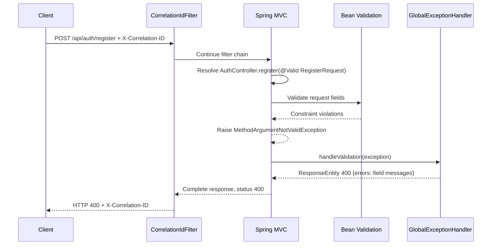

### 12.4 Logging, client detail, and evidence limits

`GlobalExceptionHandler` does not log exceptions. `logging/CorrelationIdFilter` adds `X-Correlation-ID` to the response, places the ID in MDC during each dispatch, and logs the normal request-completion event with method, route, response status, and duration as documented in §11.1. It clears MDC in `finally`. Thus MVC-handled errors can appear in request-completion logs with their response status, but the completion event does not include the exception class/message or stack trace. For errors that escape the filter chain, that filter does not emit the completion event. `security/JwtAuthenticationFilter` catches token-processing exceptions and intentionally ignores them; it does not log them.

Some specific service failures are logged: `FileService.download()` and `downloadVersion()` log caught `StorageException`s before rethrowing; restore/delete persistence cleanup paths log cleanup or metadata failures. These are source-visible logging paths, not evidence that log collection or retention is running. For client responses, storage internals are hidden by the fixed 502 body. In contrast, the handlers for `IllegalArgumentException`, `ResourceNotFoundException`, and `ForbiddenException` return the supplied message. The inspected service messages are application-level validation/access/not-found messages; no stack trace or storage cause is serialized by those handlers.

| Behavior | Source and relevant existing test assertions | Evidence status |
|---|---|---|
| DTO validation to `400 {errors:...}` | `backend/src/main/java/com/minidrive/exception/GlobalExceptionHandler.java` (`handleValidation`); `backend/src/main/java/com/minidrive/controller/AuthController.java` (`register`); `backend/src/test/java/com/minidrive/controller/AuthControllerTest.java` (`registrationRejectsInvalidFieldsWithValidationResponse`); `backend/src/test/java/com/minidrive/controller/FileControllerTest.java` (`invalidMetadataIsRejected`). | Mapping confirmed by source; test files assert response status/shape but were not executed for this documentation change. |
| Business argument error to 400 | `GlobalExceptionHandler.handleIllegalArgument`; `AuthService.register`; `FileService` name/metadata validation; `AuthControllerTest.duplicateAndCaseNormalizedEmailAreRejected`; `FileControllerTest.invalidMetadataIsRejected`. | Mapping and message behavior confirmed by source; assertions not executed here. |
| Authentication failures | `SecurityConfig.securityFilterChain`; `JwtAuthenticationFilter.doFilterInternal`; `GlobalExceptionHandler.handleBadCredentials`; `AuthControllerTest.wrongPasswordAndUnknownEmailReturnSameUnauthorizedResponseWithoutToken`, `meRejectsMalformedRandomAndInvalidSignatureTokens`, and `meRejectsMalformedAuthorizationHeadersWithoutServerError`. | Security/advice paths confirmed by source; tests cover login and protected endpoint outcomes but were not executed here. |
| Authorization/not-found responses | `FileService.get`, `download`, `delete`; `GlobalExceptionHandler.handleForbidden` / `handleNotFound`; `FileControllerTest.accessToAnotherUsersFileIsRejected`; `PermissionControllerTest.unrelatedUsersCannotAccessOrManageAnotherUsersFile`; `FileVersionHistoryControllerTest`. | Service status choices and response assertions are present in source/tests; tests not executed here. Some file endpoints use 403 while download/delete intentionally use 404 for inaccessible files. |
| Storage failure sanitization and propagation | `NodeStorageClient.upload` / `download` / `delete`; `FileService.upload` / `download`; `GlobalExceptionHandler.handleStorage`; `FileControllerTest.storageFailureDoesNotCreateMetadata` and `downloadRejectsUnauthenticatedInvalidAndMissingIdsAndControlsStorageFailure`; `FileVersionControllerTest.failedStorageUploadDoesNotCreateVersionAndLeavesFileUntouched`. | Source confirms wrapping, propagation, and generic response; tests use mocked storage and were not executed here. No live storage failure was run. |
| Locking conflict response | `GlobalExceptionHandler.handleConcurrencyConflict`. | Source confirms a 409 mapping. No existing test asserting this mapping was found; runtime response is not verified. |
| Malformed UUID / framework argument conversion | `FileController.get`; `FileControllerTest.deleteMissingAndInvalidIdsAreHandledWithoutStorageCalls`. | Source/test assertions support a 400 status for invalid UUID; no MiniDrive-specific body format is defined or asserted. |
| Unexpected exception fallback and error body | `GlobalExceptionHandler` handler inventory; framework defaults via Spring MVC/Boot. | No catch-all handler is confirmed by source. Exact default error response body and all unhandled exception outcomes were not verified by an executed request or dedicated test. |

### 12.5 Unresolved behavior

No custom mapping exists for every framework or infrastructure exception. The exact error body returned for malformed JSON, unsupported media types, unhandled database failures, and unexpected exceptions depends on Spring MVC/Boot handling and was not established from an executed request. The project also has no test found for the explicit locking-to-409 advice path. `backend/src/main/java/com/minidrive/controller/FileController.java` (`download`) and `backend/src/main/java/com/minidrive/controller/ShareController.java` (`download`) return `StreamingResponseBody` from `backend/src/main/java/com/minidrive/util/DownloadResponses.java` (`attachment`); a read failure during later stream transfer may occur after the controller has selected a 200 response, and no application code guarantees that such a late failure is converted to the custom JSON 502 body. That streaming failure response remains unverified. Finally, the validation handler stores one message per field in a `Map`, so multiple constraint violations for the same field are not all preserved in the response. The new response mapping is source- and test-file based; this section does not claim runtime verification.
