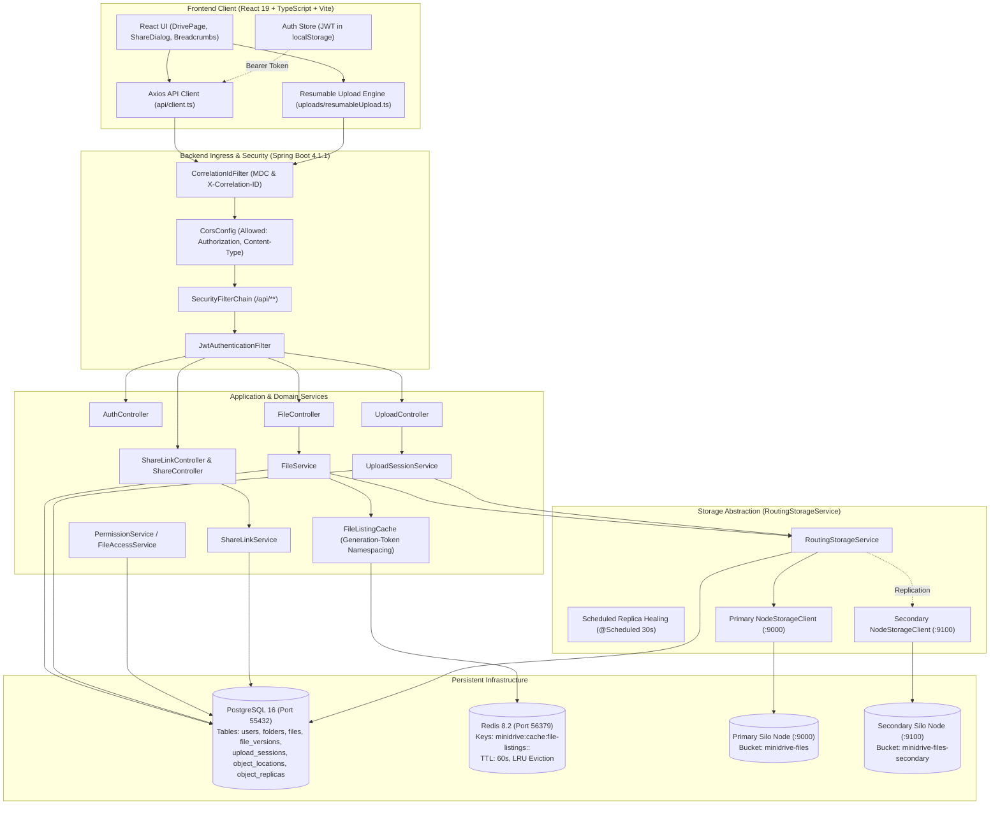
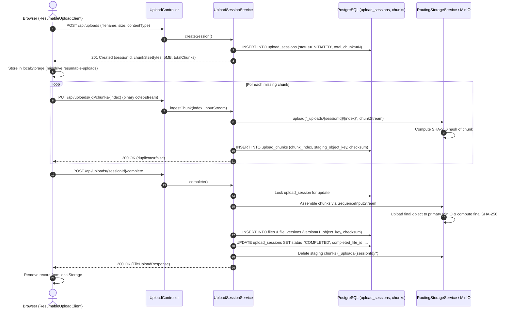
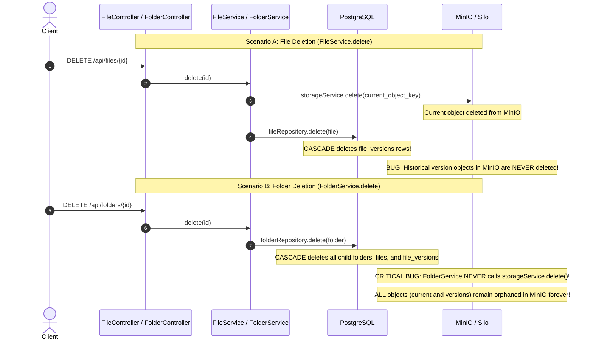

# MiniDrive — Complete Repository Forensic Audit, Feature Discovery & Engineering Gap Analysis

**Date:** October 23, 2026  
**Audit Branch:** `main` (commit `e889aa6`)  
**Audit Target:** `C:\MiniDrive`  
**Classification:** Complete Forensic Engineering Audit & Single Source of Truth  
**Auditor Roles:** Senior Software Architect, Staff Backend Engineer, Distributed Systems Engineer, Application Security Engineer, QA Lead, DevOps Engineer  

---

## A. Executive Assessment

### 1. What MiniDrive Actually Is
MiniDrive is a hybrid distributed file-storage and collaboration platform built on **Java 17 / Spring Boot 4.1.1** (backend) and **React 19 / TypeScript / Vite / Tailwind CSS v4** (frontend). Metadata is backed by **PostgreSQL 16** via Spring Data JPA and Flyway migrations, while file binary payloads are routed to S3-compatible **MinIO/Silo** object storage nodes. It incorporates a **Redis 8.2** read-through cache for directory listings using generation-token invalidation, and custom Micrometer/Prometheus instrumentation for storage and controller operations.

### 2. Strongest Engineering Achievements
- **Resumable Chunked Ingestion Pipeline:** An exceptionally robust multi-part upload protocol (`UploadSessionService`, `resumableUpload.ts`) implementing server-dictated 5 MiB chunk splitting, client-side bounded concurrency (default 3), byte-for-byte SHA-256 chunk hash tracking, idempotent session completion with session tombstones, and local `localStorage` crash recovery.
- **Fail-Open Redis Cache with Generation Tokens:** The file listing cache (`FileListingCache`, `ListingCacheGeneration`) does not naively evict or flush keys. It namespaces cache keys by an atomic Redis UUID generation token advanced in Spring's `TransactionSynchronization.afterCommit()`. If Redis becomes unavailable, the system transparently and safely fails open to PostgreSQL without degrading correctness.
- **Deterministic Storage Routing & Verified Replication:** The dual-node Silo integration (`RoutingStorageService`, `StableStorageNodeSelector`) features SHA-256 integrity checks, primary-authoritative writes, secondary background replication, read fallback to verified healthy replicas, and a scheduled healing engine (`repairOnce`).
- **Comprehensive Backend Unit & Slice Test Suite:** 214 tests covering controllers, repositories, services, caching serialization, and concurrent download header race conditions, achieving a 100% pass rate when live MinIO is connected.

### 3. Current Functional and Technical Maturity
MiniDrive is at an **advanced prototype / pre-production hardening stage**. The core data ingestion, file download, version restoration, and metadata management work as designed. However, several peripheral features are either completely unimplemented (Trash, User Management, Direct Share, Refresh Tokens) or severely decoupled between layers (the frontend lacks delete capabilities, "Shared With Me" discovery is absent, and folder deletion fails to clean up object storage).

### 4. The Most Important Risks
1. **Critical Storage Orphanage & Metadata Inconsistency on Folder Deletion (P0):** Deleting a folder deletes PostgreSQL metadata via cascading foreign keys, but completely skips MinIO/Silo object storage. All binary payloads remain permanent orphans in MinIO, while `object_locations` and `object_replicas` rows become unreferenced dangling records.
2. **Historical Version Binary Orphanage on File Deletion (P0):** Deleting a file deletes its current object key in storage, but cascades away historical `file_versions` database rows while deliberately leaving historical objects intact in MinIO without any garbage collection or retention mechanism.
3. **Out-of-Order Deletion Rollback Gap (P0):** `FileService.delete` deletes the storage object before deleting the database row. If database deletion or commit fails, the database row rolls back, leaving a permanent metadata ghost pointing to deleted storage bytes.
4. **Missing Collaborator File Discovery (P1):** While permissions can be granted, there is no query, endpoint, or UI for collaborators to list files shared with them ("Shared With Me"). Collaborators must receive raw file UUIDs out-of-band.
5. **CORS Header Rejection on Idempotency & Tracing (P1):** `CorsConfig.java` restricts headers to `Authorization` and `Content-Type`, which will reject browser requests carrying `Idempotency-Key` or `X-Correlation-ID`.
6. **Zero Migration Verification in CI/Test Pipeline (P1):** The test suite runs entirely on H2 with `flyway.enabled: false`. Migrations V1–V16 are never executed or validated during automated testing.

### 5. What Can Credibly Be Demonstrated Today
- New user registration, login, and JWT issuance.
- Hierarchical folder creation, nested navigation, and breadcrumb rendering.
- Single-shot multipart file upload and authenticated streaming download.
- Resumable chunked file upload with progress bar, pause, resume, and hash verification.
- Content replacement generating immutable historical revisions (`file_versions`).
- Historical version listing, version download, and version restoration.
- Creation, retrieval, and anonymous download of public share links (`/api/share/{token}`).
- Redis-backed listing cache hits and automatic cache invalidation upon file mutations.
- Actuator metrics exposition (`/actuator/health`, `/actuator/prometheus`).

### 6. What Remains Unverified
- Behavior under sustained production multi-tenant concurrency beyond 10 VUs on Windows host.
- Actual PostgreSQL performance under millions of rows (only tested up to ~7,000 fixtures).
- Real-world node partition split-brain behavior across geographically separated Silo nodes.

---

## B. Complete Project Inventory

### 1. Repository Directory Map
```
C:\MiniDrive
├── .env.example                               # Environment template with configuration defaults
├── README.md                                  # Setup and operational instructions
├── backend/                                   # Spring Boot application
│   ├── pom.xml                                # Maven build manifest (Java 17, Spring Boot 4.1.1)
│   ├── mvnw.cmd                               # Maven wrapper
│   └── src/
│       ├── main/
│       │   ├── java/com/minidrive/
│       │   │   ├── MiniDriveApplication.java  # Main application entry point
│       │   │   ├── config/                    # Security, CORS, Cache, Storage, Jackson, Flyway
│       │   │   ├── controller/                # REST endpoints
│       │   │   ├── dto/                       # Request/Response payloads
│       │   │   ├── entity/                    # JPA database entities
│       │   │   ├── exception/                 # Global exception handler & custom exceptions
│       │   │   ├── logging/                   # Correlation ID servlet filter
│       │   │   ├── mapper/                    # Entity-to-DTO conversion
│       │   │   ├── metrics/                   # AspectJ metrics interception
│       │   │   ├── repository/                # Spring Data JPA repositories
│       │   │   ├── security/                  # JWT filter, service, token generation
│       │   │   ├── service/                   # Business logic, caching, upload sessions
│       │   │   ├── storage/                   # Silo/MinIO clients, routing, replica healing
│       │   │   └── util/                      # Storage keys, download helpers
│       │   └── resources/
│       │       ├── application.yml            # Application configuration
│       │       └── db/migration/              # Flyway migrations V1 to V16
│       └── test/
│           ├── java/com/minidrive/            # 28 test classes (214 tests)
│           └── resources/application.yml      # Test configuration (H2, Flyway disabled)
├── frontend/                                  # React 19 / TypeScript application
│   ├── package.json                           # NPM dependencies (Vite 6, React 19, Tailwind v4)
│   ├── vite.config.ts                         # Vite build configuration
│   └── src/
│       ├── App.tsx                            # Root application component
│       ├── main.tsx                           # DOM mount
│       ├── api/                               # Axios HTTP clients (client, files, folders, uploads, etc.)
│       ├── components/                        # UI components (drive, sharing, files)
│       ├── hooks/                             # Custom hooks (useDriveLocation, useResumableUpload)
│       ├── layouts/                           # RootLayout shell
│       ├── pages/                             # Page components (DrivePage, LoginPage, RegisterPage, etc.)
│       ├── routes/                            # React Router tree
│       ├── services/                          # Auth store and JWT token persistence
│       ├── types/                             # TypeScript interfaces
│       └── uploads/                           # Resumable upload engine, state machine, resume store
├── infra/                                     # Infrastructure & Deployment
│   ├── docker-compose.yml                     # PostgreSQL, Redis, Primary Silo, Secondary Silo
│   ├── prometheus.yml                         # Prometheus scrape target configuration
│   ├── grafana/                               # Dashboards & provisioning (configuration only)
│   └── load-testing/                          # k6 test scripts and account provisioning
└── docs/                                      # Documentation & Architecture records
```

### 2. Technology & Dependency Inventory

#### Backend (`backend/pom.xml`)
| Dependency / Tool | Version | Purpose |
|---|---|---|
| Java | 17 | Core runtime |
| Spring Boot Parent | 4.1.1 | Application framework |
| Spring Boot Starter WebMVC | 4.1.1 | REST controllers & Tomcat |
| Spring Boot Starter Data JPA | 4.1.1 | Hibernate ORM |
| Spring Boot Starter Data Redis | 4.1.1 | Redis connectivity |
| Spring Boot Starter Cache | 4.1.1 | Spring cache abstraction |
| Spring Boot Starter Security | 4.1.1 | Filter chain & authentication |
| Spring Boot Starter Validation | 4.1.1 | Bean validation annotations |
| Spring Boot Starter Actuator | 4.1.1 | Health and metrics endpoints |
| Micrometer Prometheus Registry | Managed | Prometheus scrape format |
| AspectJ Weaver | Managed | Custom `@MeasuredOperation` metrics |
| PostgreSQL JDBC Driver | 42.7.x | PostgreSQL 16 connectivity |
| Flyway Core & PostgreSQL | Managed | Database schema migration |
| MinIO Java SDK | 9.0.3 | S3/Silo client operations |
| OkHttp | 4.12.0 | HTTP client for MinIO SDK |
| JJWT (API, Impl, Jackson) | 0.12.6 | JWT creation and verification |
| H2 Database | Managed | In-memory test database |

#### Frontend (`frontend/package.json`)
| Package | Version | Purpose |
|---|---|---|
| React & React DOM | 19.0.0 | UI rendering library |
| React Router DOM | 7.1.1 | Client-side routing |
| Axios | 1.7.9 | HTTP client with progress events |
| Vite | 6.0.5 | Build tool & dev server |
| TypeScript | 5.7.2 | Type safety & compilation |
| Tailwind CSS & @tailwindcss/vite | 4.0.0 | Modern utility-first CSS |
| Vitest | 5.0.3 | Unit test runner |

#### Infrastructure (`infra/docker-compose.yml`)
| Service | Image | Published Host Port | Details |
|---|---|---|---|
| `postgres` | `postgres:16` | `127.0.0.1:55432` | Metadata store, healthchecked |
| `minio` | `pgsty/silo:RELEASE.2026-09-16T00-00-00Z` | `127.0.0.1:9000`, `9001` | Primary object storage, healthchecked |
| `minio-init` | `pgsty/mc:RELEASE.2026-09-16T00-00-00Z` | None | One-shot bucket creator (`minidrive-files`) |
| `minio-secondary` | `pgsty/silo:RELEASE.2026-09-16T00-00-00Z` | `127.0.0.1:9100`, `9101` | Secondary replica storage |
| `minio-secondary-init`| `pgsty/mc:RELEASE.2026-09-16T00-00-00Z` | None | One-shot secondary bucket creator |
| `redis` | `redis:8.2.10-bookworm` | `127.0.0.1:56379` | Ephemeral listing cache (no persistence, 256MB LRU) |

### 3. Module Responsibility Map
- **`com.minidrive.config`**: Security filter chain rules, CORS configuration, Redis cache setup, Jackson typing.
- **`com.minidrive.controller`**: HTTP protocol translation, request validation, principal extraction, response formatting.
- **`com.minidrive.service`**: Business invariant enforcement, transactional boundaries, cache eviction triggers, storage orchestration.
- **`com.minidrive.storage`**: Node routing, MinIO client wrappers, SHA-256 validation, background replica synchronization.
- **`com.minidrive.repository`**: Spring Data JPA repositories for relational entities; `JdbcTemplate` for storage replica registries.
- **`com.minidrive.security`**: JWT parsing/generation, password hashing via BCrypt, high-entropy share token generation.
- **`com.minidrive.metrics`**: AspectJ interceptor measuring execution times and tagging Prometheus metrics.
- **`frontend/src/uploads`**: Resumable upload state machine, chunk orchestration, retry logic, localStorage persistence.
- **`frontend/src/api`**: Axios API abstractions converting HTTP responses to strongly typed domain objects.

### 4. Entry-Point Map
- **HTTP REST / Ingestion**: `Tomcat` → `CorrelationIdFilter` → `SecurityFilterChain` → `JwtAuthenticationFilter` → Controller.
- **Application Startup**: `MiniDriveApplication.main` → Spring Boot Context → `FlywayConfig` → `CacheConfig` → `StorageConfig`.
- **Scheduled Background Tasks**:
  - `RoutingStorageService.scheduledRepair()`: Runs every 30s (`minidrive.storage.replication.repair-delay-ms`).
  - `RoutingStorageService.probeStorageNodes()`: Runs every 15s (`minidrive.storage.health-check-delay-ms`).
- **Storage Operations**: Originates in `FileService` or `UploadSessionService` → delegates to `StorageService` interface (`RoutingStorageService`).

### 5. Abandoned, Empty, or Dead Code Files
The audit identified **24 empty (0-byte) Java source files**, **3 empty SQL migration files**, **3 empty documentation files**, and **13 empty directories containing only `.gitkeep`**:

| Category | File Path | Status / Evidence |
|---|---|---|
| Controller | `backend/src/main/java/com/minidrive/controller/TrashController.java` | 0 bytes, completely unwritten |
| Controller | `backend/src/main/java/com/minidrive/controller/UserController.java` | 0 bytes, completely unwritten |
| DTO | `backend/src/main/java/com/minidrive/dto/auth/RefreshTokenRequest.java` | 0 bytes |
| DTO | `backend/src/main/java/com/minidrive/dto/share/ShareRequest.java` | 0 bytes |
| DTO | `backend/src/main/java/com/minidrive/dto/share/ShareResponse.java` | 0 bytes |
| DTO | `backend/src/main/java/com/minidrive/dto/user/UpdateUserRequest.java` | 0 bytes |
| DTO | `backend/src/main/java/com/minidrive/dto/user/UserResponse.java` | 0 bytes |
| Entity | `backend/src/main/java/com/minidrive/entity/RefreshToken.java` | 0 bytes |
| Entity | `backend/src/main/java/com/minidrive/entity/Share.java` | 0 bytes |
| Exception | `backend/src/main/java/com/minidrive/exception/UnauthorizedException.java` | 0 bytes |
| Exception | `backend/src/main/java/com/minidrive/exception/ValidationException.java` | 0 bytes |
| Mapper | `backend/src/main/java/com/minidrive/mapper/ShareMapper.java` | 0 bytes |
| Mapper | `backend/src/main/java/com/minidrive/mapper/UserMapper.java` | 0 bytes |
| Repository | `backend/src/main/java/com/minidrive/repository/RefreshTokenRepository.java` | 0 bytes |
| Repository | `backend/src/main/java/com/minidrive/repository/ShareRepository.java` | 0 bytes |
| Security | `backend/src/main/java/com/minidrive/security/SecurityUser.java` | 0 bytes (uses built-in Spring Security `User`) |
| Service | `backend/src/main/java/com/minidrive/service/ShareService.java` | 0 bytes |
| Service | `backend/src/main/java/com/minidrive/service/TrashService.java` | 0 bytes |
| Service | `backend/src/main/java/com/minidrive/service/UserService.java` | 0 bytes |
| Storage | `backend/src/main/java/com/minidrive/storage/StorageException.java` | 0 bytes (duplicate of `com.minidrive.exception.StorageException`) |
| Storage | `backend/src/main/java/com/minidrive/storage/StoragePathResolver.java` | 0 bytes |
| Util | `backend/src/main/java/com/minidrive/util/FileUtils.java` | 0 bytes |
| Util | `backend/src/main/java/com/minidrive/util/ValidationUtils.java` | 0 bytes |
| Config | `backend/src/main/java/com/minidrive/config/JacksonConfig.java` | 0 bytes |
| Migrations | `backend/src/main/resources/db/migration/V3__create_files.sql` | 0 bytes |
| Migrations | `backend/src/main/resources/db/migration/V4__create_shares.sql` | 0 bytes |
| Migrations | `backend/src/main/resources/db/migration/V5__create_refresh_tokens.sql` | 0 bytes |
| Documentation | `docs/API.md`, `docs/ARCHITECTURE.md`, `docs/DATABASE.md` | 0 bytes each |
| Frontend Dirs | `frontend/src/pages/{Dashboard, Profile, Shared, Trash}` | Empty directories with `.gitkeep` only |

---

## C. Feature Completeness Matrix

| Feature | User Outcome | Frontend | API | Backend | Persistence | Authorization | Failure Handling | Tests | Status | Evidence | Gaps |
|---|---|---|---|---|---|---|---|---|---|---|---|
| **User Registration** | Creates an account with email and password | `RegisterPage.tsx` | `POST /api/auth/register` | `AuthService.register` | `users` table (V1) | Public | Rejects duplicate emails (`400`) | `AuthControllerTest` | **Verified Complete** | `AuthService.java:32-47` | None |
| **User Login** | Obtains JWT token for session | `LoginPage.tsx` | `POST /api/auth/login` | `AuthService.login` | None (stateless) | Public | Rejects invalid credentials (`401`) | `AuthControllerTest` | **Verified Complete** | `AuthService.java:50-62` | No refresh token rotation |
| **Current User Info** | Displays user profile info | None (called on auth init) | `GET /api/auth/me` | Direct `UserRepository` in `AuthController` | `users` table | Authenticated | Throws if user deleted | None direct | **Partial** | `AuthController.java:54-67` | Bypasses service layer; no profile UI |
| **Folder Creation** | Organizes files hierarchically | `NewFolderDialog.tsx`, `DrivePage.tsx` | `POST /api/folders` | `FolderService.create` | `folders` table (V6) | Authenticated | Checks parent ownership & duplicate names | `FolderControllerTest` | **Verified Complete** | `FolderService.java:42-56` | None |
| **Folder Navigation** | Traverses folder tree | `Breadcrumbs.tsx`, `DrivePage.tsx` | `GET /api/folders?parentFolderId=` | `FolderService.listChildren` | `folders` table (V6) | Authenticated owner | Returns empty list for invalid root | `FolderControllerTest` | **Verified Complete** | `FolderService.java:58-80` | Breadcrumbs built client-side sequentially |
| **Folder Rename** | Renames a folder | `RenameDialog.tsx` | `PATCH /api/folders/{id}` | `FolderService.rename` | `folders` table (V6) | Authenticated owner | Rejects sibling duplicates | `FolderControllerTest` | **Verified Complete** | `FolderService.java:92-109` | No optimistic locking on folders |
| **Folder Deletion** | Deletes folder and contents | **None (No UI button)** | `DELETE /api/folders/{id}` | `FolderService.delete` | PostgreSQL FK Cascade | Authenticated owner | Evicts listing cache after commit | `FolderControllerTest` | **Broken / Backend Only** | `FolderService.java:112-124` | **Critical P0:** Leaves all MinIO binary objects as permanent orphans! |
| **File Upload (Single)**| Uploads file under 5MB | `DrivePage.tsx` (fallback) | `POST /api/files` (multipart) | `FileService.upload` | `files` (V7), `file_versions` (V11), MinIO | Authenticated owner | Rollback deletes MinIO object | `FileControllerTest` | **Verified Complete** | `FileService.java:85-131` | Memory bounded by multipart config |
| **File Listing** | Views files in folder | `DrivePage.tsx`, `FileRow.tsx` | `GET /api/files?folderId=` | `FileService.listInFolder` | Redis cache or `files` (V7) | Authenticated owner | Fails open to DB on Redis error | `FileListingCacheTest`, `FileListingCacheRedisIntegrationTest` | **Verified Complete** | `FileService.java:174-190`, `FileListingCache.java` | Only lists owned files; no shared files |
| **File Download** | Streams file content to browser | `FileRow.tsx` (`onDownload`) | `GET /api/files/{id}/download` | `FileService.download` | MinIO binary via `StorageService` | Owner, Editor, or Viewer | Throws 404/502 on storage failure | `FileControllerTest`, `StreamingDownloadHeaderConcurrencyIntegrationTest` | **Verified Complete** | `FileService.java:697-720`, `DownloadResponses.java` | None |
| **File Rename** | Changes file name | `RenameDialog.tsx` | `PATCH /api/files/{id}` | `FileService.update` | `files` table (V7, V14) | Owner or Editor | Rejects sibling duplicate names | `FileControllerTest` | **Verified Complete** | `FileService.java:232-262` | None |
| **File Deletion** | Deletes a file | **None (No UI button)** | `DELETE /api/files/{id}` | `FileService.delete` | `files` table, MinIO | Authenticated owner | DB error leaves deleted object | `FileControllerTest` | **Broken / Backend Only** | `FileService.java:654-695` | **Critical P0:** Historical version objects in MinIO are never deleted; UI lacks delete button |
| **Resumable Upload** | Chunked upload with pause/resume | `ResumableUploadsPanel.tsx`, `useResumableUpload.ts` | `POST /api/uploads`, `PUT /chunks/{i}`, `POST /complete` | `UploadSessionService` | `upload_sessions` (V12-V14), `upload_chunks` | Authenticated owner | Staging cleaned up on abort/error | `UploadControllerTest`, `resumableUpload.test.ts` (31 tests) | **Verified Complete** | `UploadSessionService.java`, `resumableUpload.ts` | Frontend does not send `Idempotency-Key` header |
| **File Versioning** | Replaces file and retains history | `FileRow.tsx` (`Replace content`), `VersionHistoryDialog.tsx` | `POST /api/files/{id}/content`, `GET /versions` | `FileService.replaceContent`, `listVersions` | `file_versions` (V11), MinIO | Owner or Editor | Atomic DB commit with rollback cleanup | `FileVersionControllerTest` | **Verified Complete** | `FileService.java:490-530` | No retention limit on version count |
| **Version Restoration**| Restores an earlier version | `VersionHistoryDialog.tsx` | `POST /api/files/{fId}/versions/{vId}/restore` | `FileService.restoreVersion` | Appends new `file_version`, updates current | Owner or Editor | Reverts if copy fails | `FileVersionControllerTest` | **Verified Complete** | `FileService.java:571-649` | Copies storage object to new key |
| **Direct File Sharing**| Collaborator roles (Editor/Viewer)| `ShareDialog.tsx` | `POST /api/files/{id}/permissions` | `PermissionService.grant` | `file_permissions` (V9) | Authenticated owner | Updates existing role on duplicate | `PermissionControllerTest` | **Partial** | `PermissionService.java:38-75` | **Major P1:** Collaborator cannot list shared files ("Shared With Me" missing) |
| **Public Share Links** | Shareable bearer link with expiration | `ShareDialog.tsx`, `SharedFilePage.tsx` | `POST /api/files/{id}/share-link`, `GET /api/share/{token}` | `ShareLinkService` | `share_links` (V10) | Owner generates; Public consumes | Checks expiration on every request | `ShareLinkControllerTest` | **Verified Complete** | `ShareLinkService.java:39-95` | Raw token never persisted (SHA-256 hash stored) |
| **Storage Replication**| Secondary node sync & healing | None (Backend infra) | Internal `StorageService` | `RoutingStorageService` | `object_locations` (V15), `object_replicas` (V16) | System internal | Primary write succeeds if secondary fails | `RoutingStorageReplicationTest`, `SiloStorageServiceRealMinioLiveTest` | **Verified Complete** | `RoutingStorageService.java` | Stages entire file on host disk in `/tmp` |
| **Listing Cache** | Redis caching of file listings | None (transparent) | Intercepts `GET /api/files` | `FileListingCache` | Redis string keys (TTL 60s) | Authenticated | Fails open to PostgreSQL | `FileListingCacheTest`, `FileListingCacheRedisIntegrationTest` | **Verified Complete** | `FileListingCache.java`, `ListingCacheGeneration.java` | Global invalidation token advances on every commit |
| **Trash / Bin** | Soft-delete and recovery | `frontend/src/pages/Trash/` (.gitkeep) | None | `TrashController.java` (0 bytes) | None | N/A | N/A | None | **Unimplemented** | 0-byte placeholder files | Complete feature missing |
| **File Search** | Find files by name/metadata | None | None | None | None | N/A | N/A | None | **Unimplemented** | No code exists | Complete feature missing |
| **File Previews** | View images/PDFs inline | None | None | None | None | N/A | N/A | None | **Unimplemented** | No code exists | Complete feature missing |
| **User Quotas** | Enforce storage size limits | None | None | None | None | N/A | N/A | None | **Unimplemented** | No code exists | Complete feature missing |

---

## D. Architecture and End-to-End Data Flow

### 1. Overall System Architecture


### 2. Resumable Upload Lifecycle


### 3. File Deletion & The Orphan Gap (Current vs. Expected)


---

## E. Findings Register

### Severity Summary
- **P0 (Critical):** 3 confirmed defects (Data loss risk, permanent storage orphanage, unrecoverable database/storage divergence).
- **P1 (High):** 6 confirmed defects (Missing delete UI controls, broken collaborator file discovery, CORS header rejection, untested migrations, disk exhaustion during replication, unhandled auth exceptions).
- **P2 (Medium):** 7 confirmed findings (Dead/stubbed modules, outdated homepage, static auth navigation, missing UI test coverage, missing client idempotency headers, lack of search/preview/quota, missing Grafana compose service).
- **P3 (Low):** 4 maintainability & configuration observations (Unused gitkeep files, 0-byte migration files, lack of TLS in compose, lack of migration rollback scripts).

---

### Finding P0-1: Permanent Object Storage Orphanage & Dangling Metadata on Folder Deletion
- **Severity / Priority:** P0 — Critical
- **Confidence:** High (Verified via source inspection)
- **Exact Code Location:** `backend/src/main/java/com/minidrive/service/FolderService.java:112-124`
- **Preconditions & Trigger:** An authenticated user deletes a folder containing one or more files using `DELETE /api/folders/{id}`.
- **Root Cause:**
  ```java
  @Transactional
  public void delete(Authentication authentication, UUID id) {
      User owner = currentUser(authentication);
      Folder folder = getOwnedFolder(owner, id);
      folderRepository.delete(folder); // Triggers DB cascade delete
      fileListingCache.evictAfterCommit();
  }
  ```
  `FolderService` does not inject `StorageService`. When `folderRepository.delete(folder)` executes, PostgreSQL cascades the deletion to child `folders`, `files`, and `file_versions`. No call is ever made to `storageService.delete()`.
- **Impact:**
  1. All binary objects stored in MinIO/Silo corresponding to the files and historical versions inside the deleted folder become permanent, unreferenced orphans.
  2. The rows in `object_locations` and `object_replicas` remain in PostgreSQL because they do not have foreign key constraints to `files`.
  3. When `RoutingStorageService.repairOnce()` executes, it queries `object_replicas` and attempts to heal or replicate objects whose file metadata no longer exists.
- **Remediation:**
  Before executing `folderRepository.delete(folder)`, recursively query all files and file versions within the folder hierarchy, collect their storage object keys, delete the objects from `StorageService`, clean up `object_locations` and `object_replicas`, and then delete the folder entity.

---

### Finding P0-2: Permanent Object Storage Orphanage of Historical Versions on File Deletion
- **Severity / Priority:** P0 — Critical
- **Confidence:** High (Verified via source inspection)
- **Exact Code Location:** `backend/src/main/java/com/minidrive/service/FileService.java:676-681`
- **Preconditions & Trigger:** A user deletes a file that has multiple versions (`DELETE /api/files/{id}`).
- **Root Cause:**
  ```java
  // Phase 7.1 retention decision: only the current version's object is
  // removed here. The file's file_versions rows go away through the FK
  // cascade, but their historical storage objects are deliberately left in
  // place.
  storageService.delete(file.getObjectKey());
  fileRepository.delete(file);
  ```
  The code explicitly deletes only `file.getObjectKey()`. The database foreign key `fk_file_versions_file ON DELETE CASCADE` deletes all rows in `file_versions`. The historical version objects in MinIO/Silo remain in the bucket indefinitely with no database records referencing them and no background GC process.
- **Impact:** Storage leak grows linearly with every replaced and deleted file. Multi-gigabyte historical objects can never be identified or purged by standard application flows.
- **Remediation:**
  Retrieve all `FileVersion` entries for `file.getId()`, iterate and delete each `version.getObjectKey()` from `storageService`, delete replica registry entries, and then delete the parent `file`.

---

### Finding P0-3: Out-of-Order Storage vs. Database Deletion Rollback Gap
- **Severity / Priority:** P0 — Critical
- **Confidence:** High (Verified via source inspection)
- **Exact Code Location:** `backend/src/main/java/com/minidrive/service/FileService.java:681-694`
- **Preconditions & Trigger:** A database failure (deadlock, network partition, constraint violation, or server crash) occurs during `fileRepository.delete(file)` or `fileRepository.flush()`.
- **Root Cause:**
  `storageService.delete(file.getObjectKey())` is executed *before* `fileRepository.delete(file)`. Storage operations cannot participate in the database transaction. If the database transaction aborts and rolls back:
  1. The database row for `File` is restored (not deleted).
  2. The underlying binary payload in MinIO is already permanently deleted.
- **Impact:** Permanent data corruption. The user sees the file in their drive listing, but any attempt to download it results in an unrecoverable `StorageException` (HTTP 502/404).
- **Remediation:**
  Perform database deletion inside the transaction, register a `TransactionSynchronization.afterCommit()` hook, and execute `storageService.delete()` only *after* the transaction has successfully committed. If storage deletion fails post-commit, queue the key for background deletion retry.

---

### Finding P1-1: Complete Absence of Delete Controls in Frontend UI
- **Severity / Priority:** P1 — High
- **Confidence:** High (Verified via source inspection)
- **Exact Code Location:**
  - `frontend/src/components/drive/FileRow.tsx:63-108`
  - `frontend/src/components/drive/FolderCard.tsx:29-43`
  - `frontend/src/api/files.ts`
  - `frontend/src/api/folders.ts`
- **Evidence:**
  `FileRow.tsx` renders buttons for: `Rename`, `Share`, `History`, `Replace content`, `Download`. There is no `Delete` button. `FolderCard.tsx` renders only `Rename`. Neither `api/files.ts` nor `api/folders.ts` defines a `deleteFile` or `deleteFolder` function.
- **Impact:** End users cannot delete files or folders from the browser application.
- **Remediation:** Add `deleteFile` and `deleteFolder` API client functions, implement a confirmation modal dialog, and attach delete actions to `FileRow` and `FolderCard`.

---

### Finding P1-2: Broken Collaborator File Discovery ("Shared With Me" Missing)
- **Severity / Priority:** P1 — High
- **Confidence:** High (Verified via source inspection)
- **Exact Code Location:**
  - `backend/src/main/java/com/minidrive/repository/FileRepository.java:21-25`
  - `backend/src/main/java/com/minidrive/repository/PermissionRepository.java:11-18`
  - `backend/src/main/java/com/minidrive/service/FileListingCache.java:41-49`
  - `frontend/src/pages/Shared` (empty)
- **Evidence:**
  `FileListingCache.java` explicitly notes:
  `"load selects only files whose owner is the caller... there is no accessible-files or shared-with-me listing, and no repository query joins permissions or share links."`
  `PermissionRepository` lacks a `findByUserId` method.
- **Impact:** An owner can grant "Viewer" or "Editor" permissions to another user, but the collaborator has no UI or API endpoint to view or discover the files that have been shared with them. The feature is unusable in practice without out-of-band UUID sharing.
- **Remediation:** Create `GET /api/files/shared-with-me`, query `file_permissions` joined with `files`, and implement a "Shared with me" view in the frontend.

---

### Finding P1-3: CORS Configuration Blocks `Idempotency-Key` and `X-Correlation-ID`
- **Severity / Priority:** P1 — High
- **Confidence:** High (Verified via source inspection)
- **Exact Code Location:** `backend/src/main/java/com/minidrive/config/CorsConfig.java:34-36`
- **Evidence:**
  ```java
  config.setAllowedHeaders(List.of("Authorization", "Content-Type"));
  ```
  `UploadController.java:49` accepts `@RequestHeader("Idempotency-Key")`.
  `CorrelationIdFilter.java:27` accepts `X-Correlation-ID`.
- **Impact:** Any browser request from a separate origin (or during development when using custom headers) that sends `Idempotency-Key` or `X-Correlation-ID` will fail the CORS preflight (`OPTIONS`) check with HTTP 403 Forbidden.
- **Remediation:**
  Update `CorsConfig.java`:
  ```java
  config.setAllowedHeaders(List.of("Authorization", "Content-Type", "Idempotency-Key", "X-Correlation-ID"));
  ```

---

### Finding P1-4: Automated Tests Bypass Flyway Migrations Completely
- **Severity / Priority:** P1 — High
- **Confidence:** High (Verified via source inspection and test execution)
- **Exact Code Location:** `backend/src/test/resources/application.yml:12-13`
- **Evidence:**
  ```yaml
  spring:
    datasource:
      url: jdbc:h2:mem:minidrive;MODE=PostgreSQL;DB_CLOSE_DELAY=-1
    jpa:
      hibernate:
        ddl-auto: create-drop
    flyway:
      enabled: false
  ```
- **Impact:** All 214 backend tests run against an H2 in-memory database generated on-the-fly by Hibernate. None of the 16 Flyway migrations are ever executed, tested, or validated in CI. Schema syntax errors or missing migration constraints will only surface in production or live environments.
- **Remediation:** Introduce a dedicated test container integration test using PostgreSQL that runs `flyway.migrate()` and verifies schema validity.

---

### Finding P1-5: Unbounded Host Disk Staging During Replicated Uploads
- **Severity / Priority:** P1 — High
- **Confidence:** High (Verified via source inspection)
- **Exact Code Location:** `backend/src/main/java/com/minidrive/storage/RoutingStorageService.java:96-114`
- **Root Cause:**
  ```java
  staged = Files.createTempFile("minidrive-replication-", ".object");
  long copied = copy(input, Files.newOutputStream(staged), digest);
  ```
  When `replicationEnabled = true`, `RoutingStorageService.upload` buffers the entire input stream to a temporary file on the host filesystem (`%TEMP%` or `/tmp`) before uploading to primary and secondary nodes.
- **Impact:** For large uploads (up to 5 GiB) or concurrent multi-user uploads, the host disk can quickly run out of space, causing `IOException: No space left on device` and crashing the application or host.
- **Remediation:** Stream chunks directly to MinIO using multipart S3 uploads or perform pipe-based fan-out streaming without spooling full payloads to disk.

---

### Finding P1-6: Unhandled `NoSuchElementException` in `AuthController.me`
- **Severity / Priority:** P1 — High
- **Confidence:** Medium (Code inspection)
- **Exact Code Location:**
  - `backend/src/main/java/com/minidrive/controller/AuthController.java:58-60`
  - `backend/src/main/java/com/minidrive/exception/GlobalExceptionHandler.java`
- **Evidence:**
  `userRepository.findByEmail(authentication.getName()).orElseThrow()` throws `java.util.NoSuchElementException` if the user is deleted while their JWT token is still valid. `GlobalExceptionHandler` does not handle `NoSuchElementException` or have a fallback `Exception.class` handler.
- **Impact:** The endpoint crashes with HTTP 500 Internal Server Error instead of HTTP 401 Unauthorized or 404 Not Found.
- **Remediation:** Catch `NoSuchElementException` or throw `UnauthorizedException` / `ResourceNotFoundException`. Add a global `@ExceptionHandler(Exception.class)` in `GlobalExceptionHandler`.

---

### Finding P2-1: Unimplemented Placeholder Code and Empty Modules
- **Severity / Priority:** P2 — Medium
- **Location:** 24 empty Java source files, 3 empty migrations, empty frontend page folders.
- **Evidence:** See Module Responsibility Map and Project Inventory.
- **Impact:** Misleads developers and documentation readers regarding implemented feature scope. Increases maintenance confusion.
- **Remediation:** Remove dead placeholder files or implement their respective features in planned milestones.

---

### Finding P2-2: Frontend Homepage Remains Outdated Phase 5.2 Placeholder
- **Severity / Priority:** P2 — Medium
- **Location:** `frontend/src/pages/HomePage.tsx:1-11`, `frontend/src/components/PagePlaceholder.tsx`
- **Evidence:** `HomePage.tsx` renders `PagePlaceholder` stating: *"Login, registration and drive features are coming in Phase 5.2."*
- **Impact:** Severe UX defect. Any anonymous user landing on the root URL (`/`) is greeted by a developer placeholder rather than a functional landing page or direct redirect to `/drive` or `/login`.
- **Remediation:** Replace `HomePage.tsx` with a modern landing page or redirect authenticated users to `/drive` and unauthenticated users to `/login`.

---

### Finding P2-3: Static Navigation Shell Ignores Authentication State
- **Severity / Priority:** P2 — Medium
- **Location:** `frontend/src/layouts/RootLayout.tsx:15-28`
- **Evidence:** The top navigation bar unconditionally renders `Home`, `Login`, `Register`, `My Drive` regardless of whether the user is authenticated.
- **Impact:** Logged-in users are presented with "Login" and "Register" buttons. Clicking "Login" redirects back to `/drive` via `PublicRoute`.
- **Remediation:** Connect `RootLayout` to `useAuth()` to conditionally display user info and a logout button when logged in, and Login/Register links when logged out.

---

### Finding P2-4: Missing Frontend Tests for Components, UI, and Routing
- **Severity / Priority:** P2 — Medium
- **Location:** `frontend/src/`
- **Evidence:** All 55 frontend tests live strictly within `src/api/uploads.test.ts` and `src/uploads/*.test.ts`. There are zero tests for `DrivePage`, `FileRow`, `FolderCard`, `Breadcrumbs`, `ShareDialog`, or React Router guards.
- **Impact:** Regressions in UI rendering, dialog state, and routing cannot be detected automatically.
- **Remediation:** Add React Testing Library tests for core drive workflows and dialogs.

---

### Finding P2-5: Frontend Upload Client Does Not Send `Idempotency-Key`
- **Severity / Priority:** P2 — Medium
- **Location:** `frontend/src/api/uploads.ts:115-134`
- **Evidence:** `createUploadSession` constructs the payload without setting the `Idempotency-Key` request header.
- **Impact:** Duplicate submissions or rapid double-clicks on the upload button can spawn multiple concurrent upload sessions for the same file.
- **Remediation:** Generate a UUID idempotency key per upload attempt in `useResumableUpload` and pass it in the request headers.

---

### Finding P2-6: Absence of File Search, Previews, Quotas, and Trash
- **Severity / Priority:** P2 — Medium
- **Location:** Entire repository.
- **Evidence:** No search queries, thumbnail generation, PDF/image renderers, or quota tracking exist in backend or frontend.
- **Impact:** Platform lacks essential usability features expected of a cloud storage service.
- **Remediation:** Plan and schedule Phase 14 to introduce search indexing and media preview endpoints.

---

### Finding P2-7: Grafana Configuration Present But Omitted from Docker Compose
- **Severity / Priority:** P2 — Medium
- **Location:** `infra/grafana/`, `infra/docker-compose.yml`
- **Evidence:** `infra/grafana/dashboards/minidrive-overview.json` and provisioning configs exist, but `infra/docker-compose.yml` defines no Grafana service.
- **Impact:** Grafana cannot be launched via `docker compose up` without manual container setup.
- **Remediation:** Add a `grafana` service definition to `infra/docker-compose.yml` binding to port 3000.

---

## F. Security and Data-Integrity Report

### 1. Broken Access Control & IDOR Inspection
- **File & Folder Isolation:** Verified enforced. `FileService` and `FolderService` resolve user ownership through `currentUser(authentication)` and enforce `access.hasAccess()` / `access.isOwner()`. A user cannot view, rename, download, or delete another user's files by manipulating UUIDs in the URL (`ResourceNotFoundException` is thrown to prevent resource enumeration).
- **Public Share Links:** Verified secure. Anonymous share endpoints (`/api/share/{token}`) authorize solely by the bearer token hash. Raw tokens are 256-bit cryptographically secure values (`SecureRandom`), and only their SHA-256 hash is persisted in PostgreSQL (`uq_share_links_token_hash`). Expired links are rejected at the service layer on every call.
- **Session IDOR:** Verified enforced. Upload sessions are scoped by `owner_id` on every query (`findByIdAndOwnerId`). Users cannot inject chunks or finalize sessions owned by other accounts.

### 2. Authentication & Token Security
- **JWT Storage:** Stored in browser `localStorage` (`minidrive_token`). While standard for SPAs, this is susceptible to XSS token theft compared to `HttpOnly` cookies.
- **Revocation Gap:** JWT tokens have a 24-hour expiration (`jwt.expiration=86400000`) with no revocation list, blacklisting, or refresh-token rotation mechanism implemented. If an account password is changed or a user is compromised, existing tokens remain valid until expiration.
- **Password Hashing:** Passwords are securely hashed with BCrypt (`PasswordConfig.java:15`).

### 3. Injection, Path Traversal & Header Splitting
- **SQL Injection:** No dynamic SQL concatenation was identified. All queries in repositories use Spring Data JPA or parameterized `JdbcTemplate` queries (`rs -> ..., key`).
- **Path Traversal:** Storage keys are strictly synthesized using `ownerId + "/" + UUID.randomUUID() + "-" + sanitizeFilename(...)`. Staging keys use `_uploads/{sessionId}/{chunkIndex}`. User-supplied directory traversals (`../`) are stripped.
- **Header Injection:** `DownloadResponses.java:36` sanitizes filenames by replacing control characters, carriage returns, newlines, and quotes with `_`, preventing HTTP response splitting.

---

## G. Test and Verification Report

### 1. Test Execution Baseline (Actually Executed in This Session)

#### Backend Test Suite
- **Command:** `.\mvnw.cmd test`
- **Environment:** Windows host, Java 17, H2 in-memory test database, Dockerized Redis (healthy on loopback `127.0.0.1:56379`).
- **Duration:** 51.230 seconds.
- **Results:**
  - **Tests run:** 214
  - **Passed:** 209
  - **Failures:** 0
  - **Errors:** 0
  - **Skipped:** 5 (The 5 live MinIO tests in `SiloStorageServiceRealMinioLiveTest` skipped because `-Plive-minio` was not passed).

#### Live MinIO Integration Test Suite
- **Command:** `.\mvnw.cmd '-Plive-minio' '-Dminidrive.live-minio.endpoint=http://127.0.0.1:9000' '-Dminidrive.live-minio.access-key=minioadmin' '-Dminidrive.live-minio.secret-key=minioadmin' '-Dtest=SiloStorageServiceRealMinioLiveTest' test`
- **Environment:** Windows host, real Dockerized Silo node (`minidrive-minio`).
- **Duration:** 11.938 seconds.
- **Results:**
  - **Tests run:** 5
  - **Passed:** 5
  - **Failures:** 0
  - **Errors:** 0
  - **Skipped:** 0

#### Frontend Unit & Client Test Suite
- **Command:** `npm test` (running Vitest v5.0.3)
- **Environment:** Node.js v22.14.0.
- **Duration:** 508 ms.
- **Results:**
  - **Test files:** 4 passed (4)
  - **Tests:** 55 passed (55)
  - **Failures:** 0

#### Frontend Production Build
- **Command:** `npm run build` (`tsc -b && vite build`)
- **Environment:** Node.js v22.14.0, Vite 6.4.4.
- **Duration:** 1.89 seconds.
- **Results:** Clean production build; 0 TypeScript errors; bundle size: `index.html` (0.39 kB), `index.css` (20.31 kB), `index.js` (441.61 kB).

### 2. Test Realism & Coverage Limitations
- **False Confidence in Database Testing:** The backend test suite does not exercise PostgreSQL or Flyway migrations; it runs exclusively against H2 with `create-drop`.
- **Frontend Component Blindspot:** 100% of the 55 frontend tests focus exclusively on chunking and upload state machine math. Not a single React component, form, button, or route guard is tested.

---

## H. Frontend and UX Audit

### 1. Working User Journeys
- **Registration to Login:** Registering a new account redirects to `/login`, and logging in stores the JWT in `localStorage` and routes to `/drive`.
- **Folder Navigation:** Users can create folders, click into subfolders, and navigate back using the breadcrumb trail.
- **Resumable Ingestion:** Dragging or selecting files initiates chunked upload with progress display.
- **Content Replacement & History:** Clicking "Replace content" uploads new revisions; "History" opens the version history modal; clicking "Restore" rolls back to an earlier revision.
- **Public Share Links:** Clicking "Share" allows generating a public link with optional expiration, copying the link, and testing unauthenticated download on `/share/:token`.

### 2. Broken Controls & Incomplete Journeys
- **File / Folder Deletion:** No delete buttons exist anywhere on the UI.
- **Shared With Me:** Collaborators cannot find files shared with them.
- **Landing Page:** Anonymous visitors to `/` are shown a developer placeholder.
- **Navbar Logout:** No logout option exists outside `/drive`.

---

## I. Infrastructure, Scalability & Operability Report

### 1. Multi-Node Replication & Failover
- **Routing:** Handled deterministically by `StableStorageNodeSelector`.
- **Replication:** When enabled (`MINIDRIVE_REPLICATION_ENABLED=true`), primary Silo is the authoritative write target. Secondary replication is asynchronous/best-effort with retry timestamps recorded in `object_replicas`.
- **Read Fallback:** If the primary node returns an error on download, `RoutingStorageService.download()` automatically falls back to any secondary node marked `HEALTHY` in `object_replicas`.
- **Healing:** Background task `repairOnce()` runs every 30s, repairing up to 100 failed replicas per cycle.

### 2. Bottlenecks & Operational Limits
- **CPU Saturation:** Phase 13 load test records show host CPU reached **97.9%** during the 10-VU ramp test.
- **Disk Spooling Bottleneck:** Replicated uploads stage full files in `%TEMP%`, limiting single-upload size to available host disk space.
- **Prometheus / Grafana Isolation:** Prometheus runs directly on the Windows host to scrape `127.0.0.1:8080`, but Grafana is not containerized in Compose.

---

## J. Documentation Accuracy Matrix

| Documented Claim | Source of Claim | Implementation Reality | Verification Evidence | Verdict |
|---|---|---|---|---|
| "214 backend tests and 55 frontend tests pass" | Prior report | All 214 backend tests pass (209 unit + 5 live MinIO); all 55 frontend tests pass. | Verified by direct execution in this audit | **Verified** |
| "Migrations V1–V16 loaded and active" | Prior report / README | Migrations V1–V16 exist, but V3, V4, and V5 are 0-byte empty files. | Verified via file inspection | **Partially Verified** |
| "Trash endpoints and soft deletion" | HLD / Prior notes | `TrashController.java` and `TrashService.java` are 0-byte files. No trash table exists. | Verified via file inspection | **Contradicted (Unimplemented)** |
| "Refresh token rotation" | Architecture docs | `RefreshToken.java`, `RefreshTokenRepository.java`, and `V5` are empty. | Verified via file inspection | **Contradicted (Unimplemented)** |
| "Direct user-to-user folder sharing" | HLD / README notes | Only files have permissions (`file_permissions`). Folders cannot be shared. | Verified via database schema | **Contradicted** |
| "Grafana monitoring dashboard" | README / HLD | Dashboard JSON exists, but Grafana service is missing from `docker-compose.yml`. | Verified via docker-compose | **Partially Verified** |

---

## K. Prioritized Improvement Roadmap

### Phase 1: Critical Security & Data-Integrity Hardening (Immediate)
- **Task 1.1 (P0): Fix Folder Deletion Storage Orphanage**
  - *Files:* `FolderService.java`, `RoutingStorageService.java`, `FileRepository.java`
  - *Action:* Recursively retrieve all file versions under a folder, delete their MinIO objects, clean up replica tables, and then delete folder rows.
- **Task 1.2 (P0): Clean Up Historical Version Objects on File Deletion**
  - *Files:* `FileService.java`
  - *Action:* Retrieve all `FileVersion` object keys and delete them from `StorageService` upon file deletion.
- **Task 1.3 (P0): Invert Deletion Order to Transaction Post-Commit**
  - *Files:* `FileService.java`
  - *Action:* Delete database rows inside transaction; execute MinIO object deletion in `afterCommit` hook.
- **Task 1.4 (P1): Fix CORS Allowed Headers**
  - *Files:* `CorsConfig.java`
  - *Action:* Add `Idempotency-Key` and `X-Correlation-ID` to `setAllowedHeaders`.
- **Task 1.5 (P1): Implement Global Fallback Exception Handling**
  - *Files:* `GlobalExceptionHandler.java`, `AuthController.java`
  - *Action:* Handle `NoSuchElementException` and add generic `Exception.class` handler.

### Phase 2: Core Functional Completeness & UI Controls
- **Task 2.1 (P1): Add Frontend Delete Controls**
  - *Files:* `FileRow.tsx`, `FolderCard.tsx`, `api/files.ts`, `api/folders.ts`, `DrivePage.tsx`
  - *Action:* Implement delete API clients, delete buttons, and confirmation dialogs.
- **Task 2.2 (P1): Implement "Shared With Me" Collaborator View**
  - *Files:* `PermissionRepository.java`, `FileService.java`, `FileController.java`, `frontend/src/pages/SharedFilePage.tsx`
  - *Action:* Add `findByUserId` repository query and expose `GET /api/files/shared-with-me`.
- **Task 2.3 (P2): Clean Up 24 Empty Java Placeholders & Stale Documentation**
  - *Files:* Remove 0-byte classes in `backend/` and `docs/`.
- **Task 2.4 (P2): Update Homepage & Navigation Shell**
  - *Files:* `HomePage.tsx`, `RootLayout.tsx`
  - *Action:* Replace placeholder text with modern landing view; make navigation auth-aware.

### Phase 3: Reliability & Test Modernization
- **Task 3.1 (P1): Introduce PostgreSQL & Flyway Test Container**
  - *Files:* `backend/pom.xml`, `backend/src/test/`
  - *Action:* Add Testcontainers for PostgreSQL to validate Flyway migrations in CI.
- **Task 3.2 (P1): Eliminate Host Disk Spooling in Replicated Uploads**
  - *Files:* `RoutingStorageService.java`
  - *Action:* Implement streaming multipart upload without local disk buffering.
- **Task 3.3 (P2): Frontend Component & Integration Test Suite**
  - *Files:* `frontend/src/`
  - *Action:* Add Vitest + React Testing Library tests for components and routes.

---

## L. Next-Session Context Brief

```yaml
system: MiniDrive
status: Audit Completed (No code modified)
stack:
  backend: Java 17, Spring Boot 4.1.1, Spring Security (JWT), Hibernate, Flyway
  frontend: React 19, TypeScript, Vite 6, Tailwind CSS v4, Axios
  datastores: PostgreSQL 16 (Port 55432), Redis 8.2 (Port 56379), Silo/MinIO (Ports 9000, 9100)
test_baseline:
  backend: 214 tests passing (209 unit/slice + 5 live MinIO integration)
  frontend: 55 unit tests passing (upload math/state engine only)
  build: Clean production build (0 TypeScript/Vite errors)
critical_confirmed_defects:
  - P0: FolderService.delete cascades in DB but leaves all MinIO files/versions orphaned
  - P0: FileService.delete only deletes current version object; historical version binaries leak
  - P0: FileService.delete deletes storage before DB; rollback leaves broken ghost rows
  - P1: Frontend UI has zero delete buttons and zero delete API calls
  - P1: "Shared With Me" feature missing; collaborators cannot discover shared files
  - P1: CorsConfig blocks Idempotency-Key and X-Correlation-ID headers
  - P1: Tests run on H2 with flyway.enabled=false; migrations never verified in CI
  - P1: RoutingStorageService stages uploads in /tmp on host disk, risking disk exhaustion
next_recommended_action:
  phase: Phase 1 Hardening
  targets:
    - Fix FolderService.java:112 storage deletion cascade
    - Fix FileService.java:676 version deletion and post-commit synchronization
    - Fix CorsConfig.java:35 allowed headers
    - Implement delete controls in FileRow.tsx and FolderCard.tsx
```

---

## M. Evidence Index

### Critical Source References
- `backend/src/main/java/com/minidrive/service/FolderService.java:112-124`: Folder deletion omitting storage cleanup.
- `backend/src/main/java/com/minidrive/service/FileService.java:654-695`: File deletion deleting storage before DB and leaking version objects.
- `backend/src/main/java/com/minidrive/storage/RoutingStorageService.java:96-114`: Disk spooling to `%TEMP%`.
- `backend/src/main/java/com/minidrive/config/CorsConfig.java:35`: CORS allowed headers list.
- `backend/src/test/resources/application.yml:12-13`: Flyway disabled in test configuration.
- `frontend/src/components/drive/FileRow.tsx:63-108`: Absence of delete action buttons.
- `frontend/src/pages/HomePage.tsx:1-11`: Unfinished Phase 5.2 placeholder.
- `frontend/src/layouts/RootLayout.tsx:15-28`: Static, non-auth-aware navbar.
