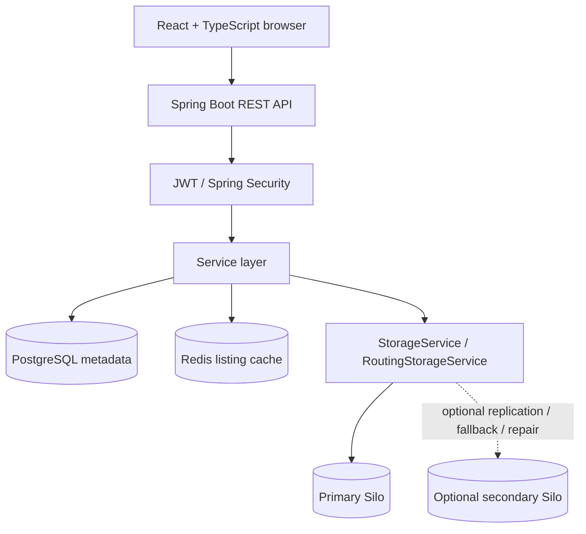

# MiniDrive — Repository Audit & Next-Session Context

**Audit date:** 2026-10-23  
**Repository reviewed:** [Tejesh-c-dev/MiniDrive](https://github.com/Tejesh-c-dev/MiniDrive)  
**Review type:** Source-level review of the accessible default branch and checked-in documentation/artifacts  
**Important limitation:** This is an evidence-backed, targeted remote audit—not a claim that every repository file, test, or runtime path has been exhaustively verified. No local checkout, live services, database, browser, or test command was run for this report. Claims about runtime behavior are labelled accordingly.

> **Purpose:** Give a future coding agent a trustworthy baseline of what MiniDrive appears to implement, the most consequential risks visible in source, and the order in which further work should proceed. Do not treat documentation, historical test reports, or class names as proof that a feature works in a live environment.

---

## 1. Executive assessment

MiniDrive is a self-hosted file-management and collaboration application built around Spring Boot, PostgreSQL, Redis, a React/TypeScript frontend, and S3-compatible Silo/MinIO object storage. The repository goes beyond ordinary CRUD: it contains immutable file-version records, resumable chunk uploads, owner-scoped permissions, public share links, generation-based listing-cache invalidation, and an optional two-node storage router with checksums, fallback, and repair logic.

The engineering ambition is real. However, several reliability capabilities are **implemented but disabled by default**, some operational guarantees are source-level intentions rather than verified outcomes, and multiple data-lifecycle gaps remain. The frontend is also behind the backend: deletion APIs exist, but the primary Drive UI still documents deletion as future work.

### Main conclusions

1. **The codebase has meaningful backend depth.** Resumable upload completion, version creation/restoration, role checks, and the storage abstraction address non-trivial edge cases.
2. **Replication must not be marketed as active by default.** `minidrive.storage.replication.enabled` defaults to `false`, and the secondary node is also disabled by default. The checked-in Phase 13 load-test report explicitly says its successful benchmark runs used primary-only storage.
3. **Folder deletion is unsafe for external storage lifecycle.** Database cascades remove metadata for descendant files/versions/sessions, but `FolderService.delete` does not enumerate or delete the corresponding object-storage objects.
4. **Replication deletion has a source-visible status bug.** A successful secondary deletion is recorded as `FAILED` with a “delete failed” message, and replica-state rows are not removed. This can leave stale repair work behind.
5. **Turning replication on for an existing dataset needs a migration/backfill plan.** V15 seeds `object_locations`; V16 creates `object_replicas` but does not seed its expected size/checksum state for legacy objects. Replication-enabled reads require that state to validate content.
6. **PostgreSQL and object storage cannot commit atomically.** The code has compensating deletes, but those calls can fail, and no general orphan reconciliation/garbage-collection job was found in the inspected design/source.
7. **Several user-facing flows are incomplete.** The homepage is still a foundation placeholder, top navigation is static, and the Drive page has no delete controls. Search, previews, drag-and-drop, trash, and “Shared with me” are not shown as implemented in the inspected frontend/documentation.
8. **Performance evidence is narrow.** The checked-in Phase 13 report records about 112 requests/s at 10 VUs on 64 KiB files, with a sampled host CPU peak of 97.9%; it used primary-only storage and did not exercise resumable uploads. This is a useful local test result, not a production scalability claim.

### Overall maturity (subjective, source-based)

| Area | Assessment |
|---|---|
| Core backend capabilities | Substantial; many source paths are implemented |
| Correctness and external-store consistency | Important gaps remain |
| Distributed replication | Implemented in code, optional/off by default; migration and delete-state issues require attention |
| Frontend completeness | Core drive exists, but important controls and polished user journeys are missing |
| Observability | Metrics/configuration exist; deployment and resource visibility are incomplete |
| Production readiness | **Not established** by this review |

---

## 2. Scope, method, and evidence standard

This report inspected representative critical code paths and design artifacts in the accessible repository, including:

- `README.md`, `docs/HLD.md`, and `docs/LLD.md`.
- `backend/pom.xml`, `backend/src/main/resources/application.yml`, Docker Compose, and migrations V15/V16.
- Security configuration and JWT services.
- File/folder services and controllers, file access/permission/sharing services.
- Upload-session service, upload entity/repository/controller, storage-key utilities, and storage-routing implementation.
- Drive page, root layout, homepage, and frontend API modules.
- `infra/load-testing/minidrive.js`, `infra/load-testing/README.md`, and `artifacts/phase13/REPORT.md`.

The source review did **not** clone the repository into a runnable local environment and did not execute Maven, Vitest, Playwright, migrations, Docker, or k6. Therefore:

- “Confirmed from source” means the relevant code/configuration directly shows the behavior or gap.
- “Reported in artifact” means the repository contains a report of a run; this reviewer did not reproduce it.
- “Requires verification” means source inspection suggests a concern, but a runtime test or more complete call-chain review is required.
- No test-pass claim in this document means a test was personally run for this audit.

A GitHub integration write attempt was denied, so this report is provided as a standalone file. It has not been committed to the repository.

---

## 3. Architecture and technology map

### 3.1 Runtime components

| Component | Role | Evidence / notes |
|---|---|---|
| Backend | Spring Boot 4.1.1, Java 17, REST API, Spring Security, JPA/Hibernate, Flyway | `backend/pom.xml`; `backend/src/main/resources/application.yml` |
| Frontend | React 19, TypeScript, Vite, React Router, Axios, Tailwind CSS 4 | `frontend/package.json` |
| PostgreSQL | Authoritative metadata, user/folder/file/version/permission/share/upload records | `infra/docker-compose.yml`; `backend/src/main/resources/db/migration/` |
| Redis | Derived file-listing cache and generation-token namespace; cache-only by design | `infra/docker-compose.yml`; `FileListingCache.java`; `ListingCacheGeneration.java` |
| Object storage | Silo, MinIO-compatible S3 storage; primary plus optional secondary | `infra/docker-compose.yml`; `StorageConfig.java`; `RoutingStorageService.java` |
| Metrics | Actuator and Micrometer/Prometheus registry | `application.yml`, `SecurityConfig.java`, metrics package |
| Load testing | k6 smoke/baseline/ramp/ramp10 script, local-only target | `infra/load-testing/minidrive.js`, `infra/load-testing/README.md` |
| Grafana | Dashboard/provisioning files exist; not a Grafana Compose service | `infra/grafana/`; HLD “Known Limitations” |

### 3.2 High-level request path



The diagram describes the source-defined architecture, not a runtime observation. The routing component also accesses `object_locations` and `object_replicas` using `JdbcTemplate` rather than JPA repositories.

### 3.3 Security and configuration facts

- `/api/**` is configured as stateless; registration/login/health are public, and only `GET /api/share/**` is permitted anonymously by the API chain.
- JWTs are HMAC-signed and contain the user email as subject. The configured expiration is 86,400,000 ms (24 hours). The JWT filter reloads the user by email on authenticated requests.
- JWT storage is in browser `localStorage` (`frontend/src/utils/tokenStorage.ts`, per HLD). Logout clears client state; a server-side token revocation/logout mechanism is not implemented.
- CORS code explicitly allows localhost/127.0.0.1 origin patterns. The source comment mentions production-origin intent, but the shown configured patterns do not include a deployed production frontend domain.
- Docker Compose publishes development services to loopback. That limits exposure in the current local topology, but it is not a production deployment design.
- `application.yml` and Compose have development defaults for object-store/PostgreSQL credentials. A production deployment needs strong externally supplied secrets and transport security.

---

## 4. Feature completeness matrix

Statuses below describe the repository evidence inspected, not a live acceptance test.

| Feature | Source-level status | Notes / limits |
|---|---|---|
| Registration/login/current-user | Implemented in source | JWT-based; not runtime-tested in this review |
| JWT-authenticated REST API | Implemented in source | 24-hour access token; no refresh-token rotation/revocation implementation |
| File metadata create/list/get/update | Implemented in source | Metadata-only records can exist without content; be careful not to confuse metadata with actual stored bytes |
| Single-shot upload/download | Implemented in source | Storage and DB side effects are not atomic; compensation can fail |
| Content replacement | Implemented in source | Creates fresh storage key and version record; concurrency/failure behavior needs integration validation |
| File version history/download/restore | Implemented in source | Restore makes a new version; no safe historical-object garbage collector found |
| File delete API | Backend implemented | No delete action in current Drive UI; cross-store failure window exists; old version objects are retained |
| Folder create/list/get/rename/delete | Backend implemented | Database cascade on delete does not clean Silo objects |
| Viewer/Editor/Owner file permissions | Implemented in source | Direct file-scoped permissions; no evidence of inherited folder permissions |
| Public share links | Implemented in source | Raw token returned once, hash persisted, expiry/revoke checked; URL tokens and rate limiting deserve security review |
| Resumable uploads | Substantial implementation | 5 GiB max, 5 MiB chunk, 10,000 chunk limit, 24-hour session TTL, checksum/idempotency paths; expiry cleanup and differing-payload retry edge remain |
| Storage routing | Implemented in source | Single-node mode uses recorded/selected location; health is not used for reads in legacy mode |
| Two-node replication/fallback/repair | Implemented but **disabled by default** | Existing-object replica metadata backfill and replication-enabled delete path need fixes/verification |
| Redis file-listing cache | Implemented in source | Generation-based invalidation; cache remains derived data; behavior during real Redis failure not run here |
| Request correlation/structured logging/metrics | Code/configuration exists | Runtime exposure and completeness not independently tested |
| Prometheus/k6 performance artifacts | Scripts and report exist | Limited local tests; no resumable workload in recorded report; no DB/Redis/storage exporters for resource use |
| Trash / soft-delete / restore-from-trash | Not implemented in inspected source/docs | Empty placeholder classes; no deleted/trashed lifecycle established |
| User profile service endpoints | Not implemented in inspected source/docs | Empty placeholder classes; `/api/auth/me` is separate |
| Refresh-token rotation | Not implemented | Empty scaffolding/migration noted in HLD/LLD |
| Direct-share entity flow | Not implemented | Do not confuse this with working public share-link flow |
| File/folder delete controls in UI | Missing | Drive page comment explicitly says delete arrives later; frontend API modules have no delete helpers in inspected code |
| Homepage/auth-aware navbar | Incomplete | `HomePage.tsx` displays old foundation placeholder; `RootLayout.tsx` always shows static links |
| Search / sort / filtering / previews / drag-and-drop | Not found in inspected frontend | Product/UX gaps, not necessarily security defects |
| “Shared with me” browser/list | Not found in inspected design | File listing is owner-scoped, so shared files are not discoverable through a dedicated shared listing |
| Storage quotas | Not established | Not evidenced as implemented in inspected paths |
| Self-contained deployment | Not implemented by Compose | Compose runs infrastructure, while backend/frontend/Prometheus are expected to run on host in documented local workflow; Grafana is configuration-only |

---

## 5. Findings register

### Severity definitions

- **P0 Critical:** immediate, confirmed catastrophic security/data loss or system-wide failure.
- **P1 High:** significant data correctness, reliability, or security defect.
- **P2 Medium:** important incomplete behavior, risk, or operational control gap.
- **P3 Low:** maintainability, developer-experience, or lower-impact polish item.

Severity is conditional on the actual deployment and configuration. No P0 finding is assigned based on the evidence inspected.

### P1 — High priority

#### MD-001 — Folder deletion cascades metadata but leaves external objects behind

**Status:** Confirmed from source.  
**Locations:** `backend/src/main/java/com/minidrive/service/FolderService.java:111-124`; `Folder.java` parent-folder cascade; `File.java` folder cascade; `UploadSession.java` folder relationship.  
**Evidence:** `FolderService.delete` authorizes the owner, calls `folderRepository.delete(folder)`, and evicts the listing cache. It does not query descendant file/version/chunk keys or call `StorageService.delete`. The entity relationships/database migrations cascade descendant rows. Silo is a separate store and is not part of the PostgreSQL cascade.

**Failure scenario:** Delete a folder containing files, historical versions, or staged upload chunks. PostgreSQL removes the folder and cascaded metadata. The corresponding object keys can remain in Silo with no database rows left to identify them. The data is no longer visible through MiniDrive, but storage continues to be consumed.

**Impact:** Orphaned private objects, storage usage growth, loss of app-level traceability, and difficult safe cleanup.  
**Recommended remediation:** Add an explicit deletion workflow that first inventories all descendant object keys across current file objects, file versions, and upload staging objects. Make cleanup retryable and durable (e.g. a deletion/outbox job) rather than relying on a single best-effort pass. Do not hard-delete metadata before a recovery-safe deletion plan exists. Add a reconciliation path for objects left after failure.

**Acceptance criteria:** Integration test with nested folders, current file objects, historical versions, and in-progress uploads; after deletion, all intended objects are removed or retained in a durable cleanup queue; retries are idempotent; a simulated storage outage does not silently lose the only references needed for recovery.

#### MD-002 — Replication-enabled deletion marks successfully deleted secondaries as failed and leaves stale replica state

**Status:** Confirmed source logic; runtime impact not reproduced.  
**Location:** `backend/src/main/java/com/minidrive/storage/RoutingStorageService.java:161-182`.  
**Evidence:** In the replication-enabled branch, the `try` body calls `client(nodeId).delete(key)` and then `mark(key, nodeId, "FAILED", ..., "delete failed")`. This line executes when deletion succeeds. The method removes the `object_locations` row after primary deletion succeeds but does not delete the object's `object_replicas` rows.

**Failure scenario:** Delete an object with replication enabled and all node delete calls succeed. The secondary status is still changed to `FAILED`; replica metadata survives, including a potentially stale `HEALTHY` primary row. The scheduled repair query scans non-healthy replica rows and may repeatedly attempt to repair a deliberately deleted object from a source that no longer contains it.

**Impact:** Stale replica inventory and repeated futile repair work; delete semantics are inconsistent with replica metadata. This finding is conditional on replication being enabled.  
**Recommended remediation:** Define a deletion state transition explicitly. After confirmed deletion, remove or tombstone every node's replica record and prevent repair from treating intentional deletion as missing content. Only mark a replica failed when its deletion actually fails; preserve failed-delete state in a durable, distinguishable status/queue.

**Acceptance criteria:** Tests for success on all nodes, primary failure, one secondary failure, multiple failures, retry after outage, and delete racing with a repair pass. After successful deletion, no repair work is scheduled for the deleted key.

#### MD-003 — Existing objects lack replica integrity metadata when replication is enabled later

**Status:** Confirmed migration/source gap; effect follows from the read path and still requires an integration test.  
**Locations:** `backend/src/main/resources/db/migration/V15__create_object_locations.sql`; `V16__create_object_replicas.sql`; `RoutingStorageService.java:133-158, 254-268`.  
**Evidence:** V15 seeds `object_locations` for existing file-version and staged-upload keys. V16 creates `object_replicas` but does not backfill rows with verified size/checksum metadata. Replication-enabled `download` obtains its expected size/checksum through `expectation(key)`, which returns a row only for an object marked `HEALTHY`; the validated read needs this expectation to accept a copy.

**Failure scenario:** Upgrade a dataset that already has real files, then enable replication without a backfill/reconciliation migration. Existing keys may have an `object_locations` row but no healthy `object_replicas` expectation, so replication-enabled reads cannot verify the primary or select a trusted fallback.

**Impact:** Existing files can become unavailable after changing the replication configuration.  
**Recommended remediation:** Do not enable the flag on an existing dataset until a backfill/reconciliation command streams each object, calculates size and SHA-256, verifies primary bytes, and populates replica-state rows. Make the process resumable and report objects it cannot validate. Consider startup/configuration safeguards that reject replication mode while eligible objects have no verified replica metadata.

**Acceptance criteria:** Migrate a populated single-node database through V16, enable replication, and verify both old and new files. Include corrupt/missing primary bytes and partial backfill restart scenarios.

#### MD-004 — File deletion can remove bytes before metadata deletion commits

**Status:** Confirmed failure window from source; DB failure not reproduced in this review.  
**Location:** `backend/src/main/java/com/minidrive/service/FileService.java:652-694`; described in `docs/LLD.md:701-785`.  
**Evidence:** The service calls `storageService.delete(file.getObjectKey())` before `fileRepository.delete(file)`/`flush`. If the database transaction subsequently fails, the metadata row rolls back but the object has already been removed. The catch block logs and rethrows; it cannot restore the object.

**Failure scenario:** Storage deletion succeeds and PostgreSQL deletion fails. The client receives an error, the file row remains after rollback, but downloads point to missing bytes. The code documents this limitation and does not recreate the object in this method.

**Impact:** An apparent failed delete can leave a broken file record.  
**Recommended remediation:** Make deletion a durable multi-step lifecycle, e.g. mark `DELETE_PENDING`/write an outbox record transactionally, then delete external objects idempotently, then finalize metadata; alternatively retain enough recoverable content until the metadata transition is confirmed. Add a reconciler for pending deletion and missing-object states.

**Acceptance criteria:** Inject database failure after successful remote deletion. The system must converge to a consistent state without returning an indefinitely broken file record, and retry/reconciliation must be safe.

### P2 — Medium priority

#### MD-005 — A different-payload retry can overwrite a staged chunk before duplicate detection

**Status:** Source-derived edge case; documented in `docs/LLD.md`, not runtime-reproduced.  
**Location:** `backend/src/main/java/com/minidrive/service/UploadSessionService.java:250-286, 774-804`.  
**Evidence:** `ingestChunk` uploads to deterministic staging key `_uploads/{owner}/{session}/{index}` before calling `persistChunk`. If a chunk row already exists, `persistChunk` returns `duplicate=true` without comparing the incoming checksum to the persisted checksum. The database row can therefore retain the old checksum while the deterministic storage key contains the new bytes; completion validates chunk checksums and rejects the content.

**Impact:** A stale/misassociated client resume or an accidental same-index/different-content retry can overwrite staged bytes and make that session fail finalization.

**Recommended remediation:** Check the existing row and checksum before writing, and reconcile same-index concurrent writes without allowing the losing request to overwrite the winner's bytes. Consider versioned temporary keys plus a compare-and-commit operation if needed.

**Acceptance criteria:** Send different same-size payloads to one chunk index sequentially and concurrently. The server must reject the conflict without corrupting the accepted chunk, and valid same-payload retries must remain idempotent.

#### MD-006 — Metadata PATCH can change size, content type, or checksum without changing stored content

**Status:** Confirmed from the update DTO/service.  
**Locations:** `backend/src/main/java/com/minidrive/dto/file/FileMetadataUpdateRequest.java`; `backend/src/main/java/com/minidrive/service/FileService.java:222-315`.  
**Evidence:** The patch DTO accepts `contentType`, `sizeBytes`, and `checksum`. The update method applies these fields to the `File` entity without writing new bytes to storage. Authorization is edit-based, so an Editor can potentially modify these metadata fields as well as an Owner.

**Impact:** Metadata may claim a byte length, MIME type, or checksum that does not correspond to the stored object. This can produce incorrect download headers or misleading integrity metadata and creates an inconsistent source of truth.

**Recommended remediation:** Restrict general PATCH to user-editable logical metadata (e.g. name and permitted folder movement). Treat size, checksum, and content type as immutable content attributes that change only during verified upload/replacement, or validate them against the stored object and enforce an explicit owner-only operation where appropriate.

**Acceptance criteria:** Attempt to PATCH size/checksum/content type with Viewer, Editor, and Owner roles. Unauthorized roles must be denied, and no endpoint should be able to make persisted content metadata disagree with stored bytes.

#### MD-007 — Expired upload sessions are rejected but not automatically swept

**Status:** Confirmed by implementation/design documentation.  
**Locations:** `UploadSessionService.java` (24-hour `SESSION_TTL` and expiry checks); `docs/LLD.md:1631-1653`.  
**Evidence:** Session creation sets a 24-hour expiry, and chunk ingestion/completion reject expired sessions. The inspected source has no scheduled expiration sweep that marks sessions expired or removes their chunk staging objects/rows. The scheduled task in `RoutingStorageService` is for replica repair/health, not upload-session cleanup.

**Impact:** Abandoned sessions and staged chunks can remain in PostgreSQL and Silo until users manually abort them; repeated abandoned uploads can consume disk/object-store capacity.

**Recommended remediation:** Add a bounded cleanup job with a durable state transition, retry counters, and observability. Do not delete staged data until a session is confirmed expired and no completion operation holds a valid lease/lock.

**Acceptance criteria:** Expired session cleanup deletes staged objects and rows, handles partial failures and process restart, and cannot race a live completion into deleting accepted chunks.

#### MD-008 — Historical object garbage collection is intentionally deferred

**Status:** Confirmed limitation, documented as a deliberate retention decision.  
**Locations:** `FileService.java:672-681`; `docs/HLD.md:537-550`.  
**Evidence:** File deletion deletes only the current object's key; the `file_versions` metadata cascades away, while historical version objects remain in storage. Replacement/restoration also creates fresh content keys. No historical-object lifecycle/GC implementation was found in the inspected source/docs.

**Impact:** Storage use can grow without bound, and once a file's version rows cascade away the older object keys may no longer be discoverable from metadata. This is not necessarily a bug while a retention policy is undecided, but it is an operational debt.

**Recommended remediation:** Define retention semantics first (e.g. grace period and whether deleted-file recovery is needed), then implement a safe reference-aware garbage collector. Never delete an object just because it is old; validate that no file/version/staging/replica record references it.

**Acceptance criteria:** Simulate replacements, restores, direct file delete, and folder delete; prove referenced versions survive and unreferenced objects are eventually reclaimed after the documented grace period.

#### MD-009 — Cross-store compensation is best-effort and has no general reconciliation sweep

**Status:** Confirmed architectural limitation.  
**Locations:** `FileService.java:87-135, 373-414, 672-694`; `UploadSessionService.java:380-400, 403-424, 774-804`; `RoutingStorageService.java:90-113, 239-252`; `docs/HLD.md:537-542`.  
**Evidence:** PostgreSQL and object storage are written in separate operations. Several paths try a compensating object delete after a database failure and log/suppress a failure if cleanup also fails. The HLD explicitly states that no general background reconciliation/orphan-sweeping job exists.

**Impact:** Crashes between remote writes and DB commits, or a failed compensating delete, can leave orphaned objects, stale location rows, or metadata that points at missing content.

**Recommended remediation:** Establish a durable operation journal/outbox for object lifecycle transitions, plus reconciliation reports for (a) DB rows whose objects are missing and (b) stored objects unreferenced by DB state. Start in report-only mode before enabling deletion.

**Acceptance criteria:** Fault-injection tests for each remote-write/DB-commit boundary; after restart and reconciliation, all operations converge to a declared state and unresolved objects are visible in metrics/logs.

#### MD-010 — Primary Drive UI cannot delete files or folders

**Status:** Confirmed from frontend source/docs.  
**Locations:** `frontend/src/pages/DrivePage.tsx:30-40, 435-468`; `frontend/src/api/files.ts`; `frontend/src/api/folders.ts`; backend `FileController.java` and `FolderController.java`.  
**Evidence:** Backend delete endpoints exist, but DrivePage's own comment says deletion arrives later. The rendered `FileRow` and `FolderCard` paths do not supply delete actions, and the frontend API modules inspected do not expose delete helpers.

**Impact:** Users cannot complete a basic file-management workflow from the primary UI despite backend support. The load-test script can delete fixtures over the API; that does not mean the UI supports deletion.

**Recommended remediation:** Add explicit delete API clients and UI controls with confirmation. For folders, clearly disclose that deletion recursively removes the visible folder tree; until storage cleanup is fixed, do not expose a destructive folder deletion control to users.

**Acceptance criteria:** File and folder delete journeys cover cancel/confirm, backend errors, refresh/cache invalidation, nested folders, and storage cleanup. Do not ship the UI control before MD-001 has a safe behavior.

#### MD-011 — Authentication has no server-side token revocation/refresh lifecycle

**Status:** Confirmed in checked-in architecture documentation/source.  
**Locations:** `JwtService.java`; `frontend/src/utils/tokenStorage.ts`; `docs/HLD.md:565-575`; empty refresh-token scaffolding described in HLD/LLD.  
**Evidence:** Access JWT lifetime is 24 hours; no refresh-token rotation/revocation path is implemented in the inspected auth service. Client-side logout clears local state but cannot invalidate an already-issued stateless token.

**Impact:** A stolen token can remain usable until expiry or user lookup/other account-state checks invalidate its use. The exact exposure depends on the deployment and browser threat model.

**Recommended remediation:** Decide whether this project needs refresh tokens, short-lived access tokens, token versioning/denylist, or another revocation design. If retaining localStorage, document and harden the XSS threat model. Do not add refresh-token complexity without a concrete requirement, but accurately document current logout semantics.

**Acceptance criteria:** Security design specifies expiry, logout/revocation guarantees, stolen-token behavior, and tests those guarantees.

#### MD-012 — Authentication and anonymous share endpoints have no application-level rate limiting

**Status:** Source/configuration gap based on inspected dependencies and documented audit.  
**Locations:** `backend/pom.xml`; `SecurityConfig.java`; HLD security limitation section.  
**Evidence:** No rate-limit dependency or endpoint-level throttling was found in the inspected configuration; login/register and anonymous GET share endpoints are public at the security layer.

**Impact:** Public endpoints can be hammered unless an upstream proxy/firewall provides limits. This matters more if deployed beyond loopback.

**Recommended remediation:** Add appropriately scoped throttling at the reverse proxy or application layer (per IP/account/token and route), with safe handling for NAT/shared networks and observable 429 responses. Avoid locking out valid users through overly aggressive rules.

**Acceptance criteria:** Controlled test confirms throttling for repeated login and invalid share-token traffic, while legitimate traffic remains usable.

#### MD-013 — CORS configuration is localhost-only despite a production-origin comment

**Status:** Confirmed source/configuration mismatch.  
**Location:** `backend/src/main/java/com/minidrive/config/CorsConfig.java`.  
**Evidence:** The configured patterns are `http://localhost:[*]` and `http://127.0.0.1:[*]`; the comment describes the production frontend origin as a target, but the implementation does not read a production origin from configuration.

**Impact:** A separately hosted production frontend will fail browser CORS checks unless it is served same-origin or fronted by an appropriate proxy. Broadening this to arbitrary origins would be unsafe.

**Recommended remediation:** Make allowed origins an explicit environment-controlled allowlist, with separate safe development and production settings. Keep credentials disabled unless the authentication model requires them.

**Acceptance criteria:** Preflight and actual requests succeed only from explicitly configured origins; unrelated origins are rejected.

#### MD-014 — Local development configuration is not a hardened deployment model

**Status:** Confirmed configuration limitation; external reverse-proxy protections are unknown.  
**Locations:** `application.yml`; `infra/docker-compose.yml`; `infra/prometheus.yml`; `docs/HLD.md:565-582`.  
**Evidence:** App and infrastructure defaults are local-development oriented; Compose runs PostgreSQL, Redis, and storage infrastructure, not backend/frontend. HLD describes HTTP/no in-repository TLS and host-run Prometheus, with Grafana configuration-only and a hard-coded Windows dashboard path. Redis has no authentication in Compose but its published port binds to loopback.

**Impact:** The repository alone does not provide a self-contained production deployment, TLS, production secret injection, or a portable monitoring stack. Loopback bindings reduce local exposure but do not substitute for a production threat model.

**Recommended remediation:** Clearly label local-development assumptions. Before remote deployment, supply strong secrets via environment/secret manager, TLS via a documented termination layer, restricted storage/admin access, hardened Redis access, network policy, backups, and portable monitoring configuration.

**Acceptance criteria:** Documented deployment topology works outside the developer's machine and passes a configuration security review. Do not claim TLS if it is only expected to exist externally.

#### MD-015 — Replication-enabled upload stages a full copy to host temp storage

**Status:** Confirmed implementation choice; capacity risk needs measurement.  
**Location:** `backend/src/main/java/com/minidrive/storage/RoutingStorageService.java:90-114`.  
**Evidence:** With replication enabled, upload copies the complete input to a temporary local file to compute size/checksum and then uploads/verifies node copies. This is disk-backed, not a full in-memory buffer, but a single maximum-size upload can occupy several GiB of host temp space.

**Impact:** Concurrent large uploads or slow nodes can exhaust temporary disk space; this may cause upload failures and can impact unrelated host processes.

**Recommended remediation:** Define temp-directory capacity and concurrency limits, monitor temp-space use, guarantee cleanup after crash/restart, and benchmark realistic file sizes. Consider a bounded spool/quota strategy if replication remains synchronous.

**Acceptance criteria:** Load/fault tests at the allowed upload size and concurrency demonstrate bounded temp-space usage and predictable failure when capacity is insufficient.

#### MD-016 — Collaboration/product workflows are incomplete in the frontend

**Status:** Confirmed gap in inspected frontend/design.  
**Locations:** `frontend/src/pages/DrivePage.tsx`; `frontend/src/pages/HomePage.tsx`; `frontend/src/layouts/RootLayout.tsx`; `docs/LLD.md` listing-cache section.  
**Evidence:** File listing is owner-scoped; no “Shared with me” listing is described/implemented in the inspected paths. There is no search, sorting, type filter, inline preview, or drag-and-drop upload in the inspected Drive screen. The homepage shows an old foundation placeholder and navigation does not react to authentication state.

**Impact:** The application can have working permission/share primitives without a cohesive discoverability/user experience. These are primarily product completeness issues rather than backend security defects.

**Recommended remediation:** Prioritize a coherent baseline: auth-aware shell, meaningful home-to-drive redirect/landing, delete lifecycle (after safe backend cleanup), search/list controls, and previews for common safe content types. Add “Shared with me” only with a clearly specified query and authorization model.

**Acceptance criteria:** New user can register, log in, upload, navigate, rename, download, share, view history, restore, and safely delete using the UI. Shared files are discoverable only through properly authorized queries.

### P3 — Low priority / polish

#### MD-017 — Single-shot upload rejects empty files while resumable upload documents zero-byte support

**Status:** Confirmed contract mismatch in source/docs.  
**Locations:** `FileService.java:87-95`; `UploadSessionService.java` comments around completion and zero-size handling; `docs/LLD.md:1535-1558`.  
**Evidence:** Multipart upload treats `multipartFile.isEmpty()` as an invalid file; the resumable upload path documents a zero-byte upload contract with an empty chunk.

**Impact:** The same logical file may behave differently depending on upload method.  
**Recommended remediation:** Decide whether zero-byte files are supported. Align validation, UI, tests, and documentation across both upload paths.

#### MD-018 — Observability stack is only partially portable/deployable from repository configuration

**Status:** Confirmed configuration gap.  
**Locations:** `infra/prometheus.yml`; `infra/grafana/`; `infra/docker-compose.yml`; `docs/HLD.md:551-564`.  
**Evidence:** Prometheus is documented as host-run and scrapes loopback; Grafana assets are provisioning/dashboard files but no Grafana service is in Compose, and the dashboard provider uses a machine-specific Windows path. The Phase 13 report says PostgreSQL/Redis/storage-node CPU and memory were unavailable due to missing exporters.

**Impact:** Operational visibility is incomplete and tied to a particular local setup.  
**Recommended remediation:** Make monitoring deployment repeatable (or document host-run intentionally), make paths portable, and add exporters/measurements before claiming DB/cache/storage resource observability.

#### MD-019 — Redis has no authentication in the development Compose service

**Status:** Confirmed configuration fact; impact is bounded by current loopback binding.  
**Location:** `infra/docker-compose.yml` Redis service.  
**Evidence:** Redis starts without password/ACL settings; the host port binds to loopback. The listing cache and generation marker are derived data, but an untrusted local process with access to the port could alter cache state.

**Impact:** Not a remote exposure under the current loopback-only mapping by itself, but unsuitable as a blanket production security posture.  
**Recommended remediation:** Set network/auth policy deliberately for the deployment, or clearly retain this only as a local development stack assumption.

---

## 6. Test and performance evidence

### 6.1 What this audit did not run

The following commands/suites were **not executed by this reviewer**:

- Maven test/compile against the current checkout.
- Frontend Vitest/build/type-check.
- Browser automation or manual browser acceptance.
- Flyway migrations against a fresh PostgreSQL database.
- Integration tests against actual PostgreSQL, Redis, and both Silo nodes.
- Fault-injection or concurrent replication/deletion tests.
- k6 load tests.

A prior supplied audit report stated 214 backend tests and 55 frontend tests passed. That remains a historical report from the supplied context, not a fresh test result for this audit. A test suite can pass while failing to exercise production-like dependencies; check each suite's actual configuration and mocks.

### 6.2 Checked-in Phase 13 load-test report

The repository includes `artifacts/phase13/REPORT.md`, which reports these successful local profiles from 2026-10-22. They are transcribed from the artifact and were not reproduced here.

| Profile | Reported concurrency | Requests/s | HTTP latency p95 / p99 | HTTP failures | Key limitation |
|---|---:|---:|---:|---:|---|
| Smoke | 1 VU | 19.38 | 97.57 / 108.21 ms | 0% | One iteration; not a capacity test |
| Baseline | 2 VUs | 66.51 | 38.62 / 46.69 ms | 0% | 64 KiB files; single-node storage |
| Ramp | 1→5 VUs | 100.52 | 43.44 / 52.23 ms | 0% | Controlled ramp; small fixtures |
| Ramp10 | 1→10 VUs | 112.13 | 67.74 / 88.38 ms | 0% | Host CPU sample peaked at 97.9% |

Reported controls/results:

- Each successful profile used 64 KiB fixtures and the development primary storage only; replication and the secondary node were disabled for the benchmark.
- Thresholds were provisional k6 safeguards (HTTP failure rate under 5%; checks over 95%), not established production SLOs.
- The ramp10 run reported a host CPU peak sample of 97.9%, so the result is constrained by local machine saturation and must not be extrapolated into a server capacity claim.
- The workload did not exercise resumable sessions; the report says resumable upload metrics consequently had no samples.
- PostgreSQL/Redis/storage-node CPU and memory were unavailable due to missing exporters.
- The report claims 6,816 fixture files were deleted by exact ID after four counted successful runs, with zero unresolved fixtures. This claim is from the artifact, not independently checked by this review.

### 6.3 Next verification commands (run in the user's local checkout)

Use the repository's actual setup instructions and review any script side effects before running:

```powershell
# Backend
Set-Location .\backend
.\mvnw.cmd clean test

# Frontend (separate terminal, from repository root)
Set-Location .\frontend
npm ci
npm run test
npm run build
```

Then add/execute explicit integration validation for:

1. Fresh-database Flyway migration V1–V16.
2. Existing dataset migration followed by enabling replication (MD-003).
3. Folder deletion with nested files, all versions, and staged uploads (MD-001).
4. Replication-enabled delete + repair scheduler (MD-002).
5. Storage deletion success followed by injected PostgreSQL delete failure (MD-004).
6. Same-index same-payload and different-payload resumable chunk retries (MD-005).
7. PATCH metadata manipulation by Viewer/Editor/Owner (MD-006).
8. Expired-session cleanup and chunk/complete/abort race tests (MD-007).

Do not call performance tests “passed” solely because a small number of requests completed; report workload, environment, failure rate, latency percentiles, resource measurements, and storage configuration.

---

## 7. Recommended roadmap

### Batch 1 — Data lifecycle and integrity (do this first)

**Goal:** Prevent deleted or partially completed operations from leaving the application and storage system in contradictory states.

1. Fix MD-002 replica deletion state transitions.
2. Design and test a safe folder deletion workflow for MD-001.
3. Design a durable file-delete state machine for MD-004.
4. Create a storage lifecycle reconciliation/report-only tool for MD-009 and define version cleanup policy for MD-008.
5. Fix MD-006 so clients cannot falsify stored content metadata.

**Exit criteria:** Critical failure paths are fault-injected and tested against PostgreSQL plus real Silo-compatible nodes; deletion is idempotent; stale and orphaned records are observable; no content metadata can be changed without a verified content operation.

### Batch 2 — Make resumable uploads robust

1. Fix MD-005 by making same-index retry checksum-aware before any overwrite.
2. Add a guarded expiry cleanup lifecycle for MD-007.
3. Add fault-injection and restart tests for stage writes, final object writes, metadata commit, and cleanup.

**Exit criteria:** Same-content retries succeed, different-content retries are rejected without corrupting accepted bytes, expired sessions converge to cleaned state, and a crash/restart leaves no untracked failure that cannot be detected/reconciled.

### Batch 3 — Make replication safe to enable

1. Implement a verified backfill/reconciliation for legacy objects before enabling the flag (MD-003).
2. Fix deletion/repair interactions (MD-002).
3. Test each failover case and all-copies-unavailable behavior with actual two-node integration tests.
4. Measure temporary disk capacity and concurrent uploads with replication enabled (MD-015).

**Exit criteria:** Existing and newly uploaded objects have verified replica metadata; corrupted/missing copies are not served as healthy; delete does not trigger resurrection/retry; the enablement procedure is documented and restartable.

### Batch 4 — Complete core user journeys

1. Add frontend delete controls only after Batch 1 is safe (MD-010).
2. Replace the homepage placeholder and make navigation auth-aware.
3. Add useful error/empty/loading states and verify upload-resume flows manually or in browser automation.
4. Select a limited product scope: search/sorting and basic image/PDF/text preview are higher value than adding many new backend abstractions.
5. Add “Shared with me” only with owner/permission-scoped backend queries and appropriate tests (MD-016).

**Exit criteria:** Core journeys can be completed from the UI, permission boundaries are enforced by the server, destructive actions are recoverable/safe, and browser smoke tests pass.

### Batch 5 — Deployment, security, and operability

1. Configure production CORS allowlist (MD-013), strong secret injection, TLS topology, and rate limits (MD-012/014).
2. Decide and document token revocation/refresh strategy (MD-011).
3. Make Prometheus/Grafana deployment portable and add missing DB/cache/storage resource metrics (MD-018).
4. Define backup/restore, storage corruption recovery, and deployment/migration safety procedures.

**Exit criteria:** A clean checkout can be deployed using documented steps, external-origin behavior is deliberate, secrets are not defaults, and operational dashboards measure the dependencies they claim to cover.

---

## 8. Highest-impact next actions

In order:

1. **Stop treating recursive folder deletion as complete until storage cleanup is safe.** It currently cascades away the identifiers needed to clean objects later.
2. **Fix and test replication deletion state handling.** A successful remote delete must not enqueue the object for repair.
3. **Create an existing-object replica backfill before turning replication on.** Do not flip the flag against a populated database without it.
4. **Harden the metadata PATCH contract.** Size/checksum/content type should track actual verified bytes.
5. **Make cross-store failures reconcilable.** Compensating deletion alone is insufficient when the compensating call can itself fail.

Avoid starting a new large feature phase until these are addressed or intentionally documented with explicit limitations.

---

## 9. Next-session context brief

Use this section as the compact handoff for a coding agent.

### Project facts

- Repository: `Tejesh-c-dev/MiniDrive`, default branch `main`.
- Backend: Java 17, Spring Boot 4.1.1, REST, Spring Security/JWT, JPA/Hibernate, Flyway, PostgreSQL, Redis, MinIO client.
- Frontend: React 19 + TypeScript + Vite + React Router + Axios + Tailwind CSS.
- Infra: Docker Compose for PostgreSQL, Redis, primary and secondary Silo/MinIO-compatible storage. Backend/frontend are host-run in the documented workflow. Prometheus is host-run; Grafana is provisioning/configuration only in the inspected repository.
- Metadata lives in PostgreSQL; bytes live in object storage. These do not share a transaction.
- File versions are immutable snapshots with fresh storage keys; current `File` metadata points to current content.
- Resumable upload policy in code: 5 GiB max logical file, 5 MiB chunks, max 10,000 chunks, 24-hour session TTL.
- Storage replication/fallback/repair code exists but is disabled by default.

### Findings to keep in working context

- `FolderService.delete` relies on DB cascades and does not delete descendant Silo objects.
- `RoutingStorageService.delete` marks a secondary `FAILED` even when its delete call succeeds and leaves replica rows behind.
- V16 creates replica metadata but does not backfill legacy objects with healthy size/checksum rows; enabling replication on existing data needs a verified backfill.
- `FileService.delete` deletes storage before the DB delete commits; DB failure leaves metadata pointing at missing content.
- Same-index upload retry writes deterministic staging key before checking an existing row; different bytes can overwrite accepted staged content without updating persisted checksum.
- File metadata PATCH allows size/contentType/checksum updates without changing object bytes.
- No automatic expired upload-session sweep found; no general object orphan reconciliation or historical-object GC found.
- Frontend delete controls missing; homepage placeholder/static navbar remain. Trash, refresh-token rotation, profile endpoints, and direct-share entity flow are placeholders, not implemented capabilities.
- Auth currently relies on 24-hour stateless JWTs in localStorage; no server-side token revocation is implemented.
- CORS configuration only allows localhost/127.0.0.1 patterns.

### Recommended first coding phase

**Phase: Storage Lifecycle Correctness & Reconciliation.** Keep scope narrow; do not redesign the whole application.

Recommended sequence:
1. Write regression tests for the existing replication-enabled delete bug and folder deletion orphan case.
2. Design deletion transitions that remain recoverable across PostgreSQL/object-store failures.
3. Fix replica-state removal/marking and prevent repair of intentionally deleted keys.
4. Add a safe folder-descendant object inventory and cleanup design.
5. Add an orphan/missing-object reconciliation report before enabling automatic deletion.

### Required guardrails

- Inspect `git status` and current diffs before editing; never overwrite unrelated work.
- Keep external-store side effects out of assumptions about `@Transactional` rollback.
- Make retry behavior idempotent and explicitly model partial failures.
- Use actual PostgreSQL and Silo integration tests for storage lifecycle changes; H2/mock-only tests are not enough for final validation.
- Do not enable replication by default as a “fix.” Backfill and test existing objects first.
- Do not expose frontend delete buttons before the backend deletion flow is safe.
- After the change, report exact files modified, tests actually run, environment/dependency realism, and unresolved limitations.

---

## 10. Evidence index

Key sources inspected (paths are repository-relative; line references refer to the retrieved source snapshot and should be rechecked before patching):

- [README.md](https://github.com/Tejesh-c-dev/MiniDrive/blob/main/README.md) — local setup, storage, monitoring.
- [HLD.md](https://github.com/Tejesh-c-dev/MiniDrive/blob/main/docs/HLD.md) — architecture and known limitations, especially lines 526–582.
- [LLD.md](https://github.com/Tejesh-c-dev/MiniDrive/blob/main/docs/LLD.md) — detailed code flow and known failure windows: deletion lines 701–785; resumable upload lines 1631–1653; storage lines 1929–2046; observability lines 1958–2046.
- [application.yml](https://github.com/Tejesh-c-dev/MiniDrive/blob/main/backend/src/main/resources/application.yml) — server, JWT expiry, Redis, storage-node and replication defaults.
- [docker-compose.yml](https://github.com/Tejesh-c-dev/MiniDrive/blob/main/infra/docker-compose.yml) — local service topology and port bindings.
- [SecurityConfig.java](https://github.com/Tejesh-c-dev/MiniDrive/blob/main/backend/src/main/java/com/minidrive/config/SecurityConfig.java) — API and Actuator route authorization.
- [CorsConfig.java](https://github.com/Tejesh-c-dev/MiniDrive/blob/main/backend/src/main/java/com/minidrive/config/CorsConfig.java) — allowed frontend origins.
- [JwtService.java](https://github.com/Tejesh-c-dev/MiniDrive/blob/main/backend/src/main/java/com/minidrive/security/JwtService.java) — token creation and expiry validation.
- [FileService.java](https://github.com/Tejesh-c-dev/MiniDrive/blob/main/backend/src/main/java/com/minidrive/service/FileService.java) — upload, update, replacement, restore and deletion; especially lines 222–315 and 652–694.
- [FolderService.java](https://github.com/Tejesh-c-dev/MiniDrive/blob/main/backend/src/main/java/com/minidrive/service/FolderService.java) — folder cascade delete, especially lines 111–124.
- [UploadSessionService.java](https://github.com/Tejesh-c-dev/MiniDrive/blob/main/backend/src/main/java/com/minidrive/service/UploadSessionService.java) — session/chunk lifecycle and idempotency, especially lines 250–286, 332–424, 774–804.
- [FileMetadataUpdateRequest.java](https://github.com/Tejesh-c-dev/MiniDrive/blob/main/backend/src/main/java/com/minidrive/dto/file/FileMetadataUpdateRequest.java) — editable metadata request fields.
- [RoutingStorageService.java](https://github.com/Tejesh-c-dev/MiniDrive/blob/main/backend/src/main/java/com/minidrive/storage/RoutingStorageService.java) — replication upload/download/delete/repair, especially lines 90–182 and 209–333.
- [V15__create_object_locations.sql](https://github.com/Tejesh-c-dev/MiniDrive/blob/main/backend/src/main/resources/db/migration/V15__create_object_locations.sql) — location backfill only.
- [V16__create_object_replicas.sql](https://github.com/Tejesh-c-dev/MiniDrive/blob/main/backend/src/main/resources/db/migration/V16__create_object_replicas.sql) — replica-state schema.
- [HomePage.tsx](https://github.com/Tejesh-c-dev/MiniDrive/blob/main/frontend/src/pages/HomePage.tsx) — stale foundation placeholder.
- [RootLayout.tsx](https://github.com/Tejesh-c-dev/MiniDrive/blob/main/frontend/src/layouts/RootLayout.tsx) — static header links.
- [DrivePage.tsx](https://github.com/Tejesh-c-dev/MiniDrive/blob/main/frontend/src/pages/DrivePage.tsx) — current drive UI and absence of delete handlers.
- [frontend/package.json](https://github.com/Tejesh-c-dev/MiniDrive/blob/main/frontend/package.json) — actual frontend scripts/dependencies.
- [k6 script](https://github.com/Tejesh-c-dev/MiniDrive/blob/main/infra/load-testing/minidrive.js), [load-test README](https://github.com/Tejesh-c-dev/MiniDrive/blob/main/infra/load-testing/README.md), and [Phase 13 report](https://github.com/Tejesh-c-dev/MiniDrive/blob/main/artifacts/phase13/REPORT.md) — workload and reported measurements.

---

## Final verdict

MiniDrive contains serious, interview-worthy backend engineering, but it should not yet be described as production-grade or as having active distributed redundancy by default. The highest-return work is storage lifecycle correctness, verified replication enablement, durable reconciliation, and completing the core frontend journeys. Fix these before adding more feature breadth.
